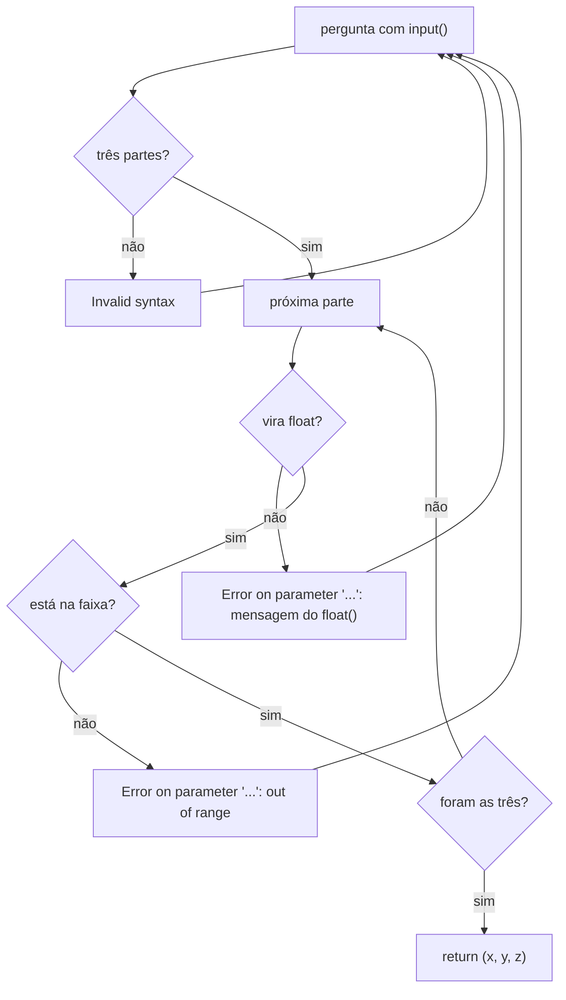

# get_player_pos

A função pergunta, confere e, se algo estiver errado, pergunta de novo. "De novo, até dar certo"
é um laço sem fim, `while True`, de onde a função só sai pelo `return`, com uma posição válida
em mãos.



`len()` não está na lista de funções autorizadas deste exercício, então nem o número de partes
nem o de valores convertidos pode ser contado com ela. As conferências usam recursos da própria
linguagem: o desempacotamento, as comparações e o `else` do `for`.

```python
PROMPT = "Enter new coordinates as floats in format 'x,y,z': "
LIMIT = 1e150


def get_player_pos() -> tuple[float, float, float]:
    """Ask for coordinates until the user types three valid floats."""
    while True:
        try:
            x_text, y_text, z_text = input(PROMPT).split(",")
        except ValueError:
            print("Invalid syntax")
            continue
        values: list[float] = []
        for text in (x_text, y_text, z_text):
            parameter = text.strip()
            try:
                value = float(parameter)
            except ValueError as error:
                print(f"Error on parameter '{parameter}': {error}")
                break
            if not -LIMIT <= value <= LIMIT:
                print(f"Error on parameter '{parameter}': out of range")
                break
            values.append(value)
        else:
            return (values[0], values[1], values[2])
```

## A pergunta

`PROMPT` guarda o texto da pergunta numa constante, como o `MAX_SCORE` do
[exercício 1](../04-ex1/03-converter-e-descartar.md#um-limite-para-as-pontuações). Assim a linha
do `input` fica curta.

## Três partes: o desempacotamento confere

`x_text, y_text, z_text = input(PROMPT).split(",")` lê o texto, corta nas vírgulas e dá um nome a
cada pedaço. O desempacotamento exige o número exato de elementos
([Tuplas](./02-tuplas.md)): com um, dois ou quatro pedaços, ele lança `ValueError`, e o `except`
imprime `Invalid syntax`. O `continue` volta ao começo do `while`, que pergunta de novo.

```python title="experimentos/tres_partes.py"
for text in ["1,2,3", "hello world", "1,2,3,4"]:
    try:
        x_text, y_text, z_text = text.split(",")
        print(f"ok: {x_text} {y_text} {z_text}")
    except ValueError as error:
        print(f"ValueError: {error}")
```

```bash
python3 experimentos/tres_partes.py
```

```text
ok: 1 2 3
ValueError: not enough values to unpack (expected 3, got 1)
ValueError: too many values to unpack (expected 3, got 4)
```

Essa é a saída do Python 3.14 em diante. Até o 3.13, a última mensagem não diz quantos pedaços
vieram:
`ValueError: too many values to unpack (expected 3)`. O erro é o mesmo `ValueError`.

## A faixa de valores

`LIMIT = 1e150` é 10¹⁵⁰, e cada coordenada aceita fica entre `-LIMIT` e `LIMIT`.
`-LIMIT <= value <= LIMIT` confere as duas pontas de uma vez: o Python lê como
`-LIMIT <= value and value <= LIMIT`. A mesma comparação recusa os três casos de
[float: converter](./03-ler-do-teclado.md#float-converter):

```python title="experimentos/faixa.py"
LIMIT = 1e150
for value in [2.5, -1e150, 1e151, float("inf"), float("nan")]:
    print(value, -LIMIT <= value <= LIMIT)
```

```bash
python3 experimentos/faixa.py
```

```text
2.5 True
-1e+150 True
1e+151 False
inf False
nan False
```

- `1e151` e `inf` passam do limite;
- as comparações `<`, `<=`, `>`, `>=` e `==` com `nan` dão sempre `False`, então `nan` também
  cai fora da faixa.

O limite garante que a conta da distância cabe num `float`. Com duas coordenadas entre −10¹⁵⁰ e
10¹⁵⁰, a diferença entre elas é no máximo 2 × 10¹⁵⁰, o quadrado no máximo 4 × 10³⁰⁰, e a soma dos
três quadrados no máximo 1.2 × 10³⁰¹, longe do maior `float`, cerca de 1.8 × 10³⁰⁸.

## Converter as três: o else do for

`values` começa vazia e recebe cada parte convertida e dentro da faixa. Se uma parte falha, o
programa imprime qual foi e o motivo, e o `break` sai do `for`: não adianta conferir as partes
seguintes, a entrada já é inválida.

Um `for` pode ter um bloco `else`, que roda **só se o laço terminou sem `break`**, ou seja, se as
três partes passaram. É nele que a função devolve a tupla com os três valores. Quando houve
`break`, o `else` é pulado, o `while` dá outra volta e pergunta de novo.

A lista `values` é um passo intermediário: ela cresce enquanto as partes são conferidas, e a
tupla só é criada no fim, já com os três valores. É o padrão das tuplas: como não mudam, são
criadas prontas.

## Com as entradas do enunciado

| Digitado | Partes | O que acontece |
|---|---|---|
| `hello world` | 1 | o desempacotamento falha: `Invalid syntax`; pergunta de novo |
| `1.0 , 2.5, 3.0` | 3 | as três convertem e estão na faixa, o `for` termina sem `break`, e o `else` devolve `(1.0, 2.5, 3.0)` |
| `4,abc,5` | 3 | `4` passa, `abc` falha: `Error on parameter 'abc': could not convert string to float: 'abc'`, e o `break` pula o `else`; pergunta de novo |
| `4,5,6` | 3 | devolve `(4.0, 5.0, 6.0)` |
