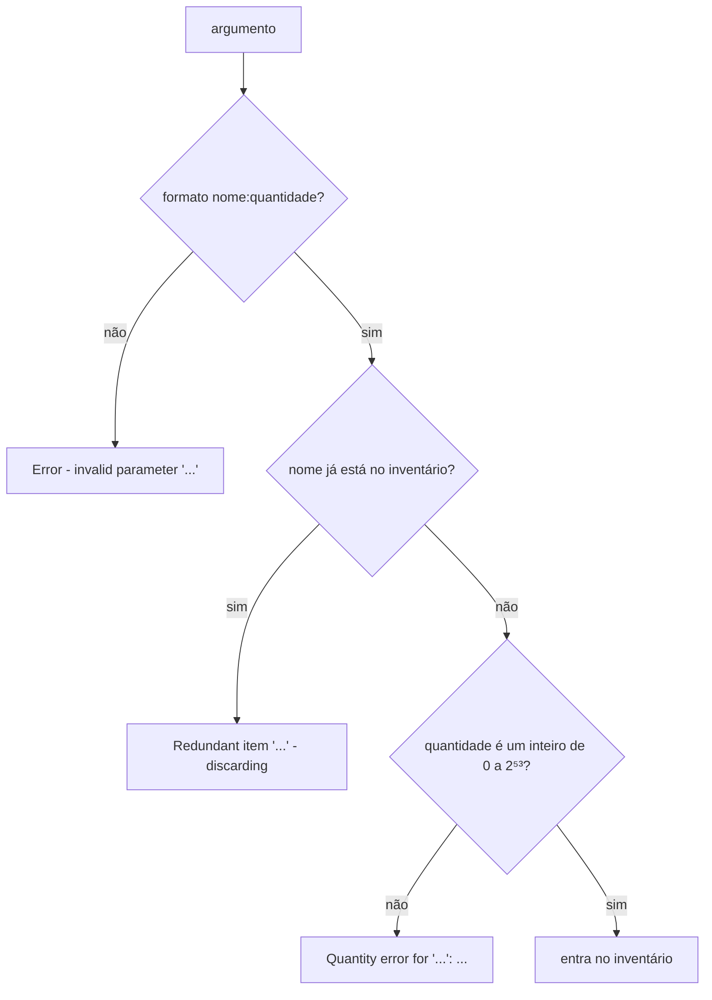

# Ler os parâmetros

Cada argumento passa por três conferências, nesta ordem, e o primeiro problema encontrado
descarta o argumento com a mensagem dele:



## O formato

`argument.split(":")` corta o argumento nos dois-pontos. O formato certo dá exatamente duas
partes, e o nome não pode ser vazio:

| Argumento | `split(":")` | Formato |
|---|---|---|
| `potion:5` | `['potion', '5']` | certo |
| `hello` | `['hello']` | errado: uma parte só |
| `a:1:2` | `['a', '1', '2']` | errado: três partes |
| `:5` | `['', '5']` | errado: nome vazio |
| `potion:` | `['potion', '']` | certo; a quantidade vazia falha na terceira conferência |

Um argumento com bytes que não formam texto UTF-8 também tem formato errado. O programa confere
isso com a função `printable` do
[exercício 0](../03-ex0/05-o-arquivo-completo.md#um-argumento-que-não-é-texto-válido): o texto é
válido quando `printable(argument)` devolve o próprio argumento. A mensagem também passa por
`printable` e sai `Error - invalid parameter '<not valid UTF-8>'`. Assim, todo nome que entra no
inventário é texto válido, e as outras mensagens podem imprimi-lo sem risco.

## O repetido

Um nome que já está no inventário é descartado, seja qual for a quantidade: o primeiro vale. Por
isso `sword:2`, depois de `sword:1`, sai como `Redundant item 'sword' - discarding`. O teste é
`name in inventory`, que olha as chaves.

Essa conferência vem antes da quantidade: um item repetido é recusado como repetido mesmo que a
sua quantidade também esteja errada. E um item recusado por quantidade errada não entra no
inventário, então o mesmo nome pode aparecer de novo, mais adiante, com uma quantidade certa.

## A quantidade

A quantidade é convertida com `int()`, que lança `ValueError` para `value` ou para o texto
vazio. A mensagem do erro vai depois de `Quantity error for 'key': `, como no enunciado.

O enunciado não fala de quantidades negativas, mas uma mochila com −3 poções não faz sentido, e
quantidades negativas estragariam as porcentagens. A escolha deste projeto é recusá-las com uma
mensagem no mesmo formato: para `potion:-3`, `Quantity error for 'potion': negative quantity -3`.
Uma quantidade 0 é aceita: o item existe na mochila, sem nenhuma unidade.

O enunciado também não fala de quantidades enormes, e elas travariam o programa. O `int()` aceita
textos de até 4300 dígitos, mas o Python se recusa a converter de volta em texto um inteiro com
mais de 4300 dígitos: com duas quantidades de 4300 dígitos, o total tem 4301, e o `print` do
total lança `ValueError`. A escolha deste projeto é um teto, 2⁵³ = 9007199254740992, o mesmo
limite das pontuações do [exercício 1](../04-ex1/03-converter-e-descartar.md#um-limite-para-as-pontuações),
guardado numa constante:

```python
MAX_QUANTITY = 2 ** 53
```

Acima do teto, a mensagem segue o mesmo formato:
`Quantity error for 'potion': quantity above 9007199254740992`.

## A função que monta o inventário

```python
def parse_inventory(arguments: list[str]) -> dict[str, int]:
    """Build the inventory from 'name:quantity' arguments."""
    inventory: dict[str, int] = {}
    for argument in arguments:
        parts = argument.split(":")
        valid_text = printable(argument) == argument
        if len(parts) != 2 or parts[0] == "" or not valid_text:
            print(f"Error - invalid parameter '{printable(argument)}'")
            continue
        name = parts[0]
        if name in inventory:
            print(f"Redundant item '{name}' - discarding")
            continue
        try:
            quantity = int(parts[1])
        except ValueError as error:
            print(f"Quantity error for '{name}': {error}")
            continue
        if quantity < 0:
            print(f"Quantity error for '{name}': negative quantity {quantity}")
            continue
        if quantity > MAX_QUANTITY:
            print(f"Quantity error for '{name}': quantity above "
                  f"{MAX_QUANTITY}")
            continue
        inventory[name] = quantity
    return inventory
```

- `dict[str, int]` anota um dicionário de chaves texto e valores inteiros, e `{}` é o dicionário
  vazio;
- cada `continue` pula para o próximo argumento depois de imprimir o motivo;
- só um argumento que passou pelas três conferências chega à última linha do laço,
  `inventory[name] = quantity`, que acrescenta o item.
