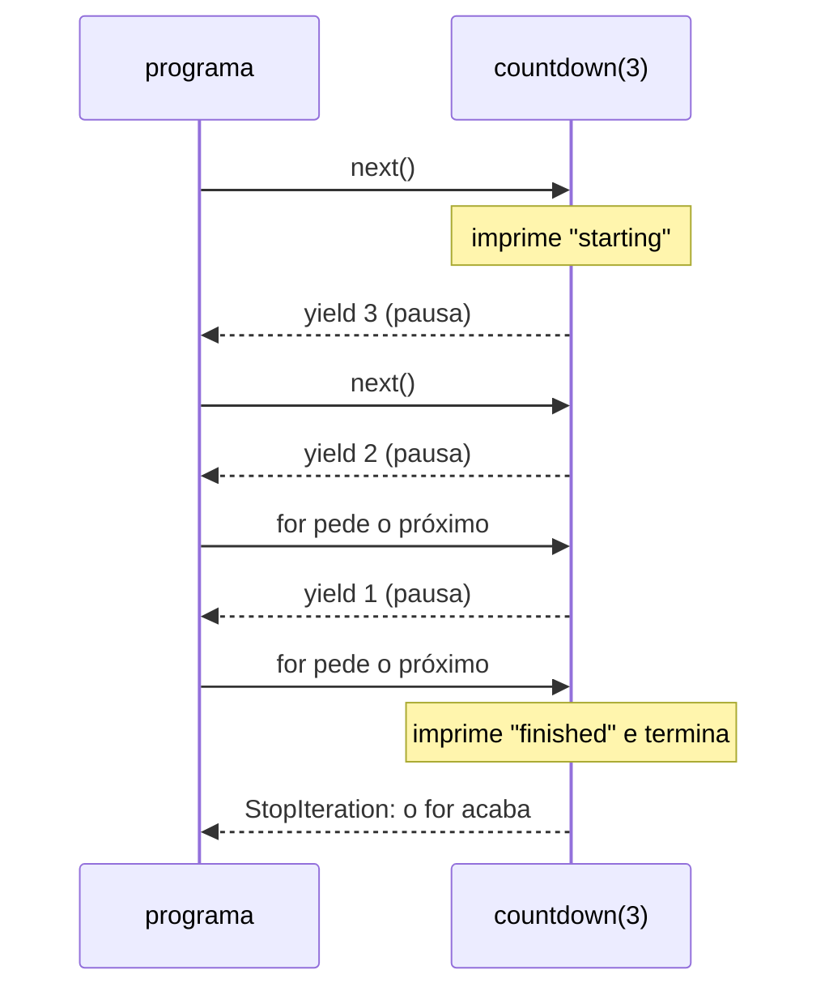

# Generators

Uma função comum roda do começo ao fim e devolve um valor com `return`. Uma **função geradora**
usa `yield` ("render", "entregar") no lugar do `return`: ela entrega um valor e **pausa**, e
continua de onde parou quando alguém pede o próximo.

```python title="experimentos/contagem.py"
import typing


def countdown(start: int) -> typing.Generator[int, None, None]:
    """Yield start, start - 1, ..., 1."""
    print("starting")
    number = start
    while number > 0:
        yield number
        number -= 1
    print("finished")


numbers = countdown(3)
print(type(numbers))
print(next(numbers))
print(next(numbers))
for number in numbers:
    print(f"for got {number}")
try:
    next(numbers)
except StopIteration:
    print("StopIteration")
```

```bash
python3 experimentos/contagem.py
```

```text
<class 'generator'>
starting
3
2
for got 1
finished
StopIteration
```

1. `countdown(3)` **não roda** a função: `starting` ainda não apareceu. A chamada só cria um
   objeto **generator**, guardado em `numbers`;
2. o primeiro `next(numbers)` roda a função do começo até o primeiro `yield`: imprime `starting`
   e entrega 3. A função fica pausada **no meio**, com `number` valendo 3;
3. o segundo `next` continua logo depois do `yield`: `number` vira 2, o `while` dá outra volta, e
   o `yield` entrega 2;
4. o `for` pede os valores seguintes, um por volta: recebe 1. Na volta seguinte, `number` vira 0,
   o `while` termina, a função imprime `finished` e chega ao fim;
5. uma função geradora que chega ao fim lança `StopIteration` ("parar a iteração"). O `for` trata
   isso sozinho: é o sinal de que acabou, e o laço termina sem erro. Um `next` chamado direto, sem
   `for`, deixa o `StopIteration` escapar, e por isso o último `next` está num `try`.



## Por que isso economiza memória

Uma lista com um milhão de eventos ocupa a memória de um milhão de eventos ao mesmo tempo. Um
generator guarda só o seu estado, as variáveis no ponto em que parou, e calcula o próximo valor
quando ele é pedido. Por isso um generator pode até não ter fim: só existe o valor da vez.

## O tipo typing.Generator

`typing.Generator[int, None, None]` anota o tipo de um generator. Os três tipos entre colchetes
são, em ordem:

1. o tipo dos valores entregues pelo `yield`: aqui, `int`;
2. o tipo dos valores que podem ser **enviados** para dentro do generator, um recurso que este
   projeto não usa: `None`;
3. o tipo do valor do `return` final, também sem uso: `None`.

`Generator` vem do módulo `typing` ("tipagem"), que reúne os tipos usados nas anotações. O
`import typing` no topo do arquivo o carrega.
