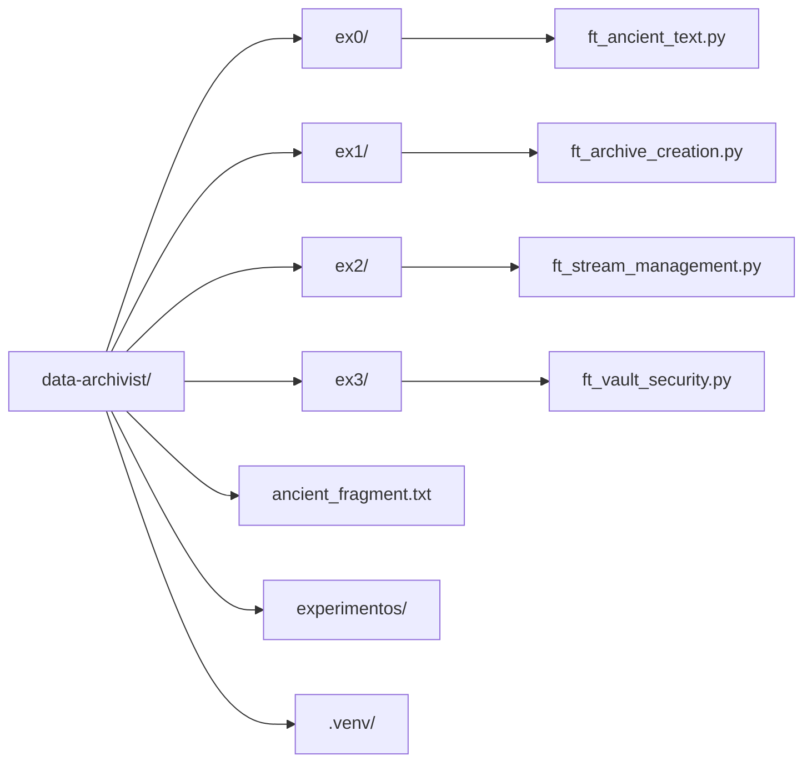

# A pasta do projeto

O enunciado pede cada exercício num arquivo próprio, dentro de uma pasta com o número do exercício:
`ex0/`, `ex1/`, `ex2/` e `ex3/`. Crie uma pasta para o projeto, entre nela e crie as quatro pastas:

```bash
mkdir data-archivist
cd data-archivist
mkdir ex0 ex1 ex2 ex3
```

`mkdir` cria uma pasta (ou várias, com os nomes em sequência). O nome `data-archivist` é só uma
sugestão; o que o enunciado fixa são as pastas `ex0` a `ex3` e os nomes dos arquivos. **Todos os
comandos do tutorial são rodados a partir desta pasta**, a `data-archivist`.

Crie também uma pasta `experimentos`, para os programas pequenos que a parte [O que é um
arquivo](../02-arquivos/01-arquivos-e-caminhos.md) usa para mostrar cada ideia. Eles não fazem parte
da entrega:

```bash
mkdir experimentos
```

## O arquivo de texto dos exemplos

Os exemplos do enunciado leem um arquivo chamado `ancient_fragment.txt` ("fragmento antigo"), com
três linhas. Crie-o na pasta `data-archivist`:

```bash
cat > ancient_fragment.txt <<'FIM'
[FRAGMENT 001] Digital preservation protocols established 2087
[FRAGMENT 002] Knowledge must survive the entropy wars
[FRAGMENT 003] Every byte saved is a victory against oblivion
FIM
```

- `cat > ancient_fragment.txt` grava no arquivo tudo o que o `cat` recebe (o `>` é explicado em [Os
  três fluxos](../05-ex2/02-os-tres-fluxos.md));
- `<<'FIM'` entrega ao `cat` as linhas seguintes, até a linha `FIM`, que não entra no arquivo.

Confira:

```bash
cat ancient_fragment.txt
```

```text
[FRAGMENT 001] Digital preservation protocols established 2087
[FRAGMENT 002] Knowledge must survive the entropy wars
[FRAGMENT 003] Every byte saved is a victory against oblivion
```

Ao fim do projeto, a pasta fica assim:



A pasta `.venv/` é criada na [próxima página](./03-o-ambiente-virtual.md). Só os quatro arquivos
`.py` das pastas `ex0` a `ex3` são entregues; o `ancient_fragment.txt` serve para testar.
