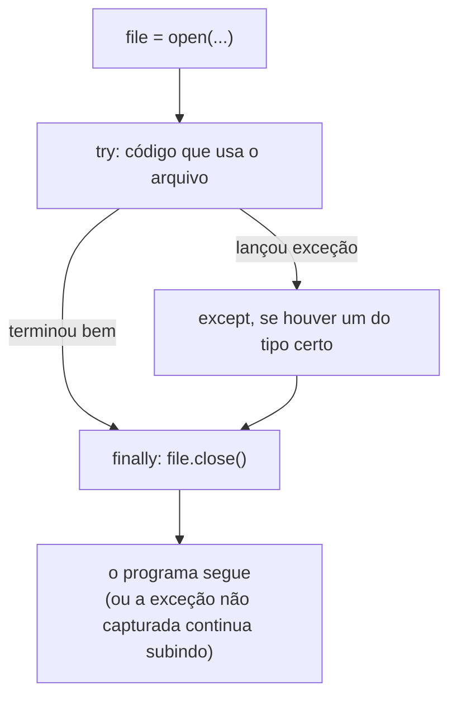

# close e o recurso

Todo arquivo aberto precisa ser fechado com `close()`. O exercício 0 imprime até uma linha dizendo
que fechou o arquivo.

## O arquivo aberto é um recurso

Ao abrir um arquivo, o sistema operacional reserva para o programa um **recurso**: uma entrada numa
tabela de arquivos abertos, de tamanho limitado. Fechar devolve essa entrada. Um programa que abre
arquivos e nunca os fecha acaba esgotando a tabela, e o próximo `open()` falha.

Há um segundo motivo, que aparece na escrita: o que se escreve num arquivo não vai direto para o
disco. Fica primeiro num **buffer**, uma área de memória que junta pedaços pequenos para gravá-los
de uma vez, o que é muito mais rápido. O `close()` despeja o que sobrou no buffer.

Crie `experimentos/buffer.py`:

```python
file = open("experimentos/rascunho.txt", "w")
file.write("archived\n")
check = open("experimentos/rascunho.txt")
print(f"before close: {check.read()!r}")
file.close()
print(f"after close: {check.read()!r}")
check.close()
```

```bash
python3 experimentos/buffer.py
```

```text
before close: ''
after close: 'archived\n'
```

- `open(..., "w")` abre para **escrita** (*write*), criando o arquivo; o modo é explicado em [Gravar
  o arquivo](../04-ex1/05-gravar-o-arquivo.md);
- `file.write("archived\n")` escreve uma linha;
- `check` é um segundo objeto arquivo, aberto para leitura no mesmo arquivo;
- `!r` dentro das chaves de uma f-string mostra o valor como o `repr()`, entre aspas.

Antes do `close()`, o arquivo no disco ainda está vazio: o texto está no buffer. Depois do
`close()`, o texto está lá.

O segundo `check.read()` encontra o texto, e não `""` como em [Ler duas
vezes](./03-read-e-o-texto.md#ler-duas-vezes). O primeiro leu um arquivo vazio, e a posição de
leitura ficou no começo; o `close()` de `file` gravou o texto, o arquivo cresceu, e a leitura
seguinte partiu do mesmo começo.

Quando um programa termina com um arquivo de escrita ainda aberto, o Python despeja o buffer ao
encerrar; um programa interrompido à força (morto pelo sistema, numa queda de energia) perde o que
estava no buffer.

## Fechar mesmo quando algo dá errado

Entre o `open()` e o `close()`, o código pode lançar uma exceção. Nesse caso, o Python pula direto
para o `except` que a captura (ou encerra o programa), e o `close()` nunca roda:

```python
file = open("ancient_fragment.txt")
content = file.read()  # se esta linha lançar uma exceção...
file.close()           # ...esta não roda
```

O bloco **`finally`** resolve isso. Ele vem depois do `try` (e dos `except`, se houver) e roda
**sempre** que o `try` termina, de qualquer jeito: sem erro, com erro capturado, com erro não
capturado, com `return` no meio.

```python
file = open("ancient_fragment.txt")
try:
    content = file.read()
finally:
    file.close()
```



O `open()` fica **fora** do `try` com `finally`: se o próprio `open()` falhar, não existe arquivo
aberto, e não há o que fechar.

O enunciado proíbe a instrução `with`, que faz o mesmo de forma mais curta, até o exercício 3: os
exercícios 0, 1 e 2 fecham os arquivos com `try` e `finally`, e o [exercício
3](../06-ex3/02-o-with.md) troca isso pelo `with`.
