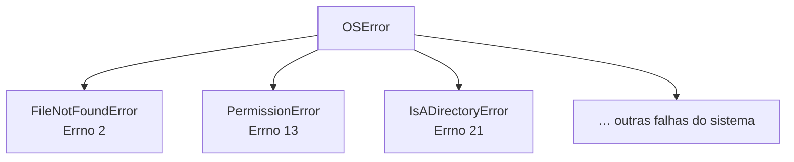

# Quando o open falha

O exercício 0 exige tratar "os vários casos de falha": arquivo que não existe, arquivo sem permissão
e outros. Cada falha faz o `open()` lançar uma exceção de um tipo diferente.

## Três falhas num experimento

Primeiro, um arquivo que ninguém pode ler:

```bash
echo secret > experimentos/trancado.txt
chmod 000 experimentos/trancado.txt
```

- `echo secret` imprime o texto `secret`, e o `>` grava essa saída no arquivo
  `experimentos/trancado.txt`, em vez de mostrá-la na tela;
- `chmod 000` tira todas as permissões do arquivo. As permissões e os números do `chmod` estão em
  [Permissões](#permissões), mais abaixo.

Crie `experimentos/falhas.py`:

```python
for name in ("foo", "experimentos", "experimentos/trancado.txt"):
    try:
        file = open(name)
        file.close()
        print(f"{name}: opened")
    except OSError as error:
        print(f"{name}: {error}")
```

```bash
python3 experimentos/falhas.py
```

```text
foo: [Errno 2] No such file or directory: 'foo'
experimentos: [Errno 21] Is a directory: 'experimentos'
experimentos/trancado.txt: [Errno 13] Permission denied: 'experimentos/trancado.txt'
```

As três tentativas falham, e as três são capturadas pelo mesmo `except OSError`:

| Caminho | Mensagem | Tipo da exceção |
|---|---|---|
| `foo` | não existe | `FileNotFoundError` |
| `experimentos` | é uma pasta, não um arquivo | `IsADirectoryError` |
| `experimentos/trancado.txt` | sem permissão de leitura | `PermissionError` |

Se o experimento imprimir `experimentos/trancado.txt: opened`, o terminal está rodando como
**root**, o administrador do sistema, que lê qualquer arquivo independente das permissões. Rode como
um usuário comum.

## OSError, a família dos erros do sistema

`OSError` é o tipo das falhas que o **sistema operacional** (em inglês, *operating system*) devolve
ao Python: arquivo inexistente, permissão negada, disco cheio. Cada falha tem um tipo próprio que
**herda** de `OSError`, e um `except OSError` captura todos:



É por isso que os exercícios capturam `OSError`, e não cada tipo separado: o programa reage do mesmo
jeito a todas essas falhas (avisa e não continua), e falhas que o código não previu, como disco
cheio, também caem no mesmo `except`.

O começo da mensagem, `[Errno 2]`, é o **número do erro** (*error number*) que o sistema operacional
devolveu. A mensagem do exemplo do enunciado é exatamente o texto que o Python monta com ele:
`[Errno 2] No such file or directory: 'foo'`. O programa não escreve esse texto; ele só imprime a
exceção com `{error}`.

## Permissões

`ls -l` mostra as permissões de um arquivo. O arquivo `/etc/sudoers` guarda a configuração do
`sudo`, o comando que deixa um usuário agir como administrador, e só o administrador pode lê-lo:

```bash
ls -l /etc/sudoers
```


A figura é de um Linux. O tamanho e a data variam de máquina para máquina, e no macOS o grupo
aparece como `wheel` no lugar de `root`; as permissões são as mesmas.

As permissões vêm em três trios, para três públicos: o **dono** do arquivo, o **grupo** do arquivo e
os **outros** (todo o resto). Em cada trio, `r` permite ler (*read*), `w` permite escrever
(*write*), `x` permite executar, e `-` quer dizer "não".

O `chmod` recebe um número de três dígitos, um por trio, na mesma ordem: dono, grupo, outros. Cada
dígito é a soma das permissões daquele trio, com `r` valendo 4, `w` valendo 2 e `x` valendo 1:

| Número | Soma | Trio |
|---|---|---|
| `0` | nada | `---` |
| `4` | só `r` | `r--` |
| `6` | 4 + 2 | `rw-` |
| `7` | 4 + 2 + 1 | `rwx` |

`chmod 000` deixa os três trios em `---`: ninguém lê nem escreve, nem o dono. `chmod 644` dá
`rw-r--r--`, o normal de um arquivo comum: o dono lê e escreve, os outros só leem. Para devolver as
permissões ao arquivo do experimento e apagá-lo com `rm` (o comando que apaga arquivos):

```bash
chmod 644 experimentos/trancado.txt
rm experimentos/trancado.txt
```

## O arquivo protegido do enunciado

O enunciado mostra `/etc/master.passwd` como exemplo de arquivo inacessível. Esse é o arquivo de
senhas do **macOS**; num Linux ele não existe, e o resultado seria `[Errno 2]` em vez de
`[Errno 13]`. O caso que o enunciado quer mostrar é a permissão negada. O tutorial usa
`/etc/sudoers`, que dá `[Errno 13]` tanto no macOS quanto no Linux, em qualquer sistema com o `sudo`
instalado.

## Quando a falha vem depois do open

Abrir pode dar certo e ler, não. Um programa como `/bin/ls` também é um arquivo, mas os bytes dele
são instruções para o processador, e não texto. `open()` o abre sem problema; `read()` tenta
traduzir os bytes em caracteres UTF-8, não consegue e lança `UnicodeDecodeError`. Esse tipo **não**
é um `OSError` (o sistema operacional entregou os bytes direitinho; quem falhou foi a tradução para
texto), e precisa ser capturado à parte. O [exercício 0](../03-ex0/04-ler-e-fechar.md) faz isso.
