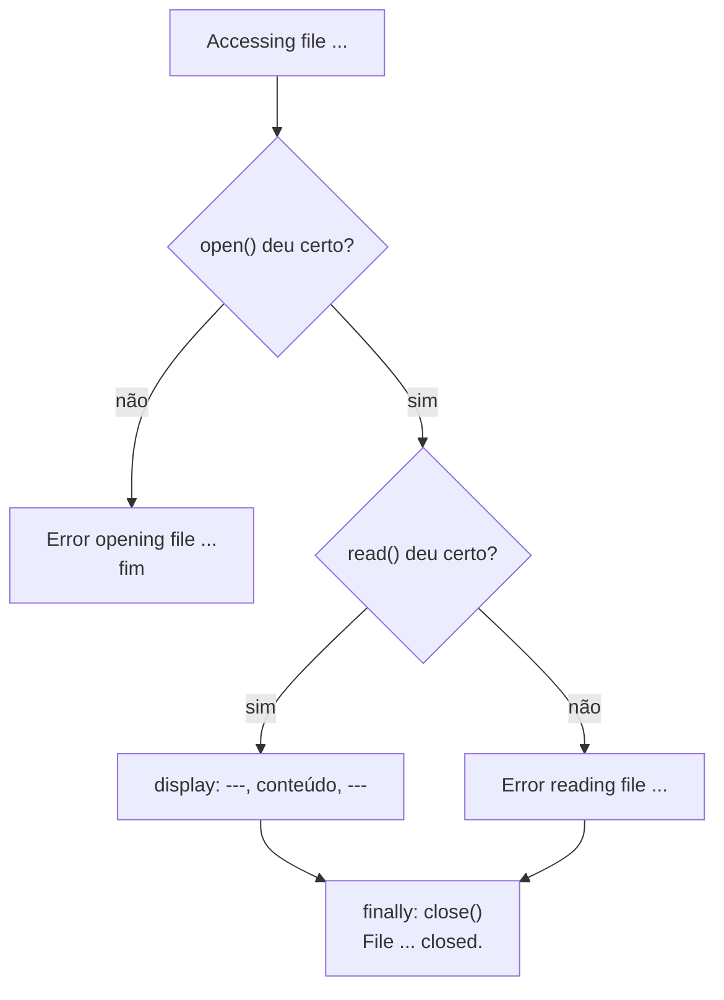

# Ler e fechar

Com o arquivo aberto, falta ler, mostrar e fechar. O fechamento precisa acontecer mesmo que a
leitura falhe.

## display

A moldura de `---` é uma função à parte, porque o exercício 1 vai usá-la de novo para o texto
transformado:

```python
def display(content: str) -> None:
    print("---\n")
    print(content)
    print("---")
```

Nas duas linhas vazias, um `\n` vem do texto e o outro do `print`: em cima, o `\n` de `"---\n"`;
embaixo, o `\n` final do conteúdo ([read e o texto](../02-arquivos/03-read-e-o-texto.md)).

## O resto de recover_archive

```python
    try:
        display(file.read())
    except (OSError, UnicodeDecodeError) as error:
        print(f"Error reading file '{file_name}': {error}")
    finally:
        file.close()
        print(f"File '{file_name}' closed.")
```

Este trecho continua a função da página anterior, logo depois do `try` do `open()`.

- `file.read()` lê o arquivo inteiro, e o texto vai direto para `display`. Se o `read()` falhar, o
  `display` nem é chamado, e nenhum `---` é impresso;
- o `except` recebe uma **tupla** de tipos: captura um `OSError` **ou** um `UnicodeDecodeError`. O
  `OSError` cobre uma falha do sistema durante a leitura (um erro de disco, por exemplo); o
  `UnicodeDecodeError` cobre um arquivo cujos bytes não são texto ([Quando o open
  falha](../02-arquivos/05-quando-o-open-falha.md));
- o `finally` fecha o arquivo e avisa, com a leitura dando certo ou não ([close e o
  recurso](../02-arquivos/04-close-e-o-recurso.md)).

A mensagem `Error reading file` é escolha do projeto: as saídas do enunciado só mostram falhas ao
abrir, e o texto segue o molde do `Error opening file`.

Com um arquivo que não é texto, como o programa `/bin/ls`, o arquivo abre, a leitura falha, o erro é
avisado com `Error reading file`, e o arquivo é fechado mesmo assim. A página [Rodar e
conferir](./06-rodar-e-conferir.md) mostra esse caso rodando.


