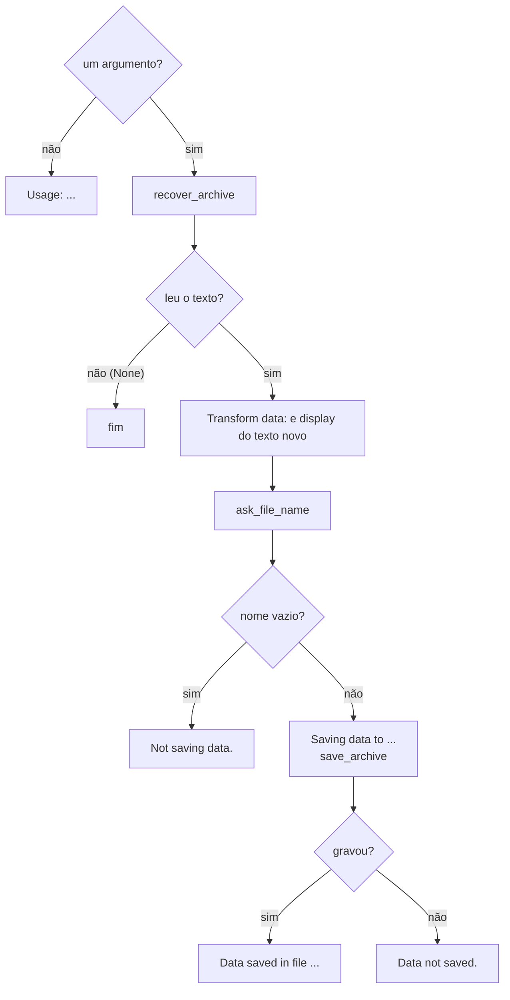

# O main

O `main` encadeia as funções na ordem das mensagens do enunciado e para no primeiro passo que não dá
certo.

```python
def main() -> None:
    if len(sys.argv) != 2:
        print(f"Usage: {sys.argv[0]} <file>")
        return
    print("=== Cyber Archives Recovery & Preservation ===")
    content = recover_archive(sys.argv[1])
    if content is None:
        return
    print("\nTransform data:")
    new_content = transform(content)
    display(new_content)
    file_name = ask_file_name()
    if file_name == "":
        print("Not saving data.")
        return
    print(f"Saving data to '{file_name}'")
    if save_archive(file_name, new_content):
        print(f"Data saved in file '{file_name}'.")
    else:
        print("Data not saved.")
```



- `content is None` testa se a leitura falhou. `is` compara se dois valores são **o mesmo** objeto,
  e é o jeito certo de perguntar por `None`. Depois desse `if`, o mypy sabe que `content` é um
  `str`, e aceita passá-lo para `transform`;
- o `\n` no começo de `"\nTransform data:"` produz a linha vazia entre `File ... closed.` e
  `Transform data:`;
- quando o arquivo não pode ser lido, o programa para depois da mensagem de erro, sem perguntar
  nada: não há texto para gravar.
