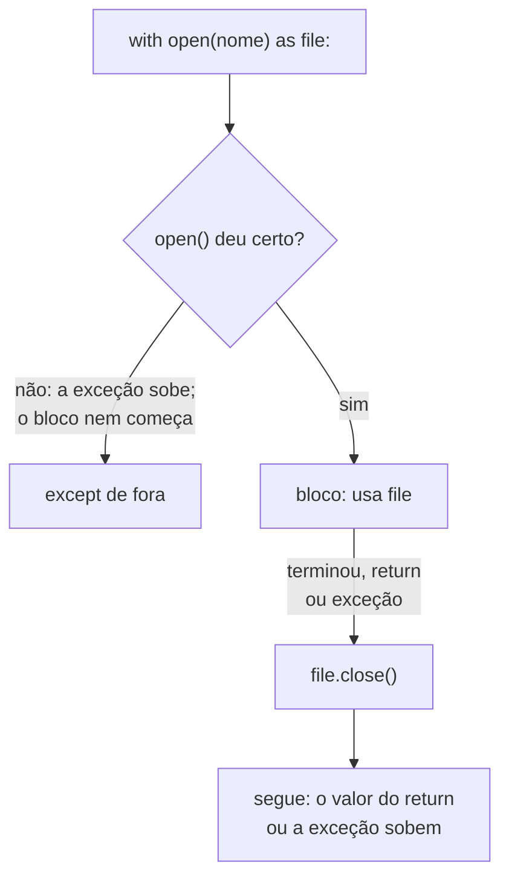

# O with

Esquecer o `close()`, ou não protegê-lo com `finally`, deixa o arquivo aberto quando algo dá errado
([close e o recurso](../02-arquivos/04-close-e-o-recurso.md)). A instrução `with` amarra o
fechamento ao bloco de código: quando o bloco termina, por qualquer motivo, o arquivo é fechado.

## A forma

```python
with open("ancient_fragment.txt") as file:
    content = file.read()
```

- `open(...)` abre o arquivo, como sempre;
- `as file` guarda o arquivo aberto na variável `file`;
- o bloco indentado usa o arquivo;
- quando o bloco termina, o `with` chama `file.close()`.

Essas duas linhas equivalem ao `try` com `finally` dos exercícios anteriores:

```python
file = open("ancient_fragment.txt")
try:
    content = file.read()
finally:
    file.close()
```

## Fecha mesmo com erro

Crie `experimentos/with_erro.py`:

```python
try:
    with open("ancient_fragment.txt") as file:
        print(f"inside: closed is {file.closed}")
        int("abc")
except ValueError as error:
    print(f"Caught: {error}")
print(f"after: closed is {file.closed}")
```

`file.closed` é um atributo (um valor guardado no objeto) que vale `True` quando o arquivo já foi
fechado. `int("abc")` lança um `ValueError` no meio do bloco.

```bash
python3 experimentos/with_erro.py
```

```text
inside: closed is False
Caught: invalid literal for int() with base 10: 'abc'
after: closed is True
```

A exceção interrompeu o bloco, foi capturada fora dele, e o arquivo foi fechado no caminho. O mesmo
vale para um `return` dentro do bloco: a função devolve o valor, e o arquivo é fechado antes.

## O gerenciador de contexto

O `with` funciona com qualquer objeto que saiba o que fazer ao entrar e ao sair do bloco. Esse
objeto se chama **gerenciador de contexto** (*context manager*). O objeto arquivo é um: ao sair do
bloco, ele se fecha.



O `with` só fecha; ele **não** captura exceções. Uma falha do `open()` ou do bloco continua
precisando de um `try` com `except` em volta, como no experimento.
