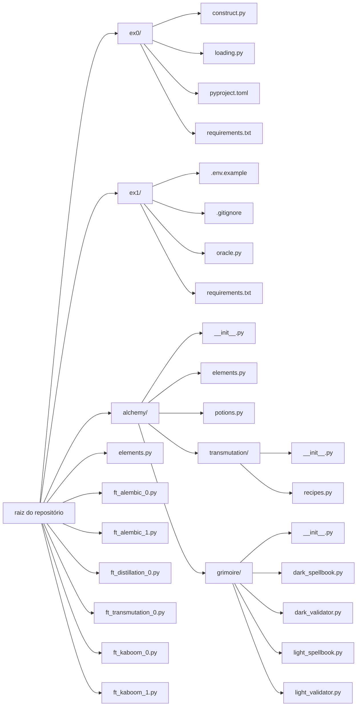

# O enunciado em linguagem simples

## Regras que valem para todos os exercícios

- **Python 3.10 ou mais novo.** Os programas são rodados com `python3`
  ([O Python](../01-ambiente/01-o-python.md)).
- **Estilo conferido pelo flake8.** O flake8 é um programa que lê o seu código e aponta o que
  foge do estilo padrão do Python: linha com mais de 79 caracteres, falta de linha em branco entre
  funções, `import` que não é usado. O código entregue não pode ter nenhum aviso dele.
- **Type hints em todo o código, conferidos pelo mypy.** Um *type hint* é a anotação do tipo de
  cada parâmetro e do retorno, como em `def dobro(n: int) -> int:`. O mypy é o programa que
  confere se esses tipos batem com o uso
  ([Type hints, flake8 e mypy](../01-ambiente/04-type-hints-flake8-e-mypy.md)). Há uma única
  reclamação do mypy que o enunciado pede de propósito, no exercício 2
  ([ft_alembic_1](../05-ex2/05-ft-alembic-1.md)).
- **Tipos e funções embutidos liberados, menos `eval()` e `exec()`.** Todos os tipos padrão
  (`int`, `str`, `list`, `dict`...) com todos os seus métodos, e todas as funções que o Python
  oferece sem `import` (`print`, `len`, `open`, `isinstance`...). `eval()` e `exec()` são duas
  funções que rodam um texto como se fosse código Python; o enunciado as proíbe.
- **Cada exercício diz o que pode ser importado**, e isso faz parte do exercício:

  | Exercício | `import` permitido |
  |---|---|
  | 0 | os módulos `os`, `sys`, `site` e `importlib`, que vêm com o Python, e as bibliotecas externas `pandas` e `numpy` |
  | 1 | `os`, `sys`, a biblioteca externa `python-dotenv` e operações com arquivos (`open`) |
  | 2 a 4 | só os arquivos que o próprio projeto cria |

  Um **módulo** é um arquivo de código Python que outro arquivo usa com `import`. Alguns vêm com
  o Python (como `os` e `sys`); uma **biblioteca externa** precisa ser instalada antes.
- **Nunca mexer no `sys.path`.** O `sys.path` é a lista de pastas onde o Python procura os módulos
  de um `import` ([Onde o Python procura](../04-conceitos/02-onde-o-python-procura.md)).
  Acrescentar uma pasta nela à mão é proibido em qualquer arquivo do projeto: todo `import` tem
  de funcionar com a organização das pastas.
- **Nos exercícios 2 a 4, funções simples que devolvem textos.** O assunto ali é o `import`, e
  não a lógica: cada função devolve uma frase fixa ou montada a partir de outras.

## Os cinco exercícios

| Exercício | O que precisa ser feito |
|---|---|
| 0 | `construct.py`: descobrir se o programa roda dentro de um **ambiente virtual**, mostrar informações do Python em uso, ensinar a criar um ambiente se não houver nenhum e mostrar onde as bibliotecas são instaladas. `loading.py`: declarar `pandas` e `numpy` como dependências em `requirements.txt` (para o pip) e em `pyproject.toml` (para o Poetry), importar cada uma e mostrar a versão, sem travar quando faltar alguma ([Exercício 0](../02-ex0/01-o-problema.md)) |
| 1 | `oracle.py`: ler cinco configurações (`MATRIX_MODE`, `DATABASE_URL`, `API_KEY`, `LOG_LEVEL`, `ZION_ENDPOINT`) de variáveis de ambiente e de um arquivo `.env`, com comportamento diferente em desenvolvimento e em produção, sem travar quando faltar configuração; o `.env` fica fora do repositório graças ao `.gitignore` ([Exercício 1](../03-ex1/01-o-problema.md)) |
| 2 | `elements.py` na raiz e o pacote `alchemy` com `elements.py` e `__init__.py`; o `__init__.py` expõe `create_air` e não expõe `create_earth`. Dois programas testam isso ([Exercício 2](../05-ex2/01-o-problema.md)) |
| 3 | `alchemy/potions.py`, que usa os quatro elementos (dois dentro do pacote, dois fora), e o subpacote `alchemy/transmutation`, com um import absoluto e um relativo ([Exercício 3](../06-ex3/01-o-problema.md)) |
| 4 | o subpacote `alchemy/grimoire`: um par de arquivos que precisam um do outro e funcionam, e outro par com a mesma necessidade escrita de um jeito que explode ([Exercício 4](../07-ex4/01-o-problema.md)) |

Para cada exercício, o enunciado mostra a saída esperada de cada programa. A página
[O resultado final](./04-o-resultado-final.md) reúne todas.

## A árvore final

Ao fim do projeto, as pastas e os arquivos entregues formam esta árvore:

## Entrega

A árvore acima, na raiz de um repositório Git. Nenhum ambiente virtual e nenhum arquivo `.env`
vão junto. Na avaliação, pode ser pedido que você crie um ambiente virtual novo do zero, explique
qualquer mecanismo de import, mude o que o pacote expõe, ou quebre e conserte uma dependência
circular ([As perguntas do enunciado](../08-fechamento/03-as-perguntas-do-enunciado.md)).

## O que o enunciado cita sem explicar

- **Ambiente virtual** (*virtual environment*, **venv**): uma pasta com um Python próprio e as
  bibliotecas de um projeto, separada do Python do sistema
  ([O ambiente virtual por dentro](../02-ex0/02-o-ambiente-virtual-por-dentro.md)).
- **pip**: o instalador de bibliotecas do Python
  ([pip e requirements.txt](../02-ex0/06-pip-e-requirements.md)).
- **Poetry**: um gerenciador de dependências que, além de instalar, registra as versões exatas
  instaladas ([Poetry e pyproject.toml](../02-ex0/07-poetry-e-pyproject.md)).
- **`pandas` e `numpy`**: duas bibliotecas externas famosas, para tabelas de dados e para contas
  com números. O projeto só confere se elas estão instaladas; não as usa para nada.
- **Variável de ambiente**: um par nome e valor que o terminal entrega a todo programa que ele
  inicia ([Variáveis de ambiente](../03-ex1/02-variaveis-de-ambiente.md)).
- **`.env` e `python-dotenv`**: um arquivo de texto com variáveis de ambiente, e a biblioteca que o
  lê ([O arquivo .env e o python-dotenv](../03-ex1/03-o-arquivo-env-e-o-python-dotenv.md)).
- **`.gitignore`**: o arquivo que diz ao Git quais arquivos ele deve ignorar
  ([O .gitignore](../03-ex1/04-o-gitignore.md)).
- **`__init__.py`**: o arquivo que transforma uma pasta num **pacote** e decide o que o pacote
  mostra ([Pacote e \_\_init\_\_.py](../04-conceitos/03-pacote-e-init.md)).
- **Import absoluto e relativo**: os dois jeitos de escrever o caminho de um módulo no `import`
  ([Absoluto e relativo](../04-conceitos/04-absoluto-e-relativo.md)).
- **Dependência circular**: dois módulos que importam um ao outro
  ([O import circular](../04-conceitos/05-o-import-circular.md)).
- **Alambique, destilação, transmutação, grimório, Oráculo, Zion, Matrix**: só o cenário de
  ficção do projeto.
- **Instruções sobre IA**: o enunciado tem um capítulo pedindo que todo código vindo de uma
  ferramenta de IA seja entendido por completo e revisado com colegas.
