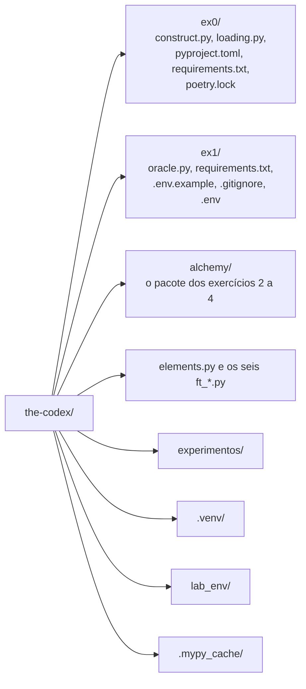

# A pasta do projeto

O enunciado fixa onde cada arquivo fica: os exercícios 0 e 1 em pastas próprias, `ex0/` e `ex1/`,
e os exercícios 2 a 4 na **raiz** do projeto, a pasta de cima, onde também ficam `ex0` e `ex1`.
Crie a pasta do projeto, entre nela e crie as duas pastas dos primeiros exercícios:

```bash
mkdir the-codex
cd the-codex
mkdir ex0 ex1
```

`mkdir` cria uma pasta (ou várias, com os nomes em sequência). O nome `the-codex` é só uma
sugestão; o que o enunciado fixa são as pastas e os nomes dos arquivos dentro dela. **Todos os
comandos do tutorial são rodados a partir desta pasta**, a `the-codex`.

Crie também uma pasta `experimentos`, para os programas pequenos que mostram cada ideia antes de
ela entrar num exercício. Eles não fazem parte da entrega:

```bash
mkdir experimentos
```

Ao fim do projeto, a pasta fica assim (as pastas `alchemy/` e os arquivos `ft_*.py` nascem nos
exercícios 2 a 4):



Fora da entrega ficam:

- `.venv/`, o ambiente das ferramentas de conferência, criado na
  [próxima página](./03-o-ambiente-virtual.md);
- `lab_env/`, o ambiente virtual do laboratório, criado no exercício 0;
- `ex0/poetry.lock`, que o Poetry gera no exercício 0;
- `ex1/.env`, o arquivo com a configuração de verdade do exercício 1, que nunca vai para o
  repositório;
- `.mypy_cache/`, que o mypy cria na primeira vez que roda, para guardar resultados e conferir
  mais rápido da próxima vez;
- `experimentos/`.
