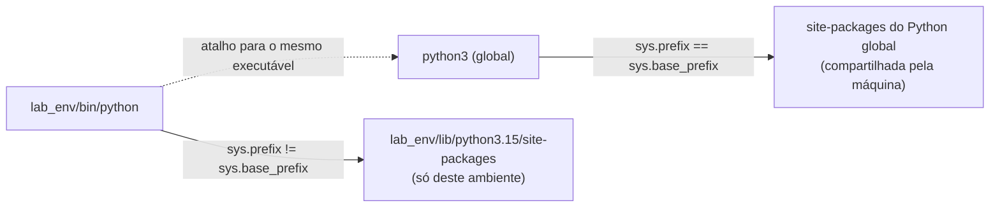

# O ambiente virtual por dentro

Para descobrir se está num ambiente virtual, `construct.py` precisa saber o que muda no Python
quando ele roda dentro de um. A resposta está no próprio ambiente, uma pasta que o roteiro do
enunciado chama de `lab_env`.

## Criar o laboratório

Na pasta `the-codex`, com o comando do enunciado:

```bash
python3 -m venv lab_env
ls -1 lab_env
```

```text
bin
include
lib
pyvenv.cfg
```

O `-1` do `ls` lista um nome por linha. No Linux pode aparecer também `lib64`, um atalho para
`lib`. Cada parte:

- **`bin/`**: os programas do ambiente. `python` e `python3` são **atalhos** (*links*) para o
  Python global, aquele com que o ambiente foi criado: o ambiente não tem um Python copiado, usa
  o mesmo. Também ficam aqui o `pip` do ambiente e os scripts `activate`, da
  [próxima página](./03-ativar-o-ambiente.md);
- **`lib/python3.15/site-packages/`**: a pasta onde as bibliotecas do ambiente são instaladas. O
  `python3.15` muda com a versão do Python;
- **`include/`**: uma pasta para compilar bibliotecas escritas em C; fica vazia e não é usada no
  projeto;
- **`pyvenv.cfg`**: um arquivo de texto pequeno que marca a pasta como ambiente virtual. Ele diz
  de qual Python o ambiente veio e se as bibliotecas do Python global ficam visíveis:

```bash
grep include-system lab_env/pyvenv.cfg
```

```text
include-system-site-packages = false
```

`grep` mostra as linhas do arquivo que contêm o texto procurado. `false` quer dizer que as
bibliotecas instaladas no Python global **não** aparecem dentro do ambiente: ele começa vazio.

## Onde as bibliotecas ficam

A pasta `site-packages` do ambiente acaba de nascer e só tem o próprio `pip`:

```bash
ls -1 lab_env/lib/python3*/site-packages
```

```text
pip
pip-26.2.2.dist-info
```

O `*` completa o nome da pasta com a versão do Python, seja ela qual for. `pip-26.2.2.dist-info`
guarda os dados da instalação do `pip`; o número da versão pode ser outro. No Python 3.10, o
ambiente nasce também com o `setuptools`, uma ferramenta de empacotamento, e a lista tem mais
linhas: `_distutils_hack`, `distutils-precedence.pth`, `pip`, `pip-23.0.1.dist-info`,
`pkg_resources`, `setuptools` e `setuptools-79.0.1.dist-info` (os números podem ser outros).

O Python global também tem a sua `site-packages`, em outro lugar: é ali que um `pip install` sem
ambiente virtual instalaria (ou tentaria instalar) as bibliotecas, para todos os programas da
máquina. Essa é a diferença de locais que `construct.py` precisa mostrar.

## Como o Python sabe que está num ambiente

Ao iniciar, o Python procura um `pyvenv.cfg` na pasta do seu executável e na pasta acima dela (o
executável `lab_env/bin/python` acha `lab_env/pyvenv.cfg`). Quando acha, ele está num ambiente
virtual, e duas variáveis do módulo `sys` (que vem com o Python) ficam
diferentes:

- `sys.prefix`: a pasta do ambiente em uso;
- `sys.base_prefix`: a pasta do Python global de onde o ambiente veio.

Fora de um ambiente, as duas são a mesma pasta. O teste rápido usa `python3 -c`, que roda o
código passado entre aspas. Primeiro com o Python global, depois com o Python de dentro do
`lab_env`:

```bash
python3 -c 'import sys; print(sys.prefix != sys.base_prefix)'
lab_env/bin/python -c 'import sys; print(sys.prefix != sys.base_prefix)'
```

```text
False
True
```

O mesmo código, rodado por dois executáveis diferentes, dá respostas diferentes: com
`lab_env/bin/python`, `sys.prefix` aponta para o `lab_env`:

```bash
lab_env/bin/python -c 'import sys; print(sys.prefix)'
```

```text
/path/to/the-codex/lab_env
```

No terminal aparece o caminho completo da pasta do projeto no lugar de `/path/to/the-codex`. O
tutorial escreve os caminhos assim, como o enunciado faz com `/path/to/lab_env`, porque eles
mudam de máquina para máquina.

O módulo `site`, que também vem com o Python, diz quais pastas `site-packages` o Python em uso
enxerga:

```bash
lab_env/bin/python -c 'import site; print(site.getsitepackages())'
```

```text
['/path/to/the-codex/lab_env/lib/python3.15/site-packages']
```

`site.getsitepackages()` devolve uma lista de pastas. Num ambiente virtual, a primeira é a
`site-packages` do ambiente, a mesma que o `ls` mostrou acima.



`sys.prefix != sys.base_prefix` é o teste que `construct.py` usa para responder se está num
ambiente virtual. É o teste que a documentação do Python indica para isso.
