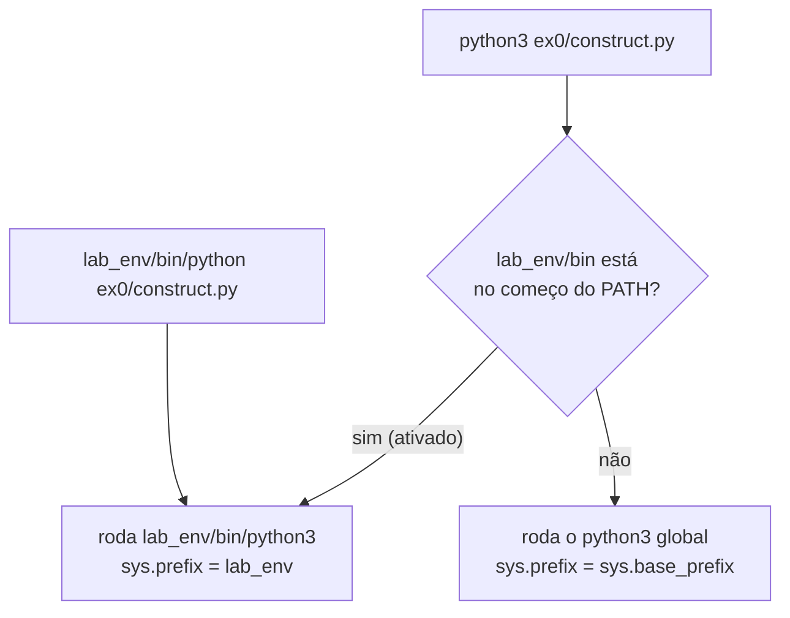

# Ativar o ambiente

Escrever `lab_env/bin/python` em todo comando funciona, mas cansa, e o roteiro do enunciado
escreve só `python3` e `pip`. **Ativar** o ambiente faz o terminal usar o Python e o `pip` de
dentro dele quando se digita só `python3` ou `pip`.

## O PATH

Quando se digita um comando como `python3`, o terminal procura um programa com esse nome numa
lista de pastas, em ordem, e roda o primeiro que achar. Essa lista é o **`PATH`**. `command -v`
mostra qual programa um nome vai rodar, sem rodá-lo:

```bash
command -v python3
```

```text
/path/to/python3
```

A resposta é o caminho do Python global. Como no enunciado, `/path/to/` está no lugar da parte do
caminho que muda de máquina para máquina: num Linux, a resposta costuma ser `/usr/bin/python3`.

## Ativar

```bash
source lab_env/bin/activate
```

O comando não imprime nada, mas o começo da linha do terminal (o *prompt*) passa a mostrar
`(lab_env)`, como no roteiro do enunciado: `(lab_env) $> python3 ex0/construct.py`. O
`source` roda o script `activate` **dentro** do terminal atual, e não num programa à parte; por
isso o script consegue mudar o terminal. Além do prompt, as mudanças que importam aqui são três:

1. põe a pasta `lab_env/bin` no começo do `PATH`;
2. cria a variável `VIRTUAL_ENV`, com o caminho do ambiente;
3. cria o comando `deactivate`, que desfaz tudo isso, inclusive o prompt.

Agora `python3` e `pip` são os do ambiente:

```bash
command -v python3
command -v pip
echo "$VIRTUAL_ENV"
```

```text
/path/to/the-codex/lab_env/bin/python3
/path/to/the-codex/lab_env/bin/pip
/path/to/the-codex/lab_env
```

`echo` imprime o texto recebido, e `$VIRTUAL_ENV` é trocado pelo valor da variável. Como na
[página anterior](./02-o-ambiente-virtual-por-dentro.md), `/path/to/the-codex` está no lugar do
caminho completo da pasta do projeto.

## Desativar

```bash
deactivate
```

O comando não imprime nada. O prompt perde o `(lab_env)`, o `PATH` volta a ser o de antes, e
`python3` volta a ser o Python global. A variável `VIRTUAL_ENV` deixa de existir.

A ativação vale só para aquele terminal: um terminal novo começa desativado, e o `source` precisa
ser rodado de novo. No Windows, o script de ativação é `lab_env\Scripts\activate`, sem `source`.

## Ativar não é o que cria o isolamento

A ativação só muda **qual** Python o nome `python3` chama. Quem decide se um programa roda num
ambiente virtual é o executável que o roda: `lab_env/bin/python programa.py` roda dentro do
ambiente mesmo sem ativação, porque esse executável acha o `lab_env/pyvenv.cfg`. Por isso
`construct.py` confere `sys.prefix` e `sys.base_prefix`, e não a variável `VIRTUAL_ENV`: com
`lab_env/bin/python`, a variável não existe, e o programa está dentro do ambiente do mesmo jeito.



Nas próximas páginas, cada comando diz se o `lab_env` precisa estar ativado.
