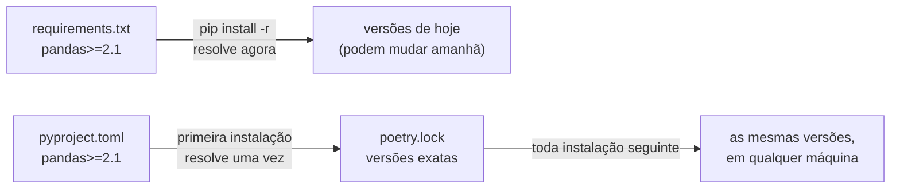

# Poetry e pyproject.toml

O `requirements.txt` diz o que instalar, mas não guarda o que foi instalado: duas pessoas que
instalam em dias diferentes podem acabar com versões diferentes, e um programa que funciona numa
máquina quebra na outra. O **Poetry** é um gerenciador de dependências que resolve isso: além de
instalar, ele grava a versão exata de cada biblioteca num arquivo, e toda instalação seguinte
repete exatamente aquelas versões.

## O pyproject.toml

O Poetry lê as dependências do `pyproject.toml`, o arquivo de configuração padrão de projetos
Python. Ele é escrito em **TOML**, um formato de texto para configuração:

- `[nome]` abre uma **seção**;
- `chave = valor` define um valor dentro da seção atual; textos vão entre aspas;
- `[ ... ]` depois do `=` é uma lista, que pode ocupar várias linhas.

Crie `ex0/pyproject.toml`:

```toml title="ex0/pyproject.toml"
[project]
name = "sealed-laboratory"
version = "0.1.0"
requires-python = ">=3.10"
dependencies = [
    "pandas>=2.1",
    "numpy>=1.25",
]

[tool.poetry]
package-mode = false
```

### A seção [project]

A seção padrão de qualquer projeto Python, que o Poetry entende:

- `name` e `version`: o nome e a versão do projeto. O nome `sealed-laboratory` ("laboratório
  selado") é escolha do tutorial;
- `requires-python`: as versões do Python em que o projeto roda, as do enunciado. O Poetry usa
  isso para escolher versões das bibliotecas que funcionem em **todas** elas;
- `dependencies`: as mesmas dependências do `requirements.txt`, com os mesmos especificadores. É
  o "declara as mesmas restrições" da saída do `loading.py`.

### A seção [tool.poetry]

Seções que começam com `tool.` são de uma ferramenta específica; esta é só do Poetry.
`package-mode = false` diz que o projeto não é uma biblioteca a ser instalada ou publicada: o
Poetry só cuida das dependências. Sem essa linha, `poetry install` também tenta instalar o próprio
projeto e para com um erro, porque não há uma pasta de código com o nome `sealed-laboratory`:

```text
Error: The current project could not be installed: No file/folder found for package sealed-laboratory
```

A própria mensagem do Poetry sugere `package-mode = false` para quem usa o Poetry só para
gerenciar dependências.

## O poetry.lock

Na primeira instalação, o Poetry **resolve** as dependências: escolhe uma versão de cada
biblioteca, inclusive das transitivas, que cumpra todos os especificadores e funcione em todas as
versões do Python de `requires-python`. Depois grava o resultado em `ex0/poetry.lock`: o nome e a
versão exata de cada biblioteca, com uma **impressão digital** (*hash*) de cada arquivo baixado.
As instalações seguintes não resolvem de novo: instalam exatamente o que está no `poetry.lock`. É a
segunda parte da comparação que o `loading.py` imprime:

```text
pyproject.toml declares the same constraints, and Poetry pins the resolved
versions in poetry.lock so every install is identical.
```

*Pin* quer dizer "fixar com um alfinete": a versão fica presa.



O `poetry.lock` é gerado pelo Poetry e não está na lista de arquivos do enunciado, que pede só
`construct.py`, `loading.py`, `requirements.txt` e `pyproject.toml` na pasta `ex0`; ele fica fora
da entrega. Num projeto de verdade, o `poetry.lock` vai para o repositório, justamente para que
todos instalem as mesmas versões.

## O ambiente do Poetry

O Poetry também cria um ambiente virtual para o projeto, numa pasta dele, fora da pasta do
projeto. O `poetry install` instala as dependências ali, e `poetry run comando` roda o comando
dentro desse ambiente. A instalação fica para depois do `loading.py`
([Instalar com o Poetry](./11-instalar-com-poetry.md)).
