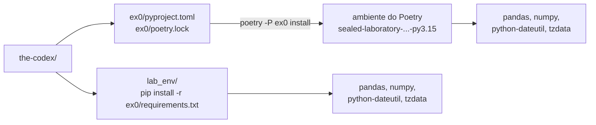

# Instalar com o Poetry

A segunda metade do roteiro instala os mesmos reagentes com o Poetry, num ambiente separado, e
roda o `loading.py` dentro dele.

## Instalar o Poetry

O Poetry é um programa feito em Python e precisa ser instalado. A documentação dele pede que ele
fique num ambiente virtual separado do resto do sistema, e nunca no ambiente do projeto que ele
gerencia. O tutorial o instala no `.venv`, o ambiente das ferramentas
([O ambiente virtual](../01-ambiente/03-o-ambiente-virtual.md)), e o chama pelo caminho, como o
flake8 e o mypy:

```bash
.venv/bin/python -m pip install poetry
.venv/bin/poetry --version
```

A primeira linha termina com `Successfully installed`, seguido da lista de bibliotecas que o
Poetry usa. A segunda mostra a versão:

```text
Poetry (version 2.5.1)
```

O número pode ser outro; os comandos desta página precisam do Poetry 2 ou mais novo. Outros jeitos
de instalar (o programa `pipx`, o instalador oficial do site do Poetry) também servem; onde o
tutorial escreve `.venv/bin/poetry`, use só `poetry`.

## Desativar o lab_env antes

Se encontra um ambiente virtual ativado (pela variável `VIRTUAL_ENV`), o Poetry instala nele em vez
de criar o seu. Com o `lab_env` ativado, as bibliotecas iriam para o `lab_env`, e a demonstração de
um segundo ambiente se perderia. Desative-o:

```bash
deactivate
```

## O pyproject.toml está em ex0

O roteiro do enunciado roda `poetry install` na pasta do projeto, mas ali não há `pyproject.toml`:
ele fica em `ex0/`. O Poetry procura o arquivo na pasta atual e nas pastas acima dela, nunca nas de
dentro:

```bash
.venv/bin/poetry install
```

```text

Poetry could not find a pyproject.toml file in /path/to/the-codex or its parents
```

("o Poetry não achou um `pyproject.toml` em `/path/to/the-codex` nem nas pastas acima"). A opção
`-P ex0` (de *project*) diz em que pasta está o projeto, e mantém a pasta atual para o resto do
comando. Assim, os comandos continuam rodando da pasta do projeto, e o caminho `ex0/loading.py` do
enunciado continua valendo. Escrever `-P ex0` em vez de entrar na pasta `ex0` é escolha do
tutorial; com `cd ex0`, os comandos seriam `poetry install` e `poetry run python loading.py`.

## Instalar

```bash
.venv/bin/poetry -P ex0 install
```

```text
Creating virtualenv sealed-laboratory-YaXe80qZ-py3.15 in /path/to/virtualenvs
Updating dependencies
Resolving dependencies...

Package operations: 4 installs, 0 updates, 0 removals

  - Installing tzdata (2026.6)
  - Installing python-dateutil (4.0.0)
  - Installing numpy (2.5.4)
  - Installing pandas (3.1.1)

Writing lock file
```

Linha por linha:

1. o Poetry cria um ambiente virtual só para este projeto. O nome junta o `name` do
   `pyproject.toml`, um código tirado do caminho da pasta (o `YaXe80qZ`, diferente na sua máquina)
   e a versão do Python. A pasta onde ficam os ambientes do Poetry (aqui, `/path/to/virtualenvs`)
   costuma ser `~/.cache/pypoetry/virtualenvs` no Linux e `~/Library/Caches/pypoetry/virtualenvs`
   no macOS; o `~` é a pasta pessoal do usuário;
2. como ainda não há `poetry.lock`, ele resolve as dependências;
3. instala as quatro bibliotecas, as mesmas que o `pip` instalou, no ambiente novo. A ordem das
   linhas `Installing` pode variar, porque o Poetry instala várias ao mesmo tempo;
4. grava o `ex0/poetry.lock`.

No Python 3.10, o Poetry escolhe a `pandas` 2.3.3 e o `numpy` 2.2.6, e instala seis bibliotecas
(mais `pytz` e `six`). No meio da lista, entre as linhas `Installing`, aparecem estas duas:

```text
/path/to/the-codex/.venv/lib/python3.10/site-packages/poetry/installation/wheel_installer.py:153: RuntimeWarning: Skip installing numpy/distutils/__pycache__/conv_template.cpython-310.pyc from numpy. Installing files in a __pycache__ directory poses a security risk. __pycache__ directories should not be included in wheels. This is probably an issue in the build process of 'numpy'.
  install(
```

A primeira diz em que arquivo do Poetry o aviso nasceu (o caminho começa pelo `.venv` do projeto,
onde o Poetry está instalado); a segunda, `install(`, é o trecho de código daquela linha. O aviso
diz "pulando a instalação de um arquivo de `__pycache__` do numpy; instalar arquivos de cache é um
risco de segurança, e eles não deveriam estar no pacote". O defeito é do pacote do `numpy` para
o Python 3.10, que traz por engano um arquivo de cache: o Poetry deixa só esse arquivo de fora, e
a instalação termina normalmente. O `pip` instala o mesmo pacote sem avisar. Do Python 3.11 ao
3.15, o Poetry escolhe outro `numpy`, sem esse arquivo, e o aviso não aparece.

```bash
LC_ALL=C ls -1 ex0
```

```text
construct.py
loading.py
poetry.lock
pyproject.toml
requirements.txt
```

## Rodar no ambiente do Poetry

```bash
.venv/bin/poetry -P ex0 run python ex0/loading.py
```

```text

REAGENT STATUS: Loading reagents...

Checking dependencies:
[OK] pandas (3.1.1) - Data manipulation ready
[OK] numpy (2.5.4) - Numerical computation ready

pip vs Poetry:
  requirements.txt declares what to install; pip resolves it at install time.
  pyproject.toml declares the same constraints, and Poetry pins the resolved
  versions in poetry.lock so every install is identical.

All reagents present and accounted for.
```

`poetry run` roda o comando seguinte com o Python do ambiente do Poetry, sem ativar nada. As
versões são as mesmas do `pip`, como o enunciado pede: os dois resolveram os mesmos especificadores
no mesmo dia. O caminho do ambiente:

```bash
.venv/bin/poetry -P ex0 env info --path
```

```text
/path/to/virtualenvs/sealed-laboratory-YaXe80qZ-py3.15
```

## A segunda instalação

Com o `poetry.lock` pronto, uma nova instalação não resolve nada: lê o arquivo e instala o que
falta para ficar igual a ele. Aqui, nada:

```bash
.venv/bin/poetry -P ex0 install
```

```text
Installing dependencies from lock file

No dependencies to install or update
```

Numa máquina nova, o mesmo comando, com o mesmo `poetry.lock`, instala exatamente as mesmas
versões. O `poetry.lock` guarda uma versão de cada biblioteca para cada faixa de versões do Python
de `requires-python`, porque nem toda versão de uma biblioteca funciona em todo Python. As entradas
do `numpy`:

```bash
grep -E '^(name|version|markers) = ' ex0/poetry.lock | grep -A2 '^name = "numpy"'
```

```text
name = "numpy"
version = "2.2.6"
markers = "python_version == \"3.10\""
name = "numpy"
version = "2.4.6"
markers = "python_version == \"3.11\""
name = "numpy"
version = "2.5.4"
markers = "python_version >= \"3.12\""
```

O primeiro `grep` guarda só as linhas que começam com `name = `, `version = ` ou `markers = ` (o
`-E` permite escrever as três opções entre parênteses, separadas por `|`); o segundo mostra cada
linha `name = "numpy"` e as duas seguintes (`-A2`). `markers` diz em qual Python cada versão vale:
a 2.2.6 no Python 3.10, a 2.4.6 no 3.11 e a 2.5.4 do 3.12 em diante. As versões dependem do dia em
que o `poetry.lock` foi gerado.



Dois ambientes separados, com as mesmas bibliotecas, instaladas por dois gerenciadores.
