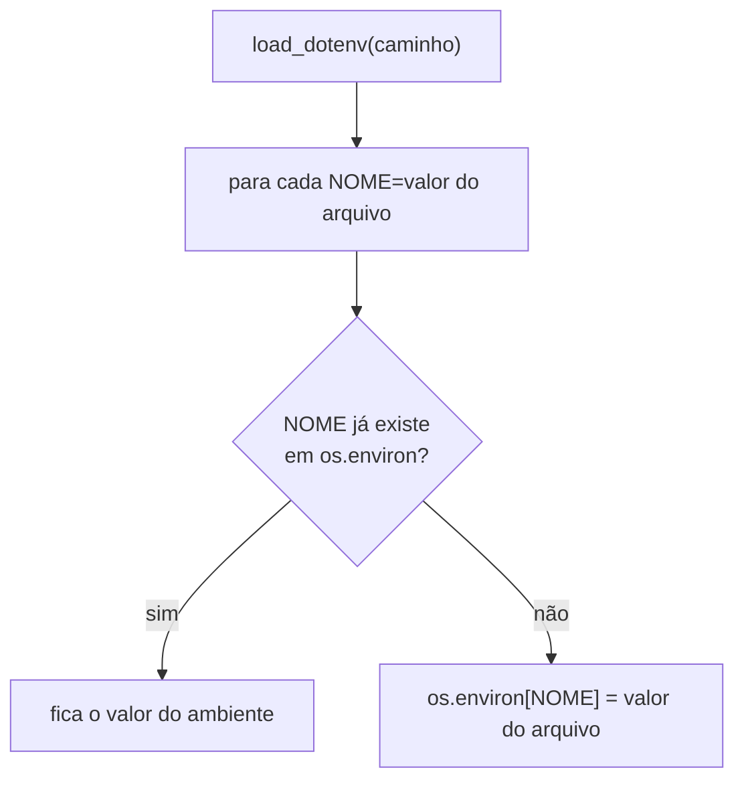

# O arquivo .env e o python-dotenv

Durante o desenvolvimento, digitar as cinco variáveis de ambiente antes de cada execução não é
prático. O arquivo **`.env`** guarda essas variáveis num texto simples, ao lado do programa, e a
biblioteca **`python-dotenv`** as carrega para dentro de `os.environ` quando o programa começa.

## O formato

Uma variável por linha, no formato `NOME=valor`, sem espaços em volta do `=`. Linhas que começam
com `#` são comentários e são ignoradas. Crie `experimentos/exemplo.env`:

```ini title="experimentos/exemplo.env"
MATRIX_MODE=development
# a comment line
LOG_LEVEL=DEBUG
```

O nome do arquivo de verdade do exercício é só `.env`, com o ponto no começo, e por isso o `ls`
comum não o mostra. Este exemplo tem outro nome para não ser confundido com ele.

## Instalar o python-dotenv

O `requirements.txt` do exercício 1 tem uma linha só. Crie `ex1/requirements.txt`:

```text title="ex1/requirements.txt"
python-dotenv>=1.0
```

O `1.0` como mínimo é escolha do tutorial: é a primeira versão da série 1 da biblioteca, e o
`load_dotenv` dela já funciona como o tutorial mostra. A instalação vai para o `lab_env`, que precisa estar
**ativado**; o fim do exercício 0 o desativou para o Poetry. Ative-o de novo e instale:

```bash
source lab_env/bin/activate
pip install -r ex1/requirements.txt
```

A última linha da saída:

```text
Successfully installed python-dotenv-1.2.4
```

O número da versão pode ser outro. O nome da biblioteca no PyPI é `python-dotenv`, mas o nome
que se importa no código é `dotenv`: os dois nomes não precisam ser iguais, e cada biblioteca
documenta o seu.

## load_dotenv

`load_dotenv(caminho)` lê o arquivo e põe cada variável dele em `os.environ`. Crie
`experimentos/carregar.py`:

```python title="experimentos/carregar.py"
import os

from dotenv import load_dotenv

print(f"before: LOG_LEVEL={os.environ.get('LOG_LEVEL')}")
load_dotenv("experimentos/exemplo.env")
print(f"after: LOG_LEVEL={os.environ.get('LOG_LEVEL')}")
print(f"after: MATRIX_MODE={os.environ.get('MATRIX_MODE')}")
```

O caminho `experimentos/exemplo.env` é relativo à pasta atual, a `the-codex`, de onde o comando
roda. O `import` de uma biblioteca externa fica separado dos `import` do Python por uma linha em
branco; é o costume (a PEP 8 pede os grupos nessa ordem), e o flake8 não reclama de nenhum dos
dois jeitos.

```bash
python3 experimentos/carregar.py
```

```text
before: LOG_LEVEL=None
after: LOG_LEVEL=DEBUG
after: MATRIX_MODE=development
```

Antes do `load_dotenv`, a variável não existia; depois, existe, com o valor do arquivo. Para o
resto do programa, não há diferença entre uma variável que veio do terminal e uma que veio do
`.env`: as duas estão em `os.environ`.

Sem o `lab_env` ativado, o `python3` global não tem a biblioteca, e o programa para na linha do
`import`, com `ModuleNotFoundError: No module named 'dotenv'`.

## Quem ganha: o ambiente ou o .env

Se a variável **já existe** no ambiente quando o `load_dotenv` roda, ele não a troca pelo valor do
arquivo:

```bash
MATRIX_MODE=production python3 experimentos/carregar.py
```

```text
before: LOG_LEVEL=None
after: LOG_LEVEL=DEBUG
after: MATRIX_MODE=production
```

O `LOG_LEVEL` veio do arquivo, mas o `MATRIX_MODE` ficou com o valor do terminal. É exatamente o
que o roteiro do enunciado pede ("preferir as variáveis de ambiente ao `.env`"), e é o
comportamento padrão do `load_dotenv`. A função tem uma opção, `override=True`, que inverte a
regra; o projeto não a usa.



Essa ordem faz sentido: o `.env` é a configuração de desenvolvimento, que vale por padrão, e quem
roda o programa pode trocar qualquer valor sem editar o arquivo. Num servidor de produção, as
variáveis são definidas no próprio ambiente, e o `.env` nem precisa existir.
