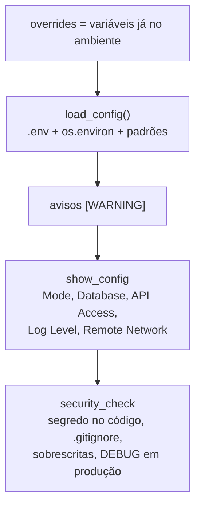

# A checagem de segurança

A saída do enunciado termina com três conferências marcadas com `[OK]`:

```text
Configuration security check:
[OK] No hardcoded secrets detected
[OK] .env file properly ignored by git
[OK] Production overrides available
```

O enunciado mostra as frases, mas não diz o que cada uma confere. As conferências abaixo são
escolha do tutorial: cada `[OK]` vem de um teste de verdade, que vira `[WARNING]` quando falha. As
peças entram no `oracle.py` depois de `show_config`.

## Ler um arquivo da pasta ex1

```python
def read_file(name: str) -> str:
    path = os.path.join(HERE, name)
    if not os.path.isfile(path):
        return ""
    with open(path) as file:
        return file.read()
```

Devolve o conteúdo de um arquivo da pasta do `oracle.py`, ou um texto vazio se ele não existe. As
"operações com arquivos" permitidas pelo enunciado são estas: `open` e `read`
([Ler um arquivo](../00-introducao/03-pre-requisitos.md#ler-um-arquivo)).

## As conferências

```python
def security_check(config: dict[str, str], overrides: list[str]) -> None:
    print("Configuration security check:")
    secret = config["API_KEY"]
    source = read_file(os.path.basename(__file__))
    if secret and secret in source:
        print("[WARNING] API_KEY value found in the source code")
    else:
        print("[OK] No hardcoded secrets detected")
    if ".env" in read_file(".gitignore").splitlines():
        print("[OK] .env file properly ignored by git")
    else:
        print("[WARNING] .env file is not listed in .gitignore")
    if overrides:
        print(f"[OK] Production overrides active: {', '.join(overrides)}")
    else:
        print("[OK] Production overrides available")
    production = config["MATRIX_MODE"] == "production"
    if production and config["LOG_LEVEL"] == "DEBUG":
        print("[WARNING] DEBUG logging enabled in production")
```

### Nenhum segredo no código

O programa lê o **próprio código-fonte** (`os.path.basename(__file__)` é o nome do arquivo,
`oracle.py`) e procura nele o valor da `API_KEY` configurada. Se a chave aparece escrita no
código, alguém a copiou para lá, e ela vai para o repositório junto com o arquivo. Sem chave
configurada, não há o que procurar, e a conferência passa.

### O .env ignorado pelo git

`read_file(".gitignore").splitlines()` divide o conteúdo do `.gitignore` numa lista de linhas, e o
`in` pergunta se uma delas é exatamente `.env`. Sem `.gitignore`, a lista é vazia, e o aviso
aparece.

### As sobrescritas pelo ambiente

`overrides` é a lista das variáveis que já existiam no ambiente **antes** do `.env` ser carregado
(o `main` a monta, abaixo). São as que vieram do terminal e venceram o `.env`. A frase do enunciado,
`Production overrides available` ("sobrescritas de produção disponíveis"), aparece quando nenhuma
veio: o `.env` vale inteiro, e qualquer valor pode ser trocado pelo ambiente. Quando alguma veio, a
linha diz quais: `Production overrides active: MATRIX_MODE, API_KEY`. É assim que a saída mostra o
"preferir as variáveis de ambiente ao `.env`" do roteiro.

### DEBUG em produção

A última conferência só existe em produção: o nível `DEBUG` registra tudo, inclusive detalhes
internos que não deveriam sair de uma máquina de testes, e em produção ele vira aviso. É a segunda
diferença entre os modos ([Mostrar a configuração](./06-mostrar-a-configuracao.md#o-acesso-à-api)
tem a primeira). `production` guarda o resultado da comparação (`True` ou `False`) só para a linha
do `if` caber nos 79 caracteres.

## O main

```python
def main() -> None:
    print()
    print("ORACLE STATUS: Consulting the configuration...")
    print()
    overrides = [name for name in VARIABLES if os.environ.get(name)]
    config, warnings = load_config()
    for warning in warnings:
        print(f"[WARNING] {warning}")
    if warnings:
        print()
    show_config(config)
    print()
    security_check(config, overrides)
    print()
    print("The Oracle sees all configurations.")


if __name__ == "__main__":
    main()
```

- `[name for name in VARIABLES if os.environ.get(name)]` é uma **compreensão de lista**: monta
  uma lista com cada `name` de `VARIABLES` que passa no `if`, numa linha só. Ela roda **antes** de
  `load_config`, enquanto `os.environ` só tem o que veio do terminal;
- `config, warnings = load_config()` separa a tupla devolvida nas duas variáveis;
- os avisos aparecem entre o cabeçalho e o bloco da configuração, seguidos de uma linha vazia. Sem
  avisos, nada é impresso ali, e a saída fica igual à do enunciado.


