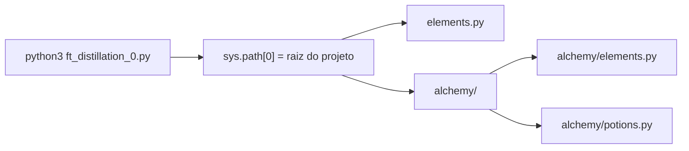

# Onde o Python procura

`import sigil` achou o `sigil.py` sem que ninguém dissesse onde ele estava. O Python procura os
módulos numa lista de pastas, em ordem, e usa o primeiro que achar. Essa lista é o **`sys.path`**.

## A primeira pasta da lista

Crie `experimentos/caminhos.py`:

```python title="experimentos/caminhos.py"
import sys

print(sys.path[0])
```

```bash
python3 experimentos/caminhos.py
```

```text
/path/to/the-codex/experimentos
```

(`/path/to/the-codex` está no lugar do caminho da pasta do projeto.) A primeira pasta do
`sys.path` é **a pasta do arquivo rodado**, e não a pasta onde o terminal está. Por isso
`experimentos/use_import.py` acha o `sigil.py`, que está na mesma pasta que ele, mesmo com o
comando rodado da `the-codex`. O resto da lista são as pastas do próprio Python: a da biblioteca
padrão (os módulos que vêm com ele, como `os` e `sys`) e a `site-packages` do ambiente em uso
([O ambiente virtual por dentro](../02-ex0/02-o-ambiente-virtual-por-dentro.md#onde-as-bibliotecas-ficam)).

O programa funciona de qualquer pasta, porque o que conta é onde o arquivo está:

```bash
cd experimentos
python3 use_import.py
cd ..
```

```text
loading sigil
lumen
LUMEN!
True
__main__
```

## Quando a pasta não está na lista

`python3 -c` roda um código sem arquivo, e então a primeira pasta do `sys.path` é a pasta atual
do terminal. Da `the-codex`, que não tem nenhum `sigil.py`:

```bash
python3 -c 'import sigil'
```

```text
Traceback (most recent call last):
  File "<string>", line 1, in <module>
    import sigil
ModuleNotFoundError: No module named 'sigil'. Did you mean: 'signal'?
```

`ModuleNotFoundError` ("módulo não encontrado") é o erro de um `import` que não achou o módulo em
nenhuma pasta da lista. O Python 3.15 ainda sugere um módulo de nome parecido que ele conhece, aqui
o `signal` da biblioteca padrão, que não tem nada a ver com o `sigil`; do 3.10 ao 3.14, a última
linha termina em `'sigil'`, sem sugestão, e do 3.10 ao 3.12 o traceback também não repete a linha
`import sigil`.

## O que isso decide no projeto

Os programas `ft_*.py` dos exercícios 2 a 4 ficam na **raiz** do projeto, ao lado do `elements.py`
e da pasta `alchemy`. Rodados com `python3 ft_alembic_0.py`, a primeira pasta do `sys.path` é a
raiz, e `import elements` e `import alchemy` encontram o que está ali. Os módulos de dentro de
`alchemy` também são encontrados a partir da raiz: a busca por `alchemy.potions` começa na pasta
`alchemy` da raiz.



## A proibição de mexer no sys.path

O `sys.path` é uma lista comum, e um programa poderia acrescentar pastas a ela com
`sys.path.append("alguma/pasta")` antes de um `import`. O enunciado proíbe isso em todo o projeto.
Um `import` que só funciona depois de mexer no `sys.path` esconde a organização real dos arquivos:
o código passa a depender de onde ele foi rodado e de uma linha escondida no começo de algum
arquivo. A organização certa das pastas (os programas na raiz, o código num pacote) faz todos os
`import` funcionarem sem truque nenhum.
