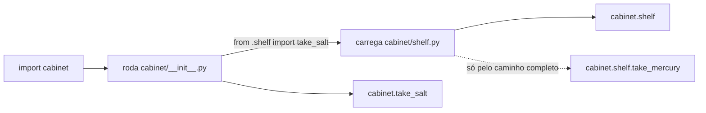

# Pacote e \_\_init\_\_.py

Um módulo é um arquivo. Quando o código cresce, os módulos são agrupados em pastas, e uma pasta de
módulos com um arquivo `__init__.py` é um **pacote**. Um pacote dentro de outro é um
**subpacote**. O `__init__.py` é o "portal" do enunciado: ele decide o que o pacote mostra a quem o
importa.

## Um pacote vazio

Crie a pasta `experimentos/cabinet` ("armário"), com um `__init__.py` vazio e um módulo `shelf.py`
("prateleira"):

```bash
mkdir experimentos/cabinet
touch experimentos/cabinet/__init__.py
```

`touch` cria um arquivo vazio. O módulo:

```python title="experimentos/cabinet/shelf.py"
def take_salt() -> str:
    return "salt"


def take_mercury() -> str:
    return "mercury"
```

E um programa que importa o pacote, em `experimentos/use_cabinet.py`:

```python title="experimentos/use_cabinet.py"
import cabinet

print(cabinet.take_salt())
```

```bash
python3 experimentos/use_cabinet.py
```

```text
Traceback (most recent call last):
  File "/path/to/the-codex/experimentos/use_cabinet.py", line 3, in <module>
    print(cabinet.take_salt())
          ^^^^^^^^^^^^^^^^^
AttributeError: module 'cabinet' has no attribute 'take_salt'
```

(`/path/to/the-codex` está no lugar do caminho da pasta do projeto. No Python 3.10, a linha de
`^` não aparece; ela marca o trecho da linha que deu erro.)

`import cabinet` achou a pasta e rodou o `__init__.py`, que está vazio. O objeto módulo do pacote
tem como atributos **só os nomes que o `__init__.py` cria**, e nenhum foi criado. O `shelf.py` nem
foi carregado: importar um pacote não importa os módulos de dentro dele. `AttributeError`
("erro de atributo") é a exceção de um nome que não existe no objeto. O mypy encontra o mesmo erro
sem rodar o programa:

```bash
.venv/bin/mypy --disallow-untyped-defs experimentos/use_cabinet.py
```

```text
experimentos/use_cabinet.py:3: error: Module has no attribute "take_salt"  [attr-defined]
Found 1 error in 1 file (checked 1 source file)
```

## O \_\_init\_\_.py expõe um nome

Escreva no `__init__.py` um import da função que o pacote deve mostrar:

```python
from .shelf import take_salt
```

O ponto antes de `shelf` quer dizer "o módulo `shelf` deste mesmo pacote"; é um import
**relativo**, assunto da [próxima página](./04-absoluto-e-relativo.md). Agora o `__init__.py` cria o
nome `take_salt`, e `cabinet.take_salt()` funciona. Mas o flake8 reclama:

```bash
.venv/bin/flake8 experimentos/cabinet
```

```text
experimentos/cabinet/__init__.py:1:1: F401 '.shelf.take_salt' imported but unused
```

"Importado mas não usado": para o flake8, um `import` que o próprio arquivo não usa é sobra
esquecida. Num `__init__.py`, o import existe justamente para os outros usarem. A convenção do
Python para dizer isso é a lista **`__all__`**: os nomes que o pacote declara como a sua interface
pública. O flake8 considera usado todo nome que está nela. O `__init__.py` fica assim:

```python title="experimentos/cabinet/__init__.py"
from .shelf import take_salt

__all__ = ["take_salt"]
```

O enunciado avisa que o `__init__.py` do exercício 2 pode gerar avisos do flake8 ou do mypy e pede
para seguir as convenções habituais: é esta.

`__all__` também decide o que `from cabinet import *` traz: só os nomes da lista. O `*` ("tudo")
é desaconselhado no código de verdade, porque esconde de onde vem cada nome, e o projeto não o
usa.

## O que o pacote mostra, e o que fica acessível

Troque o `use_cabinet.py` por esta versão, que usa o nome exposto, lista os nomes públicos do
pacote e chama a função que o `__init__.py` **não** expôs:

```python title="experimentos/use_cabinet.py"
import cabinet

print(cabinet.take_salt())
print([name for name in dir(cabinet) if not name.startswith("_")])
print(cabinet.shelf.take_mercury())
```

`dir(objeto)` devolve a lista dos nomes de atributos do objeto; a compreensão de lista guarda os
que não começam com `_` (os que começam são do próprio Python, como `__name__`).

```bash
python3 experimentos/use_cabinet.py
```

```text
salt
['shelf', 'take_salt']
mercury
```

O pacote tem dois nomes públicos, e não um:

- `take_salt`, criado pelo `from .shelf import take_salt` do `__init__.py`;
- `shelf`, o submódulo. Quando um submódulo é carregado, por qualquer import, o Python o guarda
  como atributo do pacote. O `from .shelf import ...` carregou o `shelf.py`, e com isso
  `cabinet.shelf` passou a existir.

Por isso `cabinet.shelf.take_mercury()` funciona, mesmo sem o `__init__.py` expor `take_mercury`.
O `__init__.py` não esconde nem protege nada: ele decide **quais nomes existem no pacote**, o atalho
`cabinet.take_salt`. Tudo o que está nos módulos continua alcançável pelo caminho completo. O
exercício 2 pergunta exatamente isso
([As perguntas do enunciado](../08-fechamento/03-as-perguntas-do-enunciado.md)).


