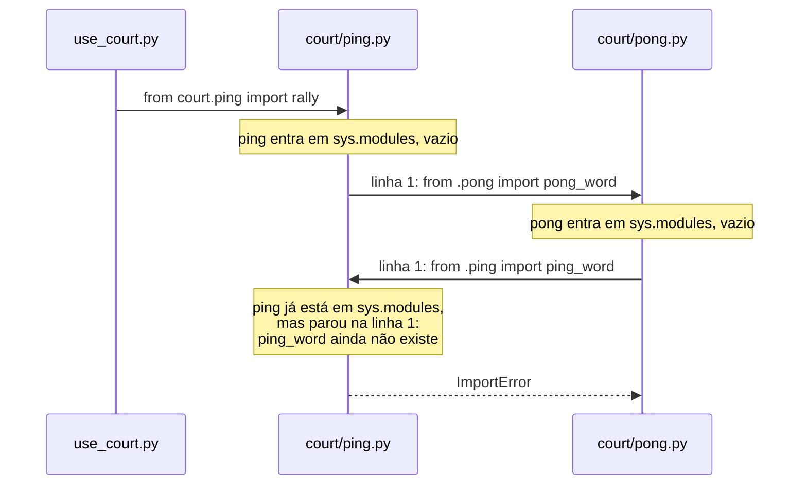

# O import circular

Dois módulos que precisam um do outro importam um ao outro: é a **dependência circular**, ou
**import circular**. Às vezes ela funciona, às vezes derruba o programa antes de ele começar. O
exercício 4 constrói os dois casos; esta página mostra o mecanismo com um par menor.

## Como um import roda, passo a passo

Para entender o problema, falta um detalhe da [primeira página](./01-modulo-e-import.md): o que o
Python faz exatamente num `import` de um módulo que ainda não foi carregado.

1. Cria um objeto módulo **vazio**.
2. Guarda esse objeto em **`sys.modules`**, o dicionário de todos os módulos já carregados, com o
   nome do módulo como chave. É assim que o segundo import do mesmo módulo não roda o arquivo de
   novo: ele acha o módulo em `sys.modules`.
3. Roda o arquivo do módulo de cima a baixo. Cada `def` cria a sua função **quando a linha roda**:
   enquanto o arquivo não chega a um `def`, aquela função não existe no módulo.

Entre os passos 2 e 3, o módulo está em `sys.modules` mas ainda pela metade: é um módulo
**parcialmente inicializado**.

## Um par que se importa no topo

Crie um pacote `experimentos/court` ("quadra") com um `__init__.py` vazio e dois módulos que jogam
pingue-pongue:

```bash
mkdir experimentos/court
touch experimentos/court/__init__.py
```

```python title="experimentos/court/ping.py"
from .pong import pong_word


def ping_word() -> str:
    return "ping"


def rally() -> str:
    return f"{ping_word()} {pong_word()}"
```

```python title="experimentos/court/pong.py"
from .ping import ping_word


def pong_word() -> str:
    return f"pong (answering {ping_word()})"
```

`ping` precisa do `pong_word` para a jogada (`rally`), e `pong` precisa do `ping_word` para
responder. E um programa que joga, `experimentos/use_court.py`:

```python title="experimentos/use_court.py"
from court.ping import rally

print(rally())
```

```bash
python3 experimentos/use_court.py
```

```text
Traceback (most recent call last):
  File "/path/to/the-codex/experimentos/use_court.py", line 1, in <module>
    from court.ping import rally
  File "/path/to/the-codex/experimentos/court/ping.py", line 1, in <module>
    from .pong import pong_word
  File "/path/to/the-codex/experimentos/court/pong.py", line 1, in <module>
    from .ping import ping_word
ImportError: cannot import name 'ping_word' from partially initialized module 'court.ping' (most likely due to a circular import) (/path/to/the-codex/experimentos/court/ping.py)
```

("não dá para importar o nome `ping_word` do módulo parcialmente inicializado `court.ping`,
provavelmente por causa de um import circular".) O traceback conta a história de cima para baixo:



O Python não entra num laço infinito: na segunda vez que `ping` é pedido, ele já está em
`sys.modules` e é devolvido como está, pela metade. O `from .ping import ping_word` procura o nome
`ping_word` nesse módulo pela metade e não acha, porque o `ping.py` ainda está parado na sua linha
1, esperando o `pong` terminar. Os dois esperam um pelo outro, e o import explode.

O flake8 e o mypy não acusam nada nesses arquivos: o mypy confere os tipos sem rodar o código, e
para ele um módulo que importa o outro é só uma referência, que existe nos dois sentidos. O
problema é da **ordem em que o código roda**.

## Desfazer o círculo

O `pong` só precisa do `ping_word` quando `pong_word` é **chamada**, e não quando o `pong.py` é
carregado. Mover o import para dentro da função adia a busca do nome para o momento da chamada:

```python title="experimentos/court/pong.py"
def pong_word() -> str:
    from .ping import ping_word

    return f"pong (answering {ping_word()})"
```

```bash
python3 experimentos/use_court.py
```

```text
ping pong (answering ping)
```

Agora carregar o `pong.py` não importa nada: só define `pong_word`. O `ping.py` termina de carregar,
e quando `rally()` chama `pong_word()`, o `from .ping import ping_word` acha o `ping` inteiro em
`sys.modules`. Um import dentro de uma função roda a cada chamada, mas depois da primeira é só uma
consulta ao `sys.modules`.

Esse é um dos jeitos de quebrar o círculo, e é o que o tutorial usa no exercício 4. Os outros
(importar o módulo em vez do nome, mover o que os dois usam para um terceiro módulo, passar o valor
como parâmetro) estão em [As perguntas do enunciado](../08-fechamento/03-as-perguntas-do-enunciado.md).
