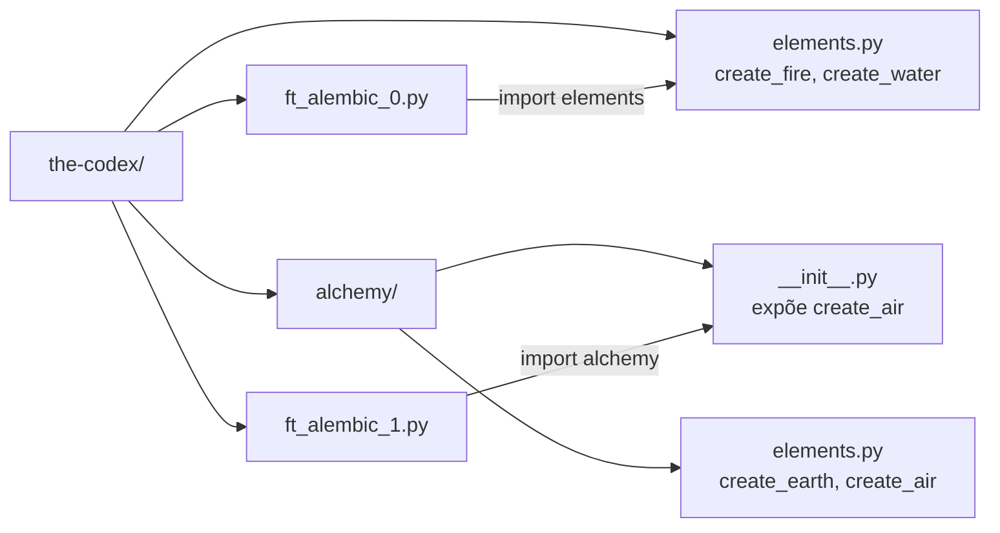

# O problema

Os ingredientes do alquimista estão em dois lugares: alguns à mão, num módulo solto na raiz do
projeto; outros guardados num armário, um pacote. Cada lugar é alcançado por um tipo de `import`,
e o pacote tem um portal, o `__init__.py`, que decide o que ele mostra para fora. O exercício 2
monta os dois lugares e testa cada caminho com um programa.

## O que o enunciado pede

Cinco arquivos, todos a partir da raiz do projeto. O único `import` permitido é o dos módulos que
o próprio projeto cria: nada da biblioteca padrão, nada instalado.

| Arquivo | Conteúdo |
|---|---|
| `elements.py` | `create_fire()`, que devolve `"Fire element created"`, e `create_water()`, que devolve `"Water element created"` |
| `alchemy/elements.py` | `create_earth()`, que devolve `"Earth element created"`, e `create_air()`, que devolve `"Air element created"` |
| `alchemy/__init__.py` | o necessário para expor `create_air` pela interface do pacote `alchemy`, e **nada** que exponha `create_earth` |
| `ft_alembic_0.py` | usa a estrutura `import ...` para chegar ao `elements.py` da raiz e cria fogo |
| `ft_alembic_1.py` | usa `import alchemy` para passar pela interface do pacote e cria ar; depois tenta chamar `create_earth()` pela mesma interface, e isso precisa **falhar** |

Sobre o `ft_alembic_1.py`, o enunciado acrescenta: capturar a exceção ou não é livre (é só para
mostrar), e um erro do mypy é esperado ali, de propósito. Sobre o `__init__.py`: ele pode gerar
avisos do flake8 ou do mypy, e a resposta é seguir as convenções habituais
([Pacote e \_\_init\_\_.py](../04-conceitos/03-pacote-e-init.md#o-__init__py-expõe-um-nome)).

Os nomes `ft_alembic_0.py` e `ft_alembic_1.py` seguem o padrão dos programas de teste de todo o
projeto: `ft_` mais o nome do exercício (*alembic*, "alambique") e um número.

## A saída esperada

```text
=== Alembic 0 ===
Using: 'import ...' structure to access elements.py
Testing create_fire: Fire element created
```

```text
=== Alembic 1 ===
Accessing the alchemy module using 'import alchemy'
Testing create_air: Air element created
Now show that not all functions can be reached
This will raise an exception!
Testing the hidden create_earth: Traceback (most recent call last):
  File "/tmp/Python/module-05-bis/ft_alembic_1.py", line 12, in <module>
    print(f"{alchemy.create_earth()}")
            ^^^^^^^^^^^^^^^^^^^^
AttributeError: module 'alchemy' has no attribute 'create_earth'. Did you mean: 'create_air'?
```

- o segundo programa termina com um traceback de verdade: a exceção não é capturada, e o programa
  para nela. O texto `Testing the hidden create_earth: ` fica na mesma linha do começo do
  traceback;
- o caminho `/tmp/Python/module-05-bis` é a pasta do projeto na máquina de quem escreveu o
  enunciado, e o `line 12` é a linha da chamada no arquivo dele; os dois mudam com a pasta e com o
  arquivo de cada um;
- `Did you mean: 'create_air'?` ("você quis dizer `create_air`?") é uma sugestão que o próprio
  Python acrescenta quando o nome pedido parece com um nome que existe.

## A árvore deste exercício



Os dois arquivos se chamam `elements.py`, e não há conflito: um é o módulo `elements`, o outro é o
módulo `alchemy.elements`. O nome completo de um módulo inclui o pacote.
