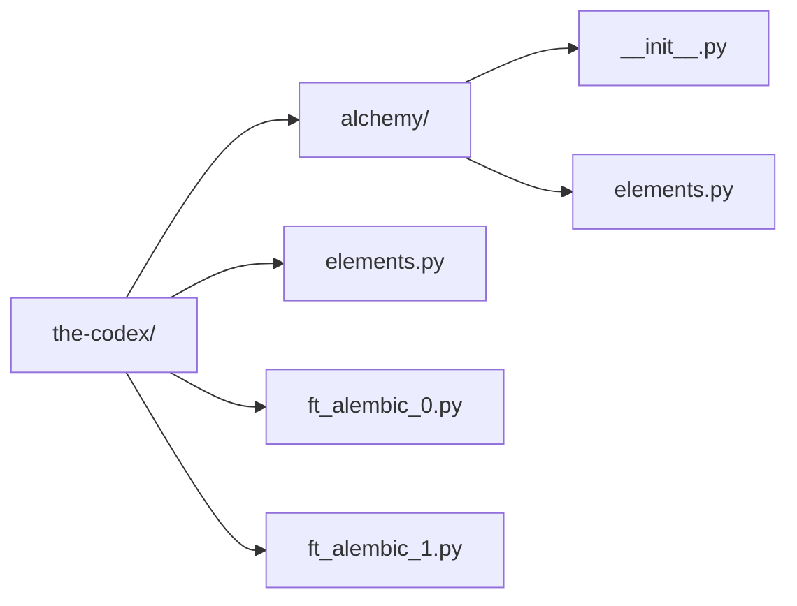

# Os arquivos completos

Os cinco arquivos do exercício 2.

```python title="elements.py"
def create_fire() -> str:
    return "Fire element created"


def create_water() -> str:
    return "Water element created"
```

```python title="alchemy/__init__.py"
from .elements import create_air

__all__ = ["create_air"]
```

```python title="alchemy/elements.py"
def create_earth() -> str:
    return "Earth element created"


def create_air() -> str:
    return "Air element created"
```

```python title="ft_alembic_0.py"
import elements

if __name__ == "__main__":
    print("=== Alembic 0 ===")
    print("Using: 'import ...' structure to access elements.py")
    print(f"Testing create_fire: {elements.create_fire()}")
```

```python title="ft_alembic_1.py"
import alchemy

if __name__ == "__main__":
    print("=== Alembic 1 ===")
    print("Accessing the alchemy module using 'import alchemy'")
    print(f"Testing create_air: {alchemy.create_air()}")
    print("Now show that not all functions can be reached")
    print("This will raise an exception!")
    print("Testing the hidden create_earth: ", end="")
    print(f"{alchemy.create_earth()}")
```

Nenhum `import` de fora do projeto: os dois programas importam `elements` e `alchemy`, e o
`__init__.py` importa o `alchemy/elements.py`. A única função embutida usada é `print`.

Depois deste exercício, a raiz do projeto fica assim (sem contar `ex0`, `ex1`, `experimentos` e os
ambientes virtuais):


