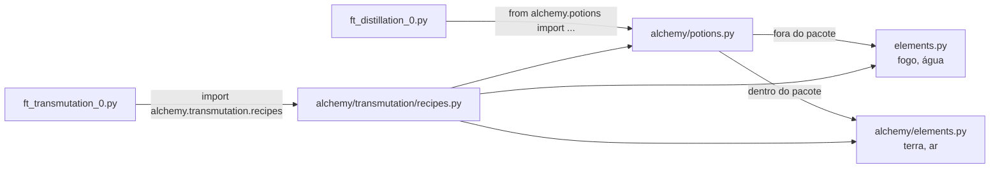

# O problema

Os elementos existem, mas sozinhos não fazem nada: as poções e as receitas os combinam. O código
que combina mora num módulo do pacote, e precisa alcançar elementos dentro e fora do pacote; a
receita mais elaborada mora um nível abaixo, num subpacote, e precisa subir até o pacote de cima.
O exercício 3 é sobre esses caminhos: de módulo para módulo, para fora do pacote e entre um
subpacote e o pacote que o contém.

## O que o enunciado pede

Os `import` permitidos continuam sendo só os dos módulos do projeto.

### Destilação

| Arquivo | Conteúdo |
|---|---|
| `alchemy/potions.py` | `healing_potion()`, que devolve `Healing potion brewed with '<terra>' and '<ar>'`; `strength_potion()`, que devolve `Strength potion brewed with '<fogo>' and '<água>'`; e o que mais for preciso para alcançar os quatro elementos, dois dos quais moram fora do pacote |
| `ft_distillation_0.py` | usa a estrutura `from ... import ...` para chegar direto ao `alchemy/potions.py` e prepara as duas poções |

Nas frases, `<terra>`, `<ar>`, `<fogo>` e `<água>` são os textos devolvidos pelas funções de cada
elemento, como `Earth element created`.

### A Grande Transmutação

| Arquivo | Conteúdo |
|---|---|
| `alchemy/transmutation/` | um **subpacote**: uma pasta com `__init__.py` dentro do pacote `alchemy` |
| `alchemy/transmutation/recipes.py` | `lead_to_gold()`, que devolve `Recipe transmuting Lead to Gold: brew '<ar>' and '<poção de força>' mixed with '<fogo>'`, e **pelo menos um import absoluto e um relativo** |
| `ft_transmutation_0.py` | usa a estrutura `import ...` para chegar direto ao `alchemy/transmutation/recipes.py` e transmuta chumbo em ouro (*lead to gold*) |

`<poção de força>` é a frase inteira de `strength_potion()`, com as aspas dela.

## A saída esperada

```text
=== Distillation 0 ===
Direct access to alchemy/potions.py
Testing strength_potion: Strength potion brewed with 'Fire element created' and 'Water element created'
Testing healing_potion: Healing potion brewed with 'Earth element created' and 'Air element created'
```

```text
=== Transmutation 0 ===
Using file alchemy/transmutation/recipes.py directly
Testing lead to gold: Recipe transmuting Lead to Gold: brew 'Air element created' and 'Strength potion brewed with 'Fire element created' and 'Water element created'' mixed with 'Fire element created'
```

A última linha da transmutação é uma linha só, longa; no enunciado ela aparece quebrada em duas
pela largura da página. As aspas simples de dentro da poção de força e as de fora ficam lado a
lado no fim (`created''`), sem nenhum tratamento especial: a frase da poção entra inteira entre
aspas.

## Os caminhos deste exercício


