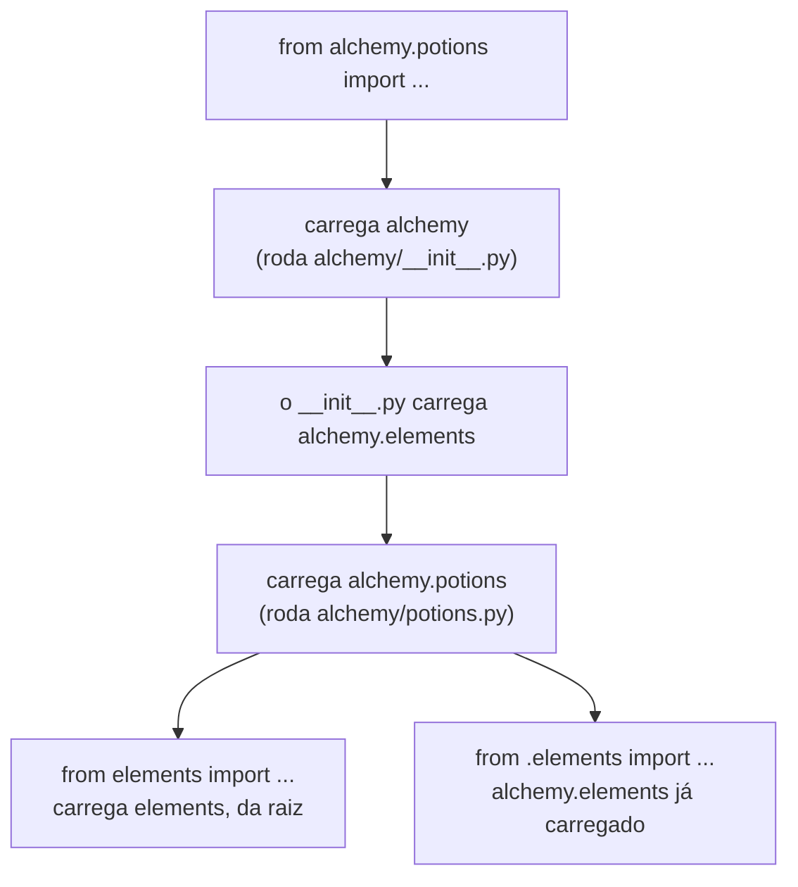

# ft_distillation_0.py

O programa da destilação usa a estrutura `from ... import ...` para chegar direto ao
`alchemy/potions.py`, sem passar pela interface do pacote. Crie `ft_distillation_0.py`, na raiz:

```python title="ft_distillation_0.py"
from alchemy.potions import healing_potion, strength_potion

if __name__ == "__main__":
    print("=== Distillation 0 ===")
    print("Direct access to alchemy/potions.py")
    print(f"Testing strength_potion: {strength_potion()}")
    print(f"Testing healing_potion: {healing_potion()}")
```

`from alchemy.potions import healing_potion, strength_potion` traz as duas funções pelo caminho
completo do módulo, `alchemy.potions`. "Direto" quer dizer isso: o `__init__.py` do `alchemy` não
expõe as poções, e nem precisa, porque o caminho completo chega ao módulo.

Mesmo assim, o `__init__.py` roda: para carregar `alchemy.potions`, o Python carrega antes o pacote
`alchemy`, e carregar um pacote é rodar o `__init__.py` dele. A ordem completa:



```bash
python3 ft_distillation_0.py
```

```text
=== Distillation 0 ===
Direct access to alchemy/potions.py
Testing strength_potion: Strength potion brewed with 'Fire element created' and 'Water element created'
Testing healing_potion: Healing potion brewed with 'Earth element created' and 'Air element created'
```

As duas linhas longas são uma linha cada; o terminal pode quebrá-las na largura da janela. A
ordem das poções é a do enunciado: força primeiro, cura depois.
