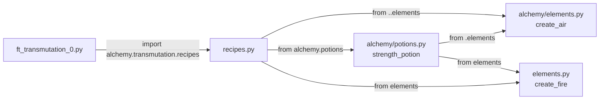

# ft_transmutation_0.py

O programa da transmutação usa a estrutura `import ...` para chegar direto ao
`alchemy/transmutation/recipes.py`. Crie `ft_transmutation_0.py`, na raiz:

```python title="ft_transmutation_0.py"
import alchemy.transmutation.recipes

if __name__ == "__main__":
    print("=== Transmutation 0 ===")
    print("Using file alchemy/transmutation/recipes.py directly")
    print("Testing lead to gold: "
          f"{alchemy.transmutation.recipes.lead_to_gold()}")
```

`import alchemy.transmutation.recipes` carrega três coisas, em ordem: o pacote `alchemy` (o
`__init__.py` dele), o subpacote `alchemy.transmutation` (o `__init__.py` vazio) e o módulo
`alchemy.transmutation.recipes`. Cada um vira atributo do anterior, e o nome que entra no arquivo
é só o primeiro, `alchemy`. Por isso a chamada usa o caminho inteiro,
`alchemy.transmutation.recipes.lead_to_gold()`. O último `print` foi dividido em dois textos
seguidos para caber nos 79 caracteres.

```bash
python3 ft_transmutation_0.py
```

```text
=== Transmutation 0 ===
Using file alchemy/transmutation/recipes.py directly
Testing lead to gold: Recipe transmuting Lead to Gold: brew 'Air element created' and 'Strength potion brewed with 'Fire element created' and 'Water element created'' mixed with 'Fire element created'
```

O caminho de cada ingrediente até a receita:



O fogo aparece duas vezes na frase (dentro da poção de força e no fim), e o `elements.py` da raiz
é carregado uma vez só: o segundo import dele acha o módulo já pronto em `sys.modules`
([O import circular](../04-conceitos/05-o-import-circular.md#como-um-import-roda-passo-a-passo)).
