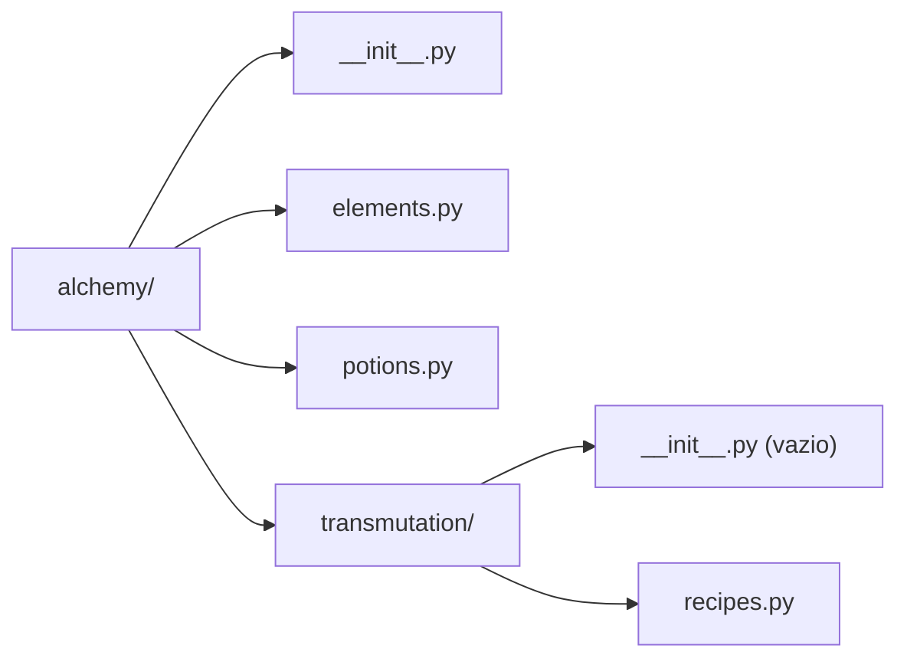

# Os arquivos completos

Os arquivos do exercício 3. O `alchemy/transmutation/__init__.py` é um arquivo vazio, criado com
`touch` ([O subpacote transmutation](./04-o-subpacote-transmutation.md#o-subpacote)).

```python title="alchemy/potions.py"
from elements import create_fire, create_water

from .elements import create_air, create_earth


def healing_potion() -> str:
    return (f"Healing potion brewed with '{create_earth()}'"
            f" and '{create_air()}'")


def strength_potion() -> str:
    return (f"Strength potion brewed with '{create_fire()}'"
            f" and '{create_water()}'")
```

```python title="alchemy/transmutation/recipes.py"
from alchemy.potions import strength_potion
from elements import create_fire

from ..elements import create_air


def lead_to_gold() -> str:
    return ("Recipe transmuting Lead to Gold: "
            f"brew '{create_air()}' and '{strength_potion()}'"
            f" mixed with '{create_fire()}'")
```

```python title="ft_distillation_0.py"
from alchemy.potions import healing_potion, strength_potion

if __name__ == "__main__":
    print("=== Distillation 0 ===")
    print("Direct access to alchemy/potions.py")
    print(f"Testing strength_potion: {strength_potion()}")
    print(f"Testing healing_potion: {healing_potion()}")
```

```python title="ft_transmutation_0.py"
import alchemy.transmutation.recipes

if __name__ == "__main__":
    print("=== Transmutation 0 ===")
    print("Using file alchemy/transmutation/recipes.py directly")
    print("Testing lead to gold: "
          f"{alchemy.transmutation.recipes.lead_to_gold()}")
```

Nenhum `import` de fora do projeto, e nenhuma função embutida além de `print`.

O pacote depois deste exercício:


