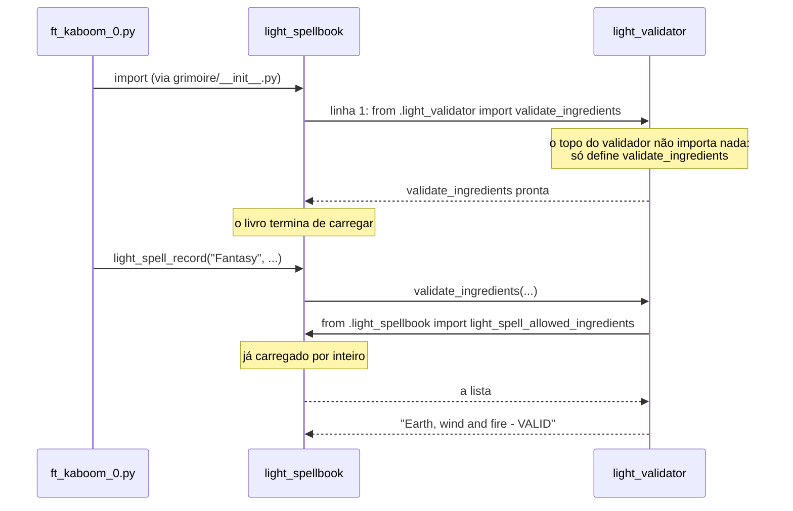

# O grimório da luz

O livro de feitiços da luz e o seu validador precisam um do outro. Um desenho simples faz os
dois funcionarem: o livro importa o validador no topo, como de costume, e o validador só busca o
livro quando valida, dentro da função.

Crie a pasta do subpacote:

```bash
mkdir alchemy/grimoire
```

## light_spellbook.py

```python title="alchemy/grimoire/light_spellbook.py"
from .light_validator import validate_ingredients


def light_spell_allowed_ingredients() -> list[str]:
    return ["earth", "air", "fire", "water"]


def light_spell_record(spell_name: str, ingredients: str) -> str:
    verdict = validate_ingredients(ingredients)
    if verdict.endswith(" - VALID"):
        return f"Spell recorded: {spell_name} ({verdict})"
    return f"Spell rejected: {spell_name} ({verdict})"
```

- `from .light_validator import validate_ingredients`, no topo: o livro depende do validador
  desde o carregamento;
- `light_spell_allowed_ingredients` devolve a lista do enunciado. O tipo `list[str]` é uma lista
  de textos;
- `light_spell_record` pede o veredito ao validador e decide pelo texto que recebe.
  `texto.endswith(fim)` responde se o texto termina com `fim`. O veredito válido termina com
  ` - VALID`; o inválido termina com ` - INVALID`, que **não** termina com ` - VALID` (antes do
  `VALID` vem um `IN`, e não o espaço). A decisão de registrar vem do validador, como o enunciado
  pede: o livro só lê o veredito.

O formato `Spell recorded: Fantasy (Earth, wind and fire - VALID)` é o do enunciado: o nome, e o
veredito do validador entre parênteses. `Spell rejected:` ("feitiço rejeitado"), para o caso
inválido, é escolha do tutorial, no mesmo formato.

## light_validator.py

```python title="alchemy/grimoire/light_validator.py"
def validate_ingredients(ingredients: str) -> str:
    from .light_spellbook import light_spell_allowed_ingredients

    lowered = ingredients.lower()
    for allowed in light_spell_allowed_ingredients():
        if allowed in lowered:
            return f"{ingredients} - VALID"
    return f"{ingredients} - INVALID"
```

- o import do livro fica **dentro da função**, na primeira linha dela, e não no topo do arquivo.
  É a decisão que impede a explosão (abaixo). A linha em branco depois dele separa o import do
  resto do código, como no topo de um arquivo;
- `ingredients.lower()` põe o texto em minúsculas, e a lista do livro já está em minúsculas: a
  comparação fica sem diferença entre maiúsculas e minúsculas, como o enunciado pede. `Earth`
  vira `earth`;
- `allowed in lowered` pergunta se o ingrediente aparece em algum lugar do texto. Basta um: no
  primeiro encontrado, a função devolve `VALID`. Se o laço termina sem achar nenhum, `INVALID`;
- o texto devolvido traz os ingredientes como foram recebidos, sem o `lower()`, seguidos de
  ` - VALID` ou ` - INVALID`. O enunciado pede "os ingredientes e a palavra"; o separador ` - ` vem
  da saída de exemplo.

Procurar o ingrediente como trecho do texto é escolha do tutorial, a mais simples: `"fire"` é
encontrado em `"Earth, wind and fire"` sem precisar separar as palavras. A consequência é que um
trecho dentro de outra palavra também conta (`"air"` aparece em `"hair"`). Separar o texto em
palavras resolveria isso, mas exigiria decidir o que separa uma palavra da outra (vírgulas,
espaços, `and`), e o enunciado não pede.

## Por que não explode

Quem importa primeiro o livro (o caso do `ft_kaboom_0.py`):



Carregar o validador não exige o livro: o topo do `light_validator.py` não importa nada. O livro só
é buscado quando `validate_ingredients` é chamada, e nessa hora ele já terminou de carregar.

Neste pacote, o livro é sempre o primeiro a carregar, mesmo quando um programa pede só o
validador: importar qualquer módulo de dentro do `grimoire` roda antes o `__init__.py` dele
([O \_\_init\_\_.py do grimoire](./03-o-init-do-grimoire.md)), que importa o livro, e o livro
importa o validador ([Rodar e conferir](./07-rodar-e-conferir.md#a-ordem-real-dos-imports)). O
desenho não depende disso: com um `__init__.py` vazio e o validador carregado sozinho, o validador
carregaria sem tocar no livro, e o livro só entraria na primeira validação.

A decisão de projeto: **o validador depende do livro na hora de validar, e não na hora de
carregar**. A dependência mútua continua existindo, mas o círculo não se fecha durante o
carregamento dos módulos.
