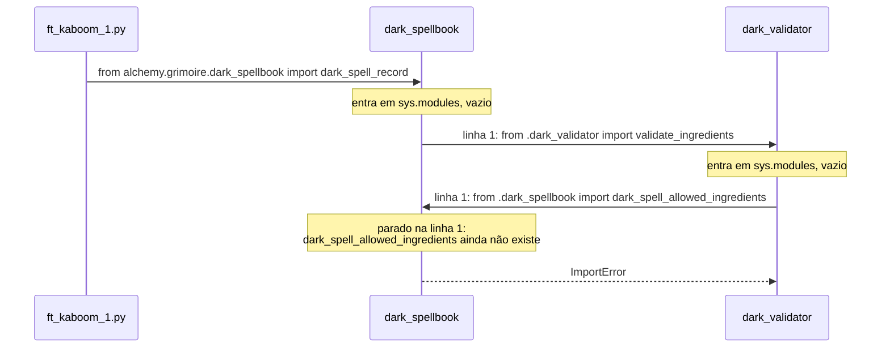

# O grimório das trevas

O par das trevas faz o mesmo trabalho que o da luz, com outros ingredientes, e com **uma** decisão
diferente, escolhida de propósito: o validador importa o livro **no topo**, no carregamento, e não
na hora de validar. O livro também importa o validador no topo, como o da luz. É o jeito ingênuo
de escrever a dependência mútua, e ele quebra.

## dark_spellbook.py

```python title="alchemy/grimoire/dark_spellbook.py"
from .dark_validator import validate_ingredients


def dark_spell_allowed_ingredients() -> list[str]:
    return ["bats", "frogs", "arsenic", "eyeball"]


def dark_spell_record(spell_name: str, ingredients: str) -> str:
    verdict = validate_ingredients(ingredients)
    if verdict.endswith(" - VALID"):
        return f"Spell recorded: {spell_name} ({verdict})"
    return f"Spell rejected: {spell_name} ({verdict})"
```

O livro das trevas é o livro da luz com os nomes `dark_` e os ingredientes sombrios: a regra de
registrar é a mesma, e o import do validador fica no topo nos dois. A diferença do exercício não
está aqui.

## dark_validator.py

```python title="alchemy/grimoire/dark_validator.py"
from .dark_spellbook import dark_spell_allowed_ingredients


def validate_ingredients(ingredients: str) -> str:
    lowered = ingredients.lower()
    for allowed in dark_spell_allowed_ingredients():
        if allowed in lowered:
            return f"{ingredients} - VALID"
    return f"{ingredients} - INVALID"
```

Aqui está a diferença: `from .dark_spellbook import dark_spell_allowed_ingredients` no topo do
arquivo, e não dentro da função. O resto do validador é o da luz.

## Por que explode



O livro começa a carregar e, na linha 1, pede o validador. O validador começa a carregar e, na
linha 1, pede ao livro o nome `dark_spell_allowed_ingredients`. O livro está em `sys.modules`, mas
parado na linha 1, e o `def` dessa função ainda não rodou: o nome não existe, e o import lança
`ImportError` ([O import circular](../04-conceitos/05-o-import-circular.md)).

A ordem não salva o par: começando pelo validador, ele pede o livro na linha 1, e o livro pede de
volta o `validate_ingredients`, que também ainda não existe
([Rodar e conferir](./07-rodar-e-conferir.md#a-outra-ordem-também-explode)).

## A comparação

| | Luz | Trevas |
|---|---|---|
| o livro importa o validador | no topo | no topo |
| o validador importa o livro | dentro de `validate_ingredients`, na hora de validar | no topo, na hora de carregar |
| carregar o validador exige o livro? | não | sim |
| resultado | funciona, em qualquer ordem de import | `ImportError`, em qualquer ordem de import |

O flake8 e o mypy aceitam os dois pares sem nenhum aviso: o problema não é de estilo nem de tipo,
é da ordem em que o código roda.
