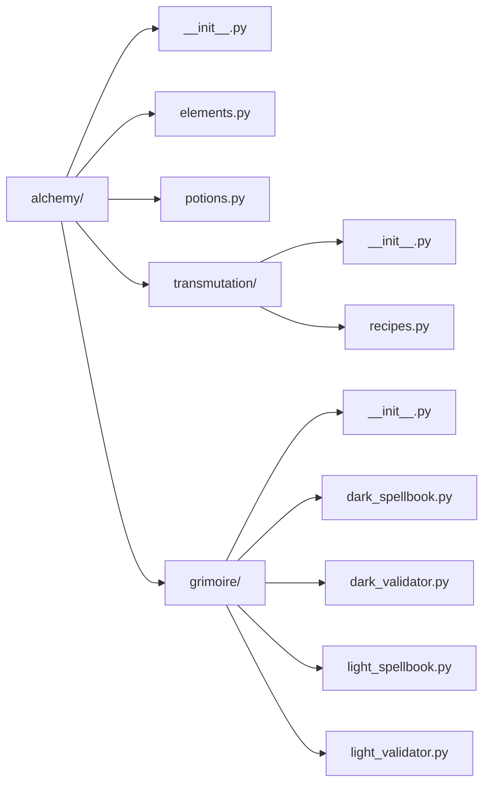

# Os arquivos completos

Os arquivos do exercício 4.

```python title="alchemy/grimoire/__init__.py"
from .light_spellbook import light_spell_record

__all__ = ["light_spell_record"]
```

```python title="alchemy/grimoire/light_spellbook.py"
from .light_validator import validate_ingredients


def light_spell_allowed_ingredients() -> list[str]:
    return ["earth", "air", "fire", "water"]


def light_spell_record(spell_name: str, ingredients: str) -> str:
    verdict = validate_ingredients(ingredients)
    if verdict.endswith(" - VALID"):
        return f"Spell recorded: {spell_name} ({verdict})"
    return f"Spell rejected: {spell_name} ({verdict})"
```

```python title="alchemy/grimoire/light_validator.py"
def validate_ingredients(ingredients: str) -> str:
    from .light_spellbook import light_spell_allowed_ingredients

    lowered = ingredients.lower()
    for allowed in light_spell_allowed_ingredients():
        if allowed in lowered:
            return f"{ingredients} - VALID"
    return f"{ingredients} - INVALID"
```

```python title="alchemy/grimoire/dark_spellbook.py"
from .dark_validator import validate_ingredients


def dark_spell_allowed_ingredients() -> list[str]:
    return ["bats", "frogs", "arsenic", "eyeball"]


def dark_spell_record(spell_name: str, ingredients: str) -> str:
    verdict = validate_ingredients(ingredients)
    if verdict.endswith(" - VALID"):
        return f"Spell recorded: {spell_name} ({verdict})"
    return f"Spell rejected: {spell_name} ({verdict})"
```

```python title="alchemy/grimoire/dark_validator.py"
from .dark_spellbook import dark_spell_allowed_ingredients


def validate_ingredients(ingredients: str) -> str:
    lowered = ingredients.lower()
    for allowed in dark_spell_allowed_ingredients():
        if allowed in lowered:
            return f"{ingredients} - VALID"
    return f"{ingredients} - INVALID"
```

```python title="ft_kaboom_0.py"
from alchemy.grimoire import light_spell_record

if __name__ == "__main__":
    print("=== Kaboom 0 ===")
    print("Using grimoire module directly")
    print("Testing record light spell: "
          f"{light_spell_record('Fantasy', 'Earth, wind and fire')}")
```

```python title="ft_kaboom_1.py"
if __name__ == "__main__":
    print("=== Kaboom 1 ===")
    print("Access to alchemy/grimoire/dark_spellbook.py directly")
    print("Test import now - THIS WILL RAISE AN UNCAUGHT EXCEPTION")
    from alchemy.grimoire.dark_spellbook import dark_spell_record

    print("Testing record dark spell: "
          f"{dark_spell_record('Curse', 'bats and frogs')}")
```

Nenhum `import` de fora do projeto. Funções e métodos embutidos usados: `print` e os métodos de
texto `lower` e `endswith`.

O pacote `alchemy` completo, com os três exercícios:


