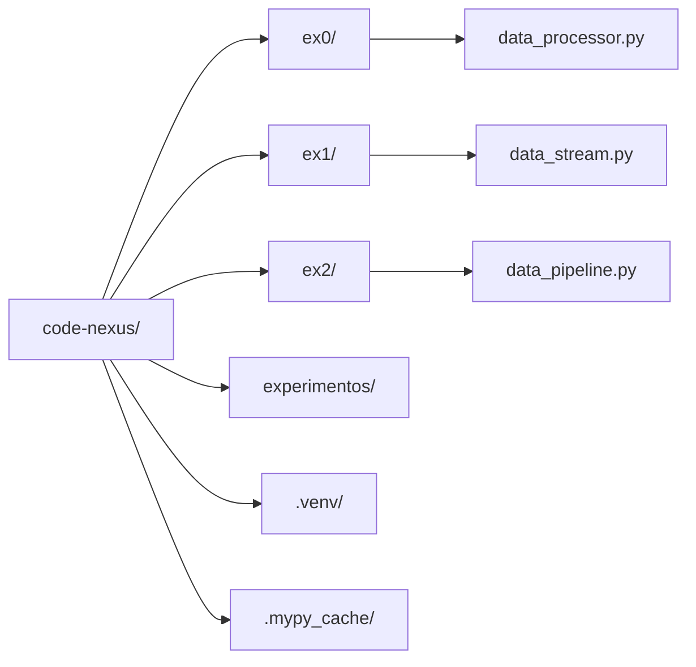

# A pasta do projeto

O enunciado pede cada exercício num arquivo próprio, dentro de uma pasta com o número do
exercício: `ex0/`, `ex1/` e `ex2/`. Crie uma pasta para o projeto, entre nela e crie as três
pastas:

```bash
mkdir code-nexus
cd code-nexus
mkdir ex0 ex1 ex2
```

`mkdir` cria uma pasta (ou várias, com os nomes em sequência). O nome `code-nexus` é só uma
sugestão; o que o enunciado fixa são as pastas `ex0` a `ex2` e os nomes dos arquivos. **Todos os
comandos do tutorial são rodados a partir desta pasta**, a `code-nexus`.

Crie também uma pasta `experimentos`, para os programas pequenos que a parte
[Classes abstratas e polimorfismo](../02-conceitos/01-sobrescrever-um-metodo.md) usa para mostrar
cada ideia. Eles não fazem parte da entrega:

```bash
mkdir experimentos
```

Ao fim do projeto, a pasta fica assim:



A pasta `.venv/` é criada na [próxima página](./03-o-ambiente-virtual.md), e a `.mypy_cache/` é
criada pelo mypy na primeira vez que ele roda, para guardar resultados e conferir mais rápido da
próxima vez. Só os três arquivos `.py` das pastas `ex0` a `ex2` são entregues.
