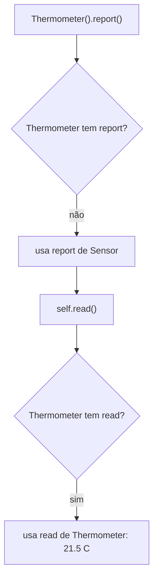

# Sobrescrever um método

Uma classe filha herda os métodos da mãe ([Pré-requisitos](../00-introducao/03-pre-requisitos.md)).
Quando a filha precisa fazer a mesma tarefa de outro jeito, ela **sobrescreve** (*override*) o
método: define um método com o **mesmo nome**, e esse passa a valer para os objetos dela.

## O experimento

Crie `experimentos/sobrescrever.py`. Um sensor genérico não sabe ler nada; um termômetro sabe:

```python title="experimentos/sobrescrever.py"
class Sensor:
    def read(self) -> str:
        return "no data"

    def report(self) -> str:
        return f"Sensor says: {self.read()}"


class Thermometer(Sensor):
    def read(self) -> str:
        return "21.5 C"


print(Sensor().report())
print(Thermometer().report())
```

```bash
python3 experimentos/sobrescrever.py
```

```text
Sensor says: no data
Sensor says: 21.5 C
```

## O que aconteceu

`Thermometer` não define `report`: herda o de `Sensor`. Mas define `read`, que **sobrescreve** o
`read` de `Sensor`.

Dentro de `report`, a chamada é `self.read()`. Quem decide qual `read` roda é o objeto guardado
em `self`, não a classe onde `report` foi escrito:

- em `Sensor().report()`, `self` é um `Sensor`, e roda o `read` de `Sensor`;
- em `Thermometer().report()`, `self` é um `Thermometer`, e roda o `read` de `Thermometer`.

O Python procura o método primeiro na classe do objeto e, se não achar, sobe para a classe mãe.



Esse é o mecanismo de todo o projeto: a classe mãe escreve o que é comum (aqui, `report`) e
chama métodos que cada filha preenche do seu jeito (aqui, `read`).

## O problema do sensor genérico

`Sensor().report()` funcionou, mas não faz sentido: um sensor genérico não lê nada, e o
`"no data"` é só um valor inventado para o método existir. A
[próxima página](./02-a-classe-abstrata.md) mostra como dizer ao Python que `Sensor` serve só de
molde e que toda filha **precisa** escrever o próprio `read`.
