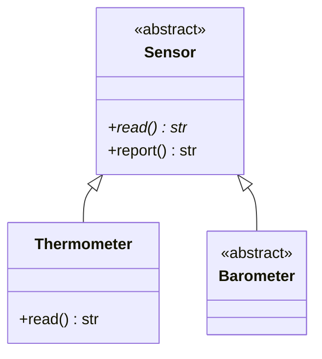

# A classe abstrata

Uma **classe abstrata** é uma classe que serve só de molde: ela não pode ser instanciada (não se
cria objeto dela) e lista os métodos que toda classe filha é obrigada a escrever. Esses métodos
obrigatórios se chamam **métodos abstratos**.

O Python faz isso com o módulo `abc` (de *Abstract Base Classes*, "classes base abstratas"), um
dos dois `import` que o enunciado permite. Dele vêm duas peças:

- `ABC`: a classe da qual uma classe herda para virar abstrata;
- `@abstractmethod`: a marca que se põe em cima de um método para torná-lo abstrato.

Uma linha que começa com `@` em cima de um `def` é um **decorador**: ela modifica o método
logo abaixo. `@abstractmethod` registra o método como "obrigatório nas filhas".

## O experimento

Crie `experimentos/abstrata.py`. É o sensor da [página anterior](./01-sobrescrever-um-metodo.md),
agora abstrato, com duas filhas: uma que escreve `read` e outra que esquece:

```python title="experimentos/abstrata.py"
from abc import ABC, abstractmethod


class Sensor(ABC):
    @abstractmethod
    def read(self) -> str:
        pass

    def report(self) -> str:
        return f"Sensor says: {self.read()}"


class Thermometer(Sensor):
    def read(self) -> str:
        return "21.5 C"


class Barometer(Sensor):
    pass


print(Thermometer().report())
try:
    Sensor()
except TypeError as error:
    print(f"Sensor(): {error}")
try:
    Barometer()
except TypeError as error:
    print(f"Barometer(): {error}")
```

- `from abc import ABC, abstractmethod` traz as duas peças do módulo `abc`;
- `class Sensor(ABC)` faz `Sensor` herdar de `ABC`;
- o corpo de `read` é só `pass`, a instrução que não faz nada. Um método abstrato não precisa de
  corpo de verdade: quem o executa é sempre a versão da filha;
- `report` é um método **comum** (concreto): tem corpo e as filhas herdam como está;
- `class Barometer(Sensor): pass` cria uma filha sem nenhum método próprio.

```bash
python3 experimentos/abstrata.py
```

```text
Sensor says: 21.5 C
Sensor(): Can't instantiate abstract class Sensor without an implementation for abstract method 'read'
Barometer(): Can't instantiate abstract class Barometer without an implementation for abstract method 'read'
```

No Python 3.10 e no 3.11, a mensagem é mais curta, com o mesmo sentido:
`Can't instantiate abstract class Sensor with abstract method read`.

## O que aconteceu

- `Thermometer()` funciona: a filha escreveu o único método abstrato;
- `Sensor()` lança `TypeError` ("não dá para instanciar a classe abstrata `Sensor` sem uma
  implementação do método abstrato `read`");
- `Barometer()` também: herdar de uma classe abstrata sem escrever os métodos abstratos deixa a
  filha abstrata também.

O erro aparece na hora de **criar** o objeto, não quando o método seria chamado. Uma filha
incompleta é descoberta logo, e não no meio do programa.

## O mypy acusa antes

```bash
.venv/bin/mypy --disallow-untyped-defs experimentos/abstrata.py
```

```text
experimentos/abstrata.py:24: error: Cannot instantiate abstract class "Sensor" with abstract attribute "read"  [abstract]
experimentos/abstrata.py:28: error: Cannot instantiate abstract class "Barometer" with abstract attribute "read"  [abstract]
Found 2 errors in 1 file (checked 1 source file)
```

O mypy encontra os dois erros sem rodar o programa. Neste experimento eles são o assunto; no
código dos exercícios, nenhuma classe abstrata é instanciada.

## A classe abstrata do projeto

O exercício 0 começa com uma classe abstrata, `DataProcessor`, com dois métodos abstratos
(`validate` e `ingest`) e um comum (`output`), no mesmo formato de `Sensor`
([A classe base](../03-ex0/02-a-classe-base.md)).



No diagrama, cada caixa é uma classe: o nome em cima e, embaixo, os métodos no formato
`+nome() : tipo do retorno`. O `+` quer dizer que o método é público, feito para ser chamado de
fora da classe. A seta de ponta vazada aponta da filha para a mãe. O método abstrato aparece em
itálico, e «abstract», em cima do nome, marca as classes que não podem ser instanciadas.
