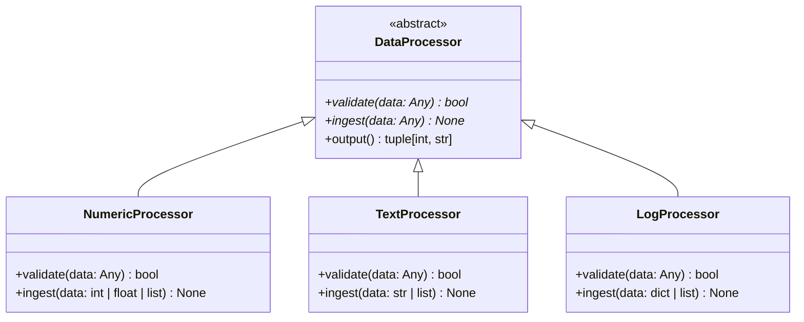

# Polimorfismo

**Polimorfismo** ("muitas formas") é escrever código que trabalha com a classe mãe e funciona com
qualquer filha. O código chama um método; cada objeto responde com a sua própria versão dele.
Quem chama não precisa saber qual é a classe de cada objeto.

## O experimento

Crie `experimentos/polimorfismo.py`, com o sensor abstrato e duas filhas:

```python title="experimentos/polimorfismo.py"
from abc import ABC, abstractmethod


class Sensor(ABC):
    @abstractmethod
    def read(self) -> str:
        pass

    def report(self) -> str:
        return f"Sensor says: {self.read()}"


class Thermometer(Sensor):
    def read(self) -> str:
        return "21.5 C"


class Hygrometer(Sensor):
    def read(self) -> str:
        return "humidity 60%"


sensors: list[Sensor] = [Thermometer(), Hygrometer(), Thermometer()]
for sensor in sensors:
    print(sensor.report())
```

```bash
python3 experimentos/polimorfismo.py
```

```text
Sensor says: 21.5 C
Sensor says: humidity 60%
Sensor says: 21.5 C
```

## O que aconteceu

- `sensors: list[Sensor]` é uma lista de sensores. Um `Thermometer` **é um** `Sensor` (herda
  dele), e por isso entra numa lista de `Sensor`;
- o laço só conhece `Sensor`: chama `sensor.report()` em cada item, sem nenhum `if` sobre a
  classe;
- cada objeto responde do seu jeito, porque o `self.read()` dentro de `report` roda a versão da
  classe de cada um ([Sobrescrever um método](./01-sobrescrever-um-metodo.md)).

Para acrescentar um sensor novo, basta escrever outra classe filha com o seu `read`. O laço não
muda.

## No projeto

O exercício 0 cria a mesma estrutura, com processadores de dados no lugar dos sensores:



No exercício 1, a classe `DataStream` faz o papel do laço: guarda uma lista de `DataProcessor`,
pergunta a cada um `validate(dado)` e entrega o dado com `ingest(dado)` ao primeiro que aceitar,
sem saber se ele processa números, textos ou logs
([Registrar e rotear](../04-ex1/03-registrar-e-rotear.md)).
