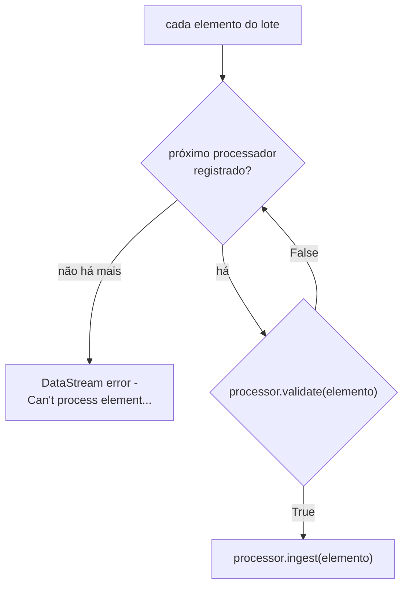

# Registrar e rotear

**Rotear** um dado é escolher para onde ele vai. `DataStream` guarda uma lista de processadores
registrados e, para cada elemento do fluxo, pergunta a eles, em ordem, quem aceita o elemento.

## Registrar

A classe `DataStream` entra no arquivo depois de `LogProcessor`; os três métodos desta página e
o da [próxima](./04-as-estatisticas.md) ficam dentro dela, na ordem do
[arquivo completo](./06-o-arquivo-completo.md).

```python
class DataStream:
    def __init__(self) -> None:
        self._processors: list[DataProcessor] = []

    def register_processor(self, proc: DataProcessor) -> None:
        self._processors.append(proc)
```

- `self._processors` é a lista dos processadores registrados, do tipo `list[DataProcessor]`.
  Qualquer filha de `DataProcessor` entra nela;
- `register_processor` acrescenta o processador no fim da lista. A assinatura, com o parâmetro
  `proc`, é a do enunciado.

## Achar o processador

```python
    def _find_processor(self, element: Any) -> DataProcessor | None:
        for processor in self._processors:
            if processor.validate(element):
                return processor
        return None
```

`_find_processor` é um método auxiliar, escolha do tutorial: percorre os processadores na ordem
em que foram registrados e devolve o **primeiro** cujo `validate` aceita o elemento. Se nenhum
aceita, o laço termina e a função devolve `None`, o valor que quer dizer "nada". O tipo de
retorno `DataProcessor | None` diz exatamente isso: um processador ou nada.

A linha `processor.validate(element)` é o polimorfismo do exercício: o método não sabe se
`processor` é de números, de textos ou de logs. Cada um responde com o seu `validate`.

## Processar o fluxo

```python
    def process_stream(self, stream: list[Any]) -> None:
        for element in stream:
            processor = self._find_processor(element)
            if processor is None:
                print("DataStream error - "
                      f"Can't process element in stream: {element}")
            else:
                processor.ingest(element)
```

- `stream: list[Any]` é a assinatura do enunciado, `list[typing.Any]`, com o `Any` importado de
  `typing` ([Any: qualquer tipo](../02-conceitos/03-any-uniao-e-isinstance.md#any-qualquer-tipo));
- `processor is None` pergunta se `_find_processor` não achou ninguém. Nesse caso, a mensagem de
  erro é impressa e o laço segue para o próximo elemento: um dado recusado não para o fluxo;
- a mensagem é longa demais para uma linha de 79 caracteres, e foi dividida em dois textos
  seguidos dentro dos parênteses. O Python junta textos escritos lado a lado num só:
  `"ab" "cd"` é `"abcd"`;
- se achou, `processor.ingest(element)` guarda o elemento.

Este `ingest` nunca lança exceção: o elemento só chega a ele depois que o `validate` do mesmo
processador o aceitou.

## O primeiro lote

O cenário do enunciado envia este lote com só o processador de números registrado, e depois de
novo com os três:


Os totais das estatísticas (4, 3 e 2) saem desta conta: a lista `[3.14, -1, 2.71]` dá 3 itens e
o `42` dá 1, total 4 para o processador de números; `'Hello world'` e `['Hi', 'five']` dão 3
itens de texto; a lista de logs dá 2.


