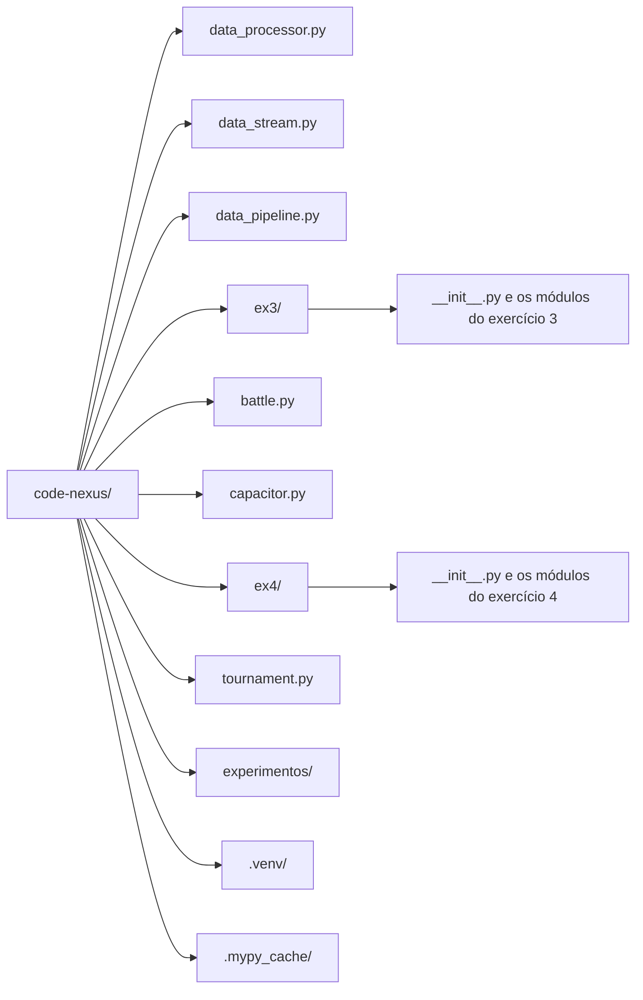

# A pasta do projeto

O enunciado fixa onde fica cada arquivo: os exercícios 0 a 2 e todos os scripts de teste ficam
soltos na pasta principal, e os exercícios 3 e 4 ficam nas pastas `ex3/` e `ex4/`. Crie uma
pasta para o projeto, entre nela e crie as duas pastas:

```bash
mkdir code-nexus
cd code-nexus
mkdir ex3 ex4
```

`mkdir` cria uma pasta (ou várias, com os nomes em sequência). O nome `code-nexus` é só uma
sugestão; o que o enunciado fixa são os nomes dos arquivos e das pastas `ex3` e `ex4`. **Todos os
comandos do tutorial são rodados a partir desta pasta**, a `code-nexus`. Ela faz o papel da
**raiz do repositório** de que o enunciado fala: a pasta principal da entrega.

Crie também uma pasta `experimentos`, para os programas pequenos que as partes de conceitos usam
para mostrar cada ideia. Eles não fazem parte da entrega:

```bash
mkdir experimentos
```

Ao fim do projeto, a pasta fica assim:



A pasta `.venv/` é criada na [próxima página](./03-o-ambiente-virtual.md), e a `.mypy_cache/` é
criada pelo mypy na primeira vez que ele roda, para guardar resultados e conferir mais rápido da
próxima vez. São entregues os seis arquivos `.py` da raiz e os arquivos `.py` das pastas `ex3` e
`ex4`.
