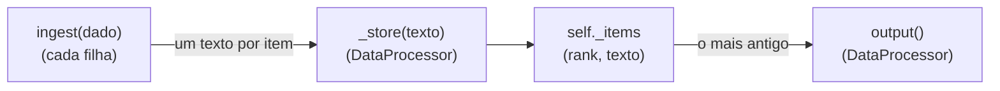

# A classe base

`DataProcessor` é a classe mãe dos três processadores. Ela guarda a fila de itens, declara os
dois métodos que cada filha escreve e implementa o `output`, pedido pelo enunciado, e um método
auxiliar, `_store`.

Crie o arquivo `data_processor.py` e escreva nele o código abaixo. As páginas seguintes
acrescentam o resto, sempre no fim do arquivo, nesta ordem:

1. as funções de conferência `is_number`, `is_text`, `is_log` e `is_list_of`
   ([Numeric Processor](./03-numeric-processor.md), [Text Processor](./04-text-processor.md) e
   [Log Processor](./05-log-processor.md));
2. as classes `NumericProcessor`, `TextProcessor` e `LogProcessor`;
3. as funções de teste e o `main` ([A demonstração](./07-a-demonstracao.md)).

A página [O arquivo completo](./08-o-arquivo-completo.md) mostra o resultado, para conferir.

```python
from abc import ABC, abstractmethod
from typing import Any, Callable


class DataProcessor(ABC):
    def __init__(self) -> None:
        self._items: list[tuple[int, str]] = []
        self._rank = 0

    @abstractmethod
    def validate(self, data: Any) -> bool:
        pass

    @abstractmethod
    def ingest(self, data: Any) -> None:
        pass

    def output(self) -> tuple[int, str]:
        return self._items.pop(0)

    def _store(self, value: str) -> None:
        self._items.append((self._rank, value))
        self._rank += 1
```

`Callable` é usado mais adiante, em [Numeric Processor](./03-numeric-processor.md).

## O estado do processador

O construtor cria dois atributos internos (o `_` no começo do nome diz que só a classe e as
filhas mexem neles):

- `self._items`: a fila, uma lista de tuplas `(rank, texto)`
  ([A fila](../02-conceitos/05-a-fila.md)). A anotação é obrigatória: a lista começa vazia, e o
  `append` fica em outro método, o `_store`
  ([O tipo de uma lista que começa vazia](../02-conceitos/05-a-fila.md#o-tipo-de-uma-lista-que-começa-vazia));
- `self._rank`: o rank que o **próximo** item vai receber. Começa em 0.

As filhas não escrevem `__init__`: herdam este. Cada objeto criado, como `NumericProcessor()`,
ganha a sua própria fila e o seu próprio contador.

## Os dois métodos abstratos

`validate` e `ingest` têm a assinatura exata do enunciado e corpo `pass`. Com
`@abstractmethod`, nenhuma filha pode ser instanciada sem escrever os dois
([A classe abstrata](../02-conceitos/02-a-classe-abstrata.md)), e o próprio `DataProcessor()`
lança `TypeError`.

## output

`output` devolve a tupla mais antiga e a tira da fila, com `pop(0)`. É o método comum que o
enunciado pede, e as filhas o herdam sem mudança. Com a fila vazia, o `pop(0)` lança
`IndexError`; quem chama `output` precisa saber que há itens. Nos testes do exercício 0, quem
chama sabe quantos itens guardou; a partir do exercício 1, a classe ganha um método que diz
quantos itens restam ([Nome e contadores](../04-ex1/02-nome-e-contadores.md)).

## _store: guardar um item

`_store` não está no enunciado: é um método auxiliar, escolha do tutorial. As três filhas
precisam acrescentar um texto na fila com o rank certo e avançar o contador; escrever isso uma
vez na mãe evita repetir as duas linhas em cada filha. O `_` no nome indica que ele é para uso
interno das classes, não para quem usa o processador.


