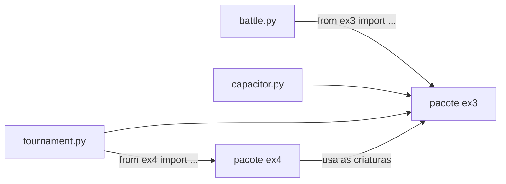

# O pacote

Os exercícios 3 e 4 têm várias classes cada um: criaturas, capacidades, fábricas, estratégias.
Num arquivo só, o código fica longo; em arquivos soltos na raiz, as peças dos dois exercícios se
misturam com os scripts de teste. O Python organiza isso com o **pacote** (*package*): uma pasta
de arquivos de código que é importada como uma peça só. O enunciado exige que `ex3/` e `ex4/`
sejam pacotes.

## Módulo e pacote

- Um **módulo** é um arquivo `.py`. `import data_pipeline` carrega o arquivo `data_pipeline.py`,
  e `from data_pipeline import DataStream` traz de lá o nome `DataStream`.
- Um **pacote** é uma pasta com um arquivo chamado `__init__.py`. `import greetings` roda o
  `__init__.py` da pasta `greetings`, e os nomes que esse arquivo define (ou importa) passam a
  ser os nomes do pacote. O Python 3 ainda consegue importar uma pasta sem esse arquivo, como um
  tipo especial de pacote, mas o enunciado exige o `__init__.py` em `ex3/` e em `ex4/`.
- Os outros arquivos `.py` da pasta são os **submódulos** do pacote: o arquivo `words.py` da
  pasta `greetings` é o módulo `greetings.words`.

Ao rodar `python3 algum/script.py`, o Python procura os módulos importados primeiro na pasta onde
o script está. Por isso os scripts de teste do projeto ficam na raiz, ao lado das pastas `ex3/` e
`ex4/`: dali, `from ex3 import ...` acha o pacote.

## O experimento

Crie a pasta do pacote dentro de `experimentos`:

```bash
mkdir experimentos/greetings
```

E, nela, três arquivos. O primeiro tem uma função que monta um cumprimento:

```python title="experimentos/greetings/words.py"
def hello(name: str) -> str:
    return f"Hello, {name}"
```

O segundo tem uma classe que usa essa função:

```python title="experimentos/greetings/polite.py"
from .words import hello


class Greeter:
    def greet(self, name: str) -> str:
        return hello(name) + ", nice to meet you!"
```

O ponto em `from .words import hello` é um **import relativo**: quer dizer "o módulo `words`
deste mesmo pacote". Sem o ponto, o Python procuraria um módulo `words` solto, fora do pacote, e
não acharia.

O terceiro é o `__init__.py`, com uma linha:

```python title="experimentos/greetings/__init__.py"
from .polite import Greeter
```

Ele traz `Greeter` para dentro do pacote: é o que permite escrever `from greetings import Greeter`
em vez de `from greetings.polite import Greeter`.

Por fim, um script fora do pacote, em `experimentos/pacote.py`:

```python title="experimentos/pacote.py"
from greetings import Greeter

print(Greeter().greet("Ada"))
```

```bash
python3 experimentos/pacote.py
```

```text
Hello, Ada, nice to meet you!
```

O script está em `experimentos/`, e é lá que o Python procura o `greetings`. Ao importar o
pacote, o Python cria a pasta `experimentos/greetings/__pycache__`, com uma cópia já traduzida
de cada módulo para carregar mais rápido da próxima vez; ela pode ser ignorada.

## O aviso do flake8

```bash
.venv/bin/flake8 experimentos/greetings
```

```text
experimentos/greetings/__init__.py:1:1: F401 '.polite.Greeter' imported but unused
```

"`Greeter` importado, mas não usado." O flake8 vê um `import` que nenhuma linha do próprio
arquivo usa e suspeita de uma sobra. No `__init__.py`, o `import` é de propósito: ele existe para
oferecer o nome a quem importa o pacote.

O jeito de dizer isso é a variável `__all__`: uma lista com os nomes **públicos** do módulo, os
que ele oferece a quem o importa. O flake8 considera usado todo nome que está no `__all__`. O
`__init__.py` fica assim:

```python title="experimentos/greetings/__init__.py"
from .polite import Greeter

__all__ = ["Greeter"]
```

```bash
.venv/bin/flake8 experimentos/greetings
.venv/bin/mypy --disallow-untyped-defs experimentos/greetings experimentos/pacote.py
```

```text
Success: no issues found in 4 source files
```

O flake8 não imprime nada, e o mypy confere os quatro arquivos sem achar problema.

## O que o pacote expõe

**Expor** um nome é oferecê-lo no próprio pacote, para quem faz `import greetings` ou
`from greetings import ...`. O pacote `greetings` expõe `Greeter`; a função `hello` é usada por
dentro, pelo `Greeter`, e não faz parte do que o pacote oferece. O enunciado do exercício 3 exige
exatamente isso: o pacote `ex3` expõe as fábricas e nunca as criaturas concretas.

Troque o `experimentos/pacote.py` por esta versão, que pergunta ao pacote o que ele tem:

```python title="experimentos/pacote.py"
import greetings
from greetings import Greeter

print(Greeter().greet("Ada"))
print(greetings.__all__)
print(hasattr(greetings, "Greeter"))
print(hasattr(greetings, "hello"))
print(hasattr(greetings, "words"))
```

Um pacote importado é um objeto como outro qualquer, e os nomes dele são atributos desse objeto.
`hasattr(objeto, "nome")`, uma função embutida, responde se o objeto tem um atributo com aquele
nome.

```bash
python3 experimentos/pacote.py
```

```text
Hello, Ada, nice to meet you!
['Greeter']
True
False
True
```

- `greetings.__all__` é a lista do `__init__.py`;
- `Greeter` está no pacote; `hello` não está. Um `from greetings import hello` falha com
  `ImportError: cannot import name 'hello' from 'greetings'` ("não dá para importar o nome
  `hello` de `greetings`");
- `words` está: ao importar um submódulo, o Python o registra como atributo do pacote, e
  `greetings.words.hello` continua alcançável.

O Python não esconde nada de verdade. Expor é um combinado, como o `_` no começo de um atributo
interno: o que o `__init__.py` oferece (e o `__all__` lista) é a porta de entrada do pacote, o
que quem o usa deve importar. Um submódulo continua importável pelo nome completo, como em
`from greetings.words import hello`; o projeto usa isso de forma pontual, para duas classes
abstratas que o pacote `ex3` não expõe
([A porta do pacote](../07-ex3/07-a-porta-do-pacote.md)).

## Um módulo do pacote não roda sozinho

Um arquivo de dentro do pacote não serve para ser rodado direto:

```bash
python3 experimentos/greetings/polite.py
```

A última linha da saída é:

```text
ImportError: attempted relative import with no known parent package
```

("import relativo sem pacote conhecido"). Rodado direto, o arquivo não faz parte de pacote
nenhum, e o ponto do `from .words` não tem para onde apontar. Os arquivos de um pacote são
importados; quem roda são os scripts de fora dele, como `battle.py`, `capacitor.py` e
`tournament.py` no projeto.

## No projeto



Os três scripts de teste ficam na raiz e importam os pacotes; o pacote `ex4` usa o `ex3`, porque
as estratégias agem sobre as criaturas. É isso que o enunciado quer dizer com "os exercícios 3 e
4 importam um ao outro".
