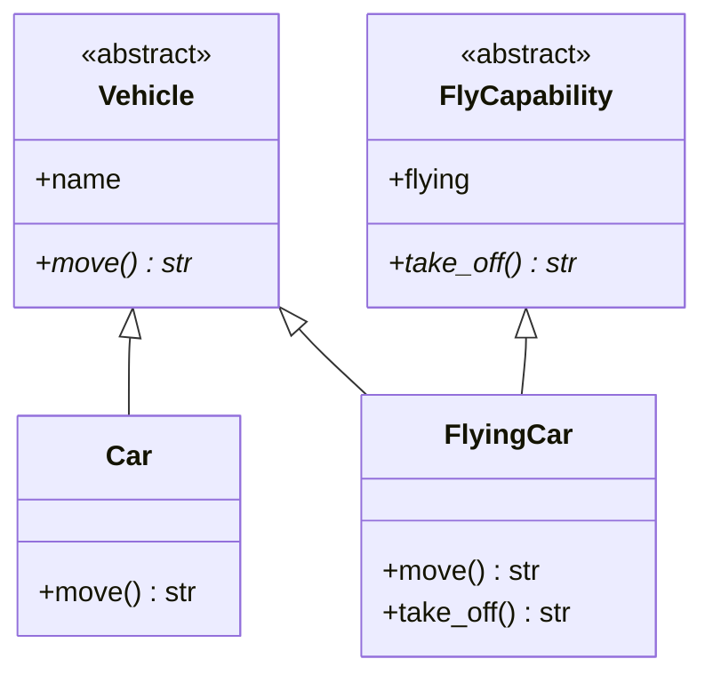

# Herança múltipla

O exercício 3 pede criaturas que herdam de duas classes ao mesmo tempo: de `Creature`, a família
de todas as criaturas, e de `TransformCapability`, a habilidade de se transformar, que **não** é
uma criatura. Uma classe com duas classes mães tem **herança múltipla**. Dois detalhes importam:
quem roda o construtor de cada mãe, e como um código que recebe "uma criatura qualquer" usa a
habilidade a mais.

## super(): o construtor da mãe

Quando a classe filha escreve o seu próprio `__init__`, ele **sobrescreve** o da mãe
([Sobrescrever um método](../02-conceitos/01-sobrescrever-um-metodo.md)): o `__init__` da mãe só
roda se a filha o chamar. Com uma mãe só, a chamada é `super().__init__(...)`. `super()` quer
dizer "a classe mãe", e `super().__init__("Car")` roda o construtor da mãe com o argumento
`"Car"`. Na classe `Car` do experimento abaixo, filha de `Vehicle`:

```python
class Car(Vehicle):
    def __init__(self) -> None:
        super().__init__("Car")
```

## O experimento

Crie `experimentos/heranca.py`. Um veículo tem um nome e sabe se mover; a capacidade de voar é
uma classe abstrata separada, que guarda se o veículo está voando. O carro comum só é um veículo;
o carro voador é as duas coisas:

```python title="experimentos/heranca.py"
from abc import ABC, abstractmethod


class Vehicle(ABC):
    def __init__(self, name: str) -> None:
        self.name = name

    @abstractmethod
    def move(self) -> str:
        pass


class FlyCapability(ABC):
    def __init__(self) -> None:
        self.flying = False

    @abstractmethod
    def take_off(self) -> str:
        pass


class Car(Vehicle):
    def __init__(self) -> None:
        super().__init__("Car")

    def move(self) -> str:
        return f"{self.name} drives"


class FlyingCar(Vehicle, FlyCapability):
    def __init__(self) -> None:
        super().__init__("FlyingCar")

    def move(self) -> str:
        if self.flying:
            return f"{self.name} flies"
        return f"{self.name} drives"

    def take_off(self) -> str:
        self.flying = True
        return f"{self.name} takes off"


def show(vehicle: Vehicle) -> None:
    print(vehicle.move())
    if isinstance(vehicle, FlyCapability):
        print(vehicle.take_off())
        print(vehicle.move())


show(Car())
show(FlyingCar())
```

- `class FlyingCar(Vehicle, FlyCapability)`: as duas mães vão entre parênteses, separadas por
  vírgula. `FlyingCar` recebe os métodos e atributos das duas e precisa escrever os métodos
  abstratos das duas: `move` e `take_off`;
- `FlyCapability` não herda de `Vehicle`: voar é uma habilidade, e não um tipo de veículo;
- `show` recebe um `Vehicle` qualquer e só usa a habilidade de voar se o objeto a tiver:
  `isinstance(vehicle, FlyCapability)` responde se o veículo também é um `FlyCapability`.

```bash
python3 experimentos/heranca.py
```

O carro comum funciona, e o voador quebra. A saída começa com a linha do carro comum,
`Car drives`; depois vem o traceback do carro voador, cuja última linha é:

```text
AttributeError: 'FlyingCar' object has no attribute 'flying'
```

"O objeto `FlyingCar` não tem o atributo `flying`." O mypy não vê o problema:

```bash
.venv/bin/mypy --disallow-untyped-defs experimentos/heranca.py
```

```text
Success: no issues found in 1 source file
```

## O que aconteceu: a ordem de busca

Para achar um método, o Python percorre as classes numa ordem fixa, a **MRO** (*method resolution
order*, "ordem de resolução de métodos"): primeiro a própria classe, depois as mães na ordem em
que foram escritas, e por fim as classes de onde as mães vêm (`ABC` e `object`, a classe de que
toda classe do Python descende). Para `FlyingCar`, a ordem é `FlyingCar`, `Vehicle`,
`FlyCapability`, `ABC`, `object`.

`super().__init__("FlyingCar")` roda o `__init__` da **próxima** classe dessa ordem, que é o de
`Vehicle`. Ele guarda o nome e termina. O `__init__` de `FlyCapability` nunca roda, o atributo
`flying` nunca é criado, e o `self.flying` de `move` falha. O mypy confere tipos, e não se cada
construtor rodou.

## A correção: chamar o construtor de cada mãe

O `__init__` de `FlyingCar` passa a chamar os dois construtores, cada um pelo nome da sua classe:

```python
class FlyingCar(Vehicle, FlyCapability):
    def __init__(self) -> None:
        Vehicle.__init__(self, "FlyingCar")
        FlyCapability.__init__(self)
```

Chamado pelo nome da classe, o método não recebe o objeto sozinho: o `self` vai escrito como
primeiro argumento. Cada construtor roda uma vez, na ordem em que aparece. Essa é a escolha do
tutorial para as criaturas do exercício 3: com duas mães cujos construtores recebem parâmetros
diferentes, é o jeito mais simples de ler e de conferir. (A alternativa é fazer todo `__init__`
chamar `super().__init__`, numa corrente que passa por todas as classes da MRO, o que exige que
todos os construtores aceitem e repassem argumentos uns dos outros.)

O arquivo completo, com o `__init__` corrigido e três linhas a mais no fim, que perguntam ao
Python sobre as classes:

```python title="experimentos/heranca.py"
from abc import ABC, abstractmethod


class Vehicle(ABC):
    def __init__(self, name: str) -> None:
        self.name = name

    @abstractmethod
    def move(self) -> str:
        pass


class FlyCapability(ABC):
    def __init__(self) -> None:
        self.flying = False

    @abstractmethod
    def take_off(self) -> str:
        pass


class Car(Vehicle):
    def __init__(self) -> None:
        super().__init__("Car")

    def move(self) -> str:
        return f"{self.name} drives"


class FlyingCar(Vehicle, FlyCapability):
    def __init__(self) -> None:
        Vehicle.__init__(self, "FlyingCar")
        FlyCapability.__init__(self)

    def move(self) -> str:
        if self.flying:
            return f"{self.name} flies"
        return f"{self.name} drives"

    def take_off(self) -> str:
        self.flying = True
        return f"{self.name} takes off"


def show(vehicle: Vehicle) -> None:
    print(vehicle.move())
    if isinstance(vehicle, FlyCapability):
        print(vehicle.take_off())
        print(vehicle.move())


show(Car())
show(FlyingCar())
print(isinstance(FlyingCar(), Vehicle), isinstance(FlyingCar(), FlyCapability))
print(isinstance(Car(), FlyCapability))
print(FlyingCar.__mro__)
```

```bash
python3 experimentos/heranca.py
```

```text
Car drives
FlyingCar drives
FlyingCar takes off
FlyingCar flies
True True
False
(<class '__main__.FlyingCar'>, <class '__main__.Vehicle'>, <class '__main__.FlyCapability'>, <class 'abc.ABC'>, <class 'object'>)
```

- `show(FlyingCar())` imprime três linhas: o carro anda, decola e, com `flying` verdadeiro, voa.
  O mesmo `move` responde diferente conforme o atributo guardado;
- um `FlyingCar` é, ao mesmo tempo, um `Vehicle` e um `FlyCapability`; um `Car` não é um
  `FlyCapability`;
- `FlyingCar.__mro__` é a ordem de busca da seção anterior. `__main__` é o nome do módulo do
  arquivo que foi rodado.

## isinstance e o mypy

Em `show`, o parâmetro é um `Vehicle`, e `Vehicle` não tem `take_off`. Mesmo assim, o mypy aceita
`vehicle.take_off()` dentro do `if isinstance(vehicle, FlyCapability):`. Dentro desse bloco, o
mypy sabe que o objeto é um `Vehicle` **e** um `FlyCapability`, e aceita os métodos dos dois.
Isso se chama **estreitamento de tipo** (*type narrowing*): um `isinstance` num `if` estreita o
tipo da variável dentro do bloco.

Sem o `isinstance` (com `if True:` no lugar dele, por exemplo), o mypy recusa a chamada:

```text
experimentos/heranca.py:48: error: "Vehicle" has no attribute "take_off"  [attr-defined]
Found 1 error in 1 file (checked 1 source file)
```

Com o arquivo completo:

```bash
.venv/bin/flake8 experimentos/heranca.py
.venv/bin/mypy --disallow-untyped-defs experimentos/heranca.py
```

```text
Success: no issues found in 1 source file
```

## No projeto



O exercício 3 tem a mesma forma: `Creature` no lugar de `Vehicle`, `TransformCapability` no lugar
de `FlyCapability`, as criaturas comuns (`Flameling` e `Pyrodon`) no lugar de `Car` e as que se
transformam (`Shiftling` e `Morphagon`) no lugar de `FlyingCar`
([O problema do exercício 3](../07-ex3/01-o-problema.md)).
