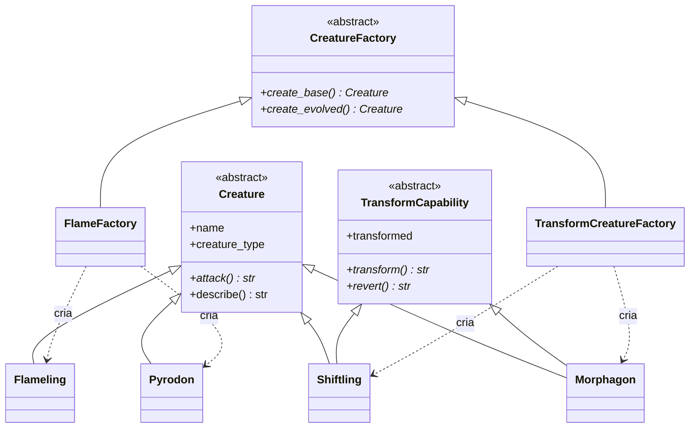

# O problema

Os exercícios 0 a 2 construíram uma hierarquia abstrata: uma classe mãe com métodos abstratos e
filhas que os escrevem. O exercício 3 troca de assunto, para criaturas que lutam numa arena de
testes, e responde a duas perguntas que uma hierarquia sozinha não resolve:

1. **Quem cria os objetos?** As criaturas vêm em **famílias**: na família do fogo, o `Flameling`
   é a forma **base** e o `Pyrodon` é a forma **evoluída**. O código que usa uma criatura não
   deveria precisar saber qual classe concreta recebe; ele pede a uma **fábrica** "a criatura
   base da sua família", e a fábrica decide. É o padrão **fábrica abstrata** (*abstract
   factory*).
2. **Como dar uma habilidade só a algumas classes?** Algumas criaturas sabem se transformar;
   outras não. A habilidade fica numa classe abstrata separada, uma **capacidade**
   (*capability*), que só as criaturas que se transformam herdam, ao lado de `Creature`
   ([Herança múltipla](../06-pacotes/02-heranca-multipla.md)).

## O que o enunciado pede

Um pacote `ex3` com estas classes. Uma classe **concreta** é uma classe que pode ser instanciada,
o contrário de uma abstrata:

| Classe | Tipo | O que é |
|---|---|---|
| `Creature` | abstrata, filha de `ABC` | guarda o nome e o tipo da criatura; tem o método abstrato `attack` e o método comum `describe`, que devolve uma frase padrão feita com o nome e o tipo |
| `Flameling` e `Pyrodon` | concretas, filhas de `Creature` | criaturas comuns; o `attack` de cada uma devolve a sua frase de ataque |
| `TransformCapability` | abstrata, filha de `ABC` e **não** de `Creature` | a capacidade de se transformar: métodos abstratos `transform` e `revert`; um atributo guarda se a criatura está transformada, e esse estado muda o que `attack` devolve |
| `Shiftling` e `Morphagon` | concretas, filhas de `Creature` **e** de `TransformCapability` | criaturas que se transformam |
| `CreatureFactory` | abstrata, filha de `ABC` | a fábrica abstrata: métodos abstratos `create_base` e `create_evolved` |
| `FlameFactory` | concreta, filha de `CreatureFactory` | cria o `Flameling` (base) e o `Pyrodon` (evoluída) |
| `TransformCreatureFactory` | concreta, filha de `CreatureFactory` | cria o `Shiftling` (base) e o `Morphagon` (evoluída) |

Uma regra sobre o pacote: ele **expõe só as fábricas**, nunca as criaturas concretas
([O que o pacote expõe](../06-pacotes/01-o-pacote.md#o-que-o-pacote-expõe)). O enunciado
aceita outros nomes de criaturas e de fábricas, desde que os dois padrões estejam certos (a
fábrica abstrata, e a capacidade que não herda de `Creature`); o tutorial usa os nomes do
enunciado.

## Os dois scripts de teste

Ficam na raiz do projeto, fora do pacote:

- **`battle.py`** testa as fábricas: cria as duas; tem uma **única** função que recebe uma
  fábrica, cria a criatura base e depois a evoluída, e, com cada uma, descreve e ataca; e outra
  função que recebe duas fábricas e põe as criaturas base delas para lutar;
- **`capacitor.py`** testa a capacidade: cria a fábrica das criaturas que se transformam e, com
  ela, a base e a evoluída; com cada uma, descreve, ataca, transforma, ataca de novo e volta ao
  normal.

## A saída esperada

`python3 battle.py`:

```text
Testing factory
Flameling is a Fire type Creature
Flameling uses Ember!
Pyrodon is a Fire/Flying type Creature
Pyrodon uses Flamethrower!

Testing factory
Shiftling is a Normal type Creature
Shiftling attacks normally.
Morphagon is a Normal/Dragon type Creature
Morphagon attacks normally.

Testing battle
Flameling is a Fire type Creature
 vs.
Shiftling is a Normal type Creature
 fight!
Flameling uses Ember!
Shiftling attacks normally.
```

`python3 capacitor.py`:

```text
Testing Creature with transform capability
 base:
Shiftling is a Normal type Creature
Shiftling attacks normally.
Shiftling shifts into a sharper form!
Shiftling performs a boosted strike!
Shiftling returns to normal.
 evolved:
Morphagon is a Normal/Dragon type Creature
Morphagon attacks normally.
Morphagon morphs into a dragonic battle form!
Morphagon unleashes a devastating morph strike!
Morphagon stabilizes its form.
```

As linhas ` vs.`, ` fight!`, ` base:` e ` evolved:` começam com um espaço.

## As frases de cada criatura

Tiradas da saída do enunciado. O **tipo** de uma criatura é o seu elemento (`Fire`, `Normal`...),
e não um tipo do Python:

| Criatura | Tipo | `attack` | `attack` transformada | `transform` | `revert` |
|---|---|---|---|---|---|
| `Flameling` | `Fire` | `Flameling uses Ember!` | — | — | — |
| `Pyrodon` | `Fire/Flying` | `Pyrodon uses Flamethrower!` | — | — | — |
| `Shiftling` | `Normal` | `Shiftling attacks normally.` | `Shiftling performs a boosted strike!` | `Shiftling shifts into a sharper form!` | `Shiftling returns to normal.` |
| `Morphagon` | `Normal/Dragon` | `Morphagon attacks normally.` | `Morphagon unleashes a devastating morph strike!` | `Morphagon morphs into a dragonic battle form!` | `Morphagon stabilizes its form.` |

A frase de `describe` é sempre `<nome> is a <tipo> type Creature`, como em
`Flameling is a Fire type Creature`.

## Os arquivos do pacote

O enunciado exige o `__init__.py` e deixa o resto livre ("todos os arquivos necessários"). A
escolha do tutorial é um módulo por peça:

| Arquivo | Conteúdo |
|---|---|
| `ex3/creature.py` | `Creature` |
| `ex3/capability.py` | `TransformCapability` |
| `ex3/flame.py` | `Flameling` e `Pyrodon`, a família do fogo |
| `ex3/transform.py` | `Shiftling` e `Morphagon`, a família que se transforma |
| `ex3/factory.py` | `CreatureFactory`, `FlameFactory` e `TransformCreatureFactory` |
| `ex3/__init__.py` | a porta do pacote: expõe as fábricas |

Todas as classes num módulo só, ao lado do `__init__.py`, também cumpririam o enunciado; separadas,
cada página do tutorial cuida de um arquivo.



A seta de ponta vazada liga a filha à mãe; a seta tracejada liga cada fábrica às criaturas que ela
cria.
