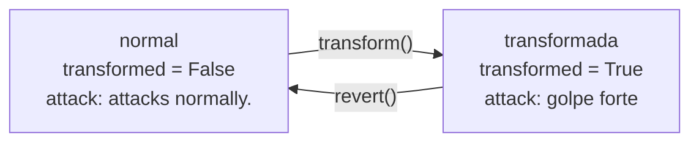

# A família que se transforma

A segunda família tem duas criaturas com a capacidade de transformação: o `Shiftling`, forma
base, e o `Morphagon`, forma evoluída. Cada uma é, ao mesmo tempo, uma `Creature` e uma
`TransformCapability`.

Crie o arquivo `ex3/transform.py`:

```python title="ex3/transform.py"
from .capability import TransformCapability
from .creature import Creature


class Shiftling(Creature, TransformCapability):
    def __init__(self) -> None:
        Creature.__init__(self, "Shiftling", "Normal")
        TransformCapability.__init__(self)

    def attack(self) -> str:
        if self.transformed:
            return f"{self.name} performs a boosted strike!"
        return f"{self.name} attacks normally."

    def transform(self) -> str:
        self.transformed = True
        return f"{self.name} shifts into a sharper form!"

    def revert(self) -> str:
        self.transformed = False
        return f"{self.name} returns to normal."


class Morphagon(Creature, TransformCapability):
    def __init__(self) -> None:
        Creature.__init__(self, "Morphagon", "Normal/Dragon")
        TransformCapability.__init__(self)

    def attack(self) -> str:
        if self.transformed:
            return f"{self.name} unleashes a devastating morph strike!"
        return f"{self.name} attacks normally."

    def transform(self) -> str:
        self.transformed = True
        return f"{self.name} morphs into a dragonic battle form!"

    def revert(self) -> str:
        self.transformed = False
        return f"{self.name} stabilizes its form."
```

## As duas mães

- `class Shiftling(Creature, TransformCapability)` herda das duas classes abstratas e escreve os
  três métodos abstratos delas: `attack`, de `Creature`, e `transform` e `revert`, de
  `TransformCapability`. Sem qualquer um dos três, `Shiftling()` lançaria `TypeError`
  ([A classe abstrata](../02-conceitos/02-a-classe-abstrata.md));
- o construtor chama o construtor de cada mãe pelo nome da classe, com o `self` como primeiro
  argumento. Com `super().__init__(...)`, só o de `Creature` rodaria, e `self.transformed` não
  existiria ([Herança múltipla](../06-pacotes/02-heranca-multipla.md#o-que-aconteceu-a-ordem-de-busca)).

## O estado muda o ataque

- `attack` consulta `self.transformed`: transformada, a criatura devolve a frase do golpe forte;
  na forma normal, `attacks normally.`;
- `transform` liga o estado (`True`) e devolve a frase da transformação;
- `revert` desliga o estado (`False`) e devolve a frase da volta ao normal.

O mypy sabe que `self.transformed` é um `bool` porque o construtor de `TransformCapability` o
cria com `False`.



As duas criaturas têm a mesma estrutura e frases diferentes. Juntar as frases numa classe comum às
duas pouparia linhas, mas criaria uma classe a mais entre `Creature` e as criaturas; o tutorial
deixa as duas classes completas, cada uma lida de uma vez.
