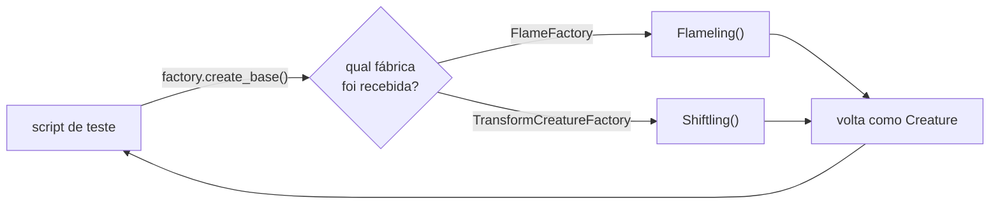

# A fábrica abstrata

Para criar um `Flameling`, um script precisaria importar a classe `Flameling` e chamá-la. Aí o
script fica preso àquela classe: para testar outra família, é preciso mudar o código dele, e o
pacote não pode esconder as criaturas concretas, como o enunciado exige. A **fábrica abstrata**
resolve isso pondo a criação num objeto à parte, a **fábrica**:

- uma classe abstrata, `CreatureFactory`, declara o que toda fábrica sabe fazer: criar a criatura
  base e a evoluída da sua família;
- cada família tem a sua fábrica concreta, que sabe quais classes criar;
- quem precisa de criaturas recebe uma fábrica qualquer e chama `create_base()` ou
  `create_evolved()`. A classe da criatura que volta é decisão da fábrica.

Crie o arquivo `ex3/factory.py`:

```python title="ex3/factory.py"
from abc import ABC, abstractmethod

from .creature import Creature
from .flame import Flameling, Pyrodon
from .transform import Morphagon, Shiftling


class CreatureFactory(ABC):
    @abstractmethod
    def create_base(self) -> Creature:
        pass

    @abstractmethod
    def create_evolved(self) -> Creature:
        pass


class FlameFactory(CreatureFactory):
    def create_base(self) -> Creature:
        return Flameling()

    def create_evolved(self) -> Creature:
        return Pyrodon()


class TransformCreatureFactory(CreatureFactory):
    def create_base(self) -> Creature:
        return Shiftling()

    def create_evolved(self) -> Creature:
        return Morphagon()
```

## O que cada parte faz

- os `import`s trazem `Creature`, para os type hints, e as quatro criaturas concretas. Este
  módulo é o único lugar do projeto, fora dos módulos das próprias criaturas, que conhece
  `Flameling`, `Pyrodon`, `Shiftling` e `Morphagon`;
- `CreatureFactory` herda de `ABC` e tem os dois métodos abstratos do enunciado,
  `create_base` e `create_evolved`;
- cada fábrica concreta escreve os dois métodos com as criaturas da sua família: `FlameFactory`
  cria `Flameling` e `Pyrodon`; `TransformCreatureFactory` cria `Shiftling` e `Morphagon`;
- cada chamada cria um objeto **novo**: duas chamadas a `create_base()` dão duas criaturas
  diferentes, cada uma com o seu próprio estado.

## O tipo de retorno é Creature

Nas fábricas concretas, o tipo de retorno continua `Creature`, e não `Flameling`. É o que o
código que chama enxerga: "uma criatura", com `describe` e `attack`. O mypy aceitaria
`-> Flameling` (uma filha pode prometer um retorno mais específico que a mãe), mas aí a assinatura
mostraria a classe concreta a quem a lê, que é o que a fábrica existe para esconder.



A pergunta "qual fábrica foi recebida?" não é um `if` escrito em lugar nenhum: é o polimorfismo
([Polimorfismo](../02-conceitos/04-polimorfismo.md)). O script chama `create_base()`, e roda o
método da classe da fábrica que ele tem nas mãos.
