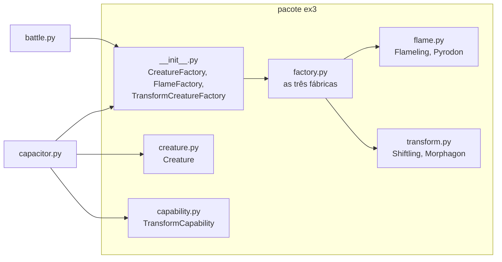

# A porta do pacote

O enunciado exige um `__init__.py` em `ex3/` e diz o que o pacote pode oferecer: só as fábricas,
nunca as criaturas concretas. O `__init__.py` é a porta de entrada do pacote: o que ele traz para
dentro é o que `from ex3 import ...` encontra ([O pacote](../06-pacotes/01-o-pacote.md)).

Crie o arquivo `ex3/__init__.py`:

```python title="ex3/__init__.py"
from .factory import CreatureFactory, FlameFactory, TransformCreatureFactory

__all__ = ["CreatureFactory", "FlameFactory", "TransformCreatureFactory"]
```

- a primeira linha traz as três fábricas do módulo `factory`. `CreatureFactory`, a fábrica
  abstrata, também entra: os scripts a usam no type hint dos parâmetros, como em
  `def test_factory(factory: CreatureFactory)`;
- `__all__` lista os nomes públicos do pacote e evita o aviso `F401` do flake8
  ([O aviso do flake8](../06-pacotes/01-o-pacote.md#o-aviso-do-flake8)). As duas linhas têm 76 e
  73 caracteres, dentro do limite de 79 do flake8.

`Flameling`, `Pyrodon`, `Shiftling` e `Morphagon` não estão aqui: `from ex3 import Flameling`
falha com `ImportError`. Quem quer uma criatura pede a uma fábrica.

## E as classes abstratas?

`Creature` e `TransformCapability` também não estão no `__init__.py`: não são fábricas, e o
enunciado diz "só as fábricas". Mas dois lugares precisam escrever o nome delas:

- `capacitor.py` usa `Creature` num type hint e `TransformCapability` num `isinstance`
  ([capacitor.py](./09-capacitor.md));
- o pacote `ex4`, do exercício 4, faz o mesmo nas estratégias.

A escolha do tutorial é seguir a letra do enunciado: o `__init__.py` expõe só as três fábricas, e
quem precisa das duas classes abstratas as importa do módulo onde estão, pelo nome completo:
`from ex3.creature import Creature` e `from ex3.capability import TransformCapability`. As
criaturas concretas nunca são importadas fora do pacote. Uma leitura também razoável do enunciado
põe `Creature` e `TransformCapability` no `__init__.py` (elas não são criaturas concretas); o
tutorial não a segue porque o "só as fábricas" do enunciado não abre essa exceção.



Os scripts entram pela porta (o `__init__.py`); só o `capacitor.py` vai também às duas classes
abstratas. Nenhuma seta de fora do pacote chega a `flame.py` ou a `transform.py`.
