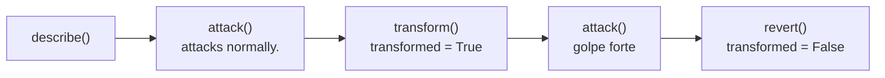

# capacitor.py

O segundo script de teste exercita a capacidade: pega as duas criaturas da família que se
transforma e, com cada uma, descreve, ataca, transforma, ataca de novo e volta ao normal. O
segundo ataque mostra o efeito do estado de transformação.

Crie o arquivo `capacitor.py`, na raiz do projeto:

```python title="capacitor.py"
from ex3 import TransformCreatureFactory
from ex3.capability import TransformCapability
from ex3.creature import Creature


def test_transform(creature: Creature) -> None:
    print(creature.describe())
    print(creature.attack())
    if not isinstance(creature, TransformCapability):
        print(f"{creature.name} has no transform capability")
        return
    print(creature.transform())
    print(creature.attack())
    print(creature.revert())


def main() -> None:
    factory = TransformCreatureFactory()
    print("Testing Creature with transform capability")
    print(" base:")
    test_transform(factory.create_base())
    print(" evolved:")
    test_transform(factory.create_evolved())


if __name__ == "__main__":
    main()
```

## Os imports

- `TransformCreatureFactory` vem da porta do pacote, como em `battle.py`;
- `TransformCapability` e `Creature` vêm dos seus módulos, pelo nome completo
  ([E as classes abstratas?](./07-a-porta-do-pacote.md#e-as-classes-abstratas)). As criaturas
  concretas continuam fora do script.

## test_transform

A fábrica devolve um `Creature`, e `Creature` não tem `transform` nem `revert`. O script precisa
perguntar se a criatura tem a capacidade antes de usá-la, com `isinstance`, como o enunciado
manda as estratégias do exercício 4 fazerem.

- `describe` e o primeiro `attack` valem para qualquer criatura;
- `if not isinstance(creature, TransformCapability):` trata a criatura **sem** a capacidade:
  imprime uma mensagem e sai da função com `return`. Esse caso não acontece no cenário do
  enunciado, que só usa a fábrica das criaturas que se transformam; a mensagem é escolha do
  tutorial, para que uma criatura comum, passada por engano, dê um aviso em vez de um erro;
- depois do `if`, a criatura com certeza tem a capacidade: `transform`, o segundo `attack` e
  `revert` rodam nessa ordem.

O mypy também entende o `return`: depois do `if not isinstance(...)` que sai da função, ele
estreita o tipo de `creature` para "um `Creature` que também é `TransformCapability`" e aceita
`creature.transform()` e `creature.revert()`
([isinstance e o mypy](../06-pacotes/02-heranca-multipla.md#isinstance-e-o-mypy)).

## O main

O `main` cria a fábrica, imprime o cabeçalho e testa a criatura base e a evoluída, cada uma depois
da sua linha ` base:` ou ` evolved:`, que começam com um espaço.



O mesmo método `attack`, chamado duas vezes no mesmo objeto, devolve frases diferentes: entre as
duas chamadas, o `transform` mudou o atributo `transformed`.
