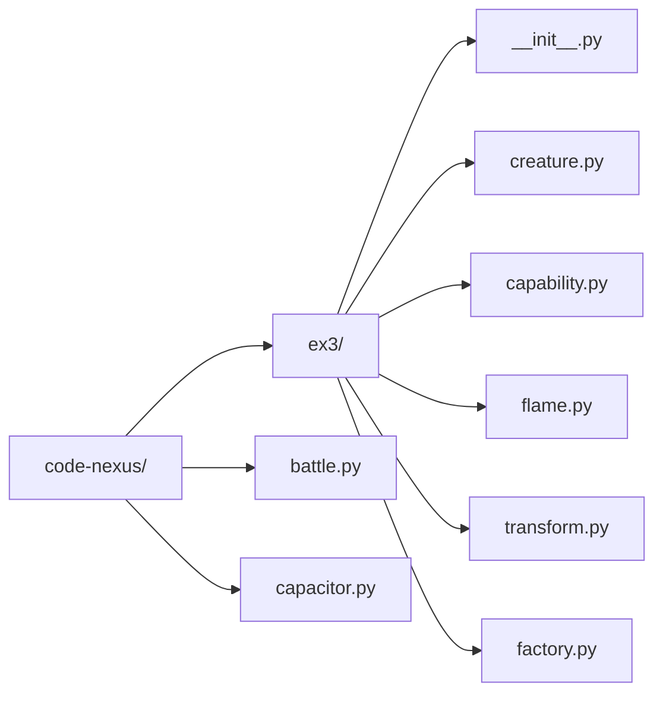

# Os arquivos completos

O exercício 3 tem oito arquivos: seis no pacote `ex3/` e os dois scripts de teste na raiz.



## O pacote

```python title="ex3/__init__.py"
from .factory import CreatureFactory, FlameFactory, TransformCreatureFactory

__all__ = ["CreatureFactory", "FlameFactory", "TransformCreatureFactory"]
```

```python title="ex3/creature.py"
from abc import ABC, abstractmethod


class Creature(ABC):
    def __init__(self, name: str, creature_type: str) -> None:
        self.name = name
        self.creature_type = creature_type

    @abstractmethod
    def attack(self) -> str:
        pass

    def describe(self) -> str:
        return f"{self.name} is a {self.creature_type} type Creature"
```

```python title="ex3/capability.py"
from abc import ABC, abstractmethod


class TransformCapability(ABC):
    def __init__(self) -> None:
        self.transformed = False

    @abstractmethod
    def transform(self) -> str:
        pass

    @abstractmethod
    def revert(self) -> str:
        pass
```

```python title="ex3/flame.py"
from .creature import Creature


class Flameling(Creature):
    def __init__(self) -> None:
        super().__init__("Flameling", "Fire")

    def attack(self) -> str:
        return f"{self.name} uses Ember!"


class Pyrodon(Creature):
    def __init__(self) -> None:
        super().__init__("Pyrodon", "Fire/Flying")

    def attack(self) -> str:
        return f"{self.name} uses Flamethrower!"
```

```python title="ex3/transform.py"
from .capability import TransformCapability
from .creature import Creature


class Shiftling(Creature, TransformCapability):
    def __init__(self) -> None:
        Creature.__init__(self, "Shiftling", "Normal")
        TransformCapability.__init__(self)

    def attack(self) -> str:
        if self.transformed:
            return f"{self.name} performs a boosted strike!"
        return f"{self.name} attacks normally."

    def transform(self) -> str:
        self.transformed = True
        return f"{self.name} shifts into a sharper form!"

    def revert(self) -> str:
        self.transformed = False
        return f"{self.name} returns to normal."


class Morphagon(Creature, TransformCapability):
    def __init__(self) -> None:
        Creature.__init__(self, "Morphagon", "Normal/Dragon")
        TransformCapability.__init__(self)

    def attack(self) -> str:
        if self.transformed:
            return f"{self.name} unleashes a devastating morph strike!"
        return f"{self.name} attacks normally."

    def transform(self) -> str:
        self.transformed = True
        return f"{self.name} morphs into a dragonic battle form!"

    def revert(self) -> str:
        self.transformed = False
        return f"{self.name} stabilizes its form."
```

```python title="ex3/factory.py"
from abc import ABC, abstractmethod

from .creature import Creature
from .flame import Flameling, Pyrodon
from .transform import Morphagon, Shiftling


class CreatureFactory(ABC):
    @abstractmethod
    def create_base(self) -> Creature:
        pass

    @abstractmethod
    def create_evolved(self) -> Creature:
        pass


class FlameFactory(CreatureFactory):
    def create_base(self) -> Creature:
        return Flameling()

    def create_evolved(self) -> Creature:
        return Pyrodon()


class TransformCreatureFactory(CreatureFactory):
    def create_base(self) -> Creature:
        return Shiftling()

    def create_evolved(self) -> Creature:
        return Morphagon()
```

## Os scripts de teste

```python title="battle.py"
from ex3 import CreatureFactory, FlameFactory, TransformCreatureFactory


def test_factory(factory: CreatureFactory) -> None:
    print("Testing factory")
    for creature in (factory.create_base(), factory.create_evolved()):
        print(creature.describe())
        print(creature.attack())


def test_battle(first: CreatureFactory, second: CreatureFactory) -> None:
    print("Testing battle")
    left = first.create_base()
    right = second.create_base()
    print(left.describe())
    print(" vs.")
    print(right.describe())
    print(" fight!")
    print(left.attack())
    print(right.attack())


def main() -> None:
    flame = FlameFactory()
    transform = TransformCreatureFactory()
    test_factory(flame)
    print()
    test_factory(transform)
    print()
    test_battle(flame, transform)


if __name__ == "__main__":
    main()
```

```python title="capacitor.py"
from ex3 import TransformCreatureFactory
from ex3.capability import TransformCapability
from ex3.creature import Creature


def test_transform(creature: Creature) -> None:
    print(creature.describe())
    print(creature.attack())
    if not isinstance(creature, TransformCapability):
        print(f"{creature.name} has no transform capability")
        return
    print(creature.transform())
    print(creature.attack())
    print(creature.revert())


def main() -> None:
    factory = TransformCreatureFactory()
    print("Testing Creature with transform capability")
    print(" base:")
    test_transform(factory.create_base())
    print(" evolved:")
    test_transform(factory.create_evolved())


if __name__ == "__main__":
    main()
```

Cada arquivo termina com uma única quebra de linha depois da última linha, que o botão de copiar
não leva ([O arquivo completo do exercício 0](../03-ex0/08-o-arquivo-completo.md)).

O que os arquivos usam, todos autorizados: `abc` (`ABC` e `abstractmethod`), as funções embutidas
`isinstance`, `print` e `super`, e os `import`s entre os próprios arquivos do projeto (os
relativos, com ponto, dentro do pacote, e os de `ex3` nos scripts).
