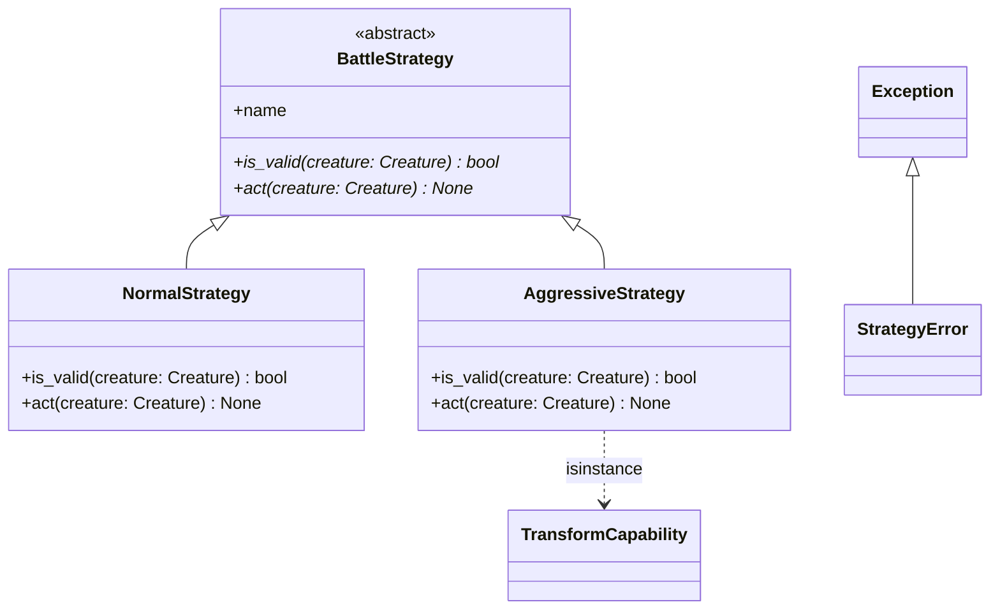

# O problema

No exercício 3, cada família age de um jeito: uma criatura que se transforma faz `transform`,
`attack` e `revert`; uma criatura comum só faz `attack`. Um torneio com criaturas de famílias
diferentes precisaria, a cada luta, perguntar "esta criatura se transforma?" e escolher o que
fazer. Cada capacidade nova acrescentaria mais um `if` no código do torneio.

O padrão **estratégia abstrata** (*abstract strategy*) tira essa decisão do torneio. O jeito de
lutar vira um objeto à parte, a **estratégia**, que o torneio recebe junto com a criatura e só
manda agir. O torneio não sabe o que a estratégia faz; cada estratégia sabe.

## O que o enunciado pede

Um pacote `ex4` com:

| Classe | Abstrata ou concreta | O que faz |
|---|---|---|
| `BattleStrategy` | abstrata, filha de `ABC` | métodos abstratos `is_valid`, que devolve um `bool` dizendo se uma criatura serve para a estratégia, e `act`, que o torneio chama para a criatura agir |
| `NormalStrategy` | concreta, filha de `BattleStrategy` | serve para qualquer criatura; só chama `attack` |
| `AggressiveStrategy` | concreta, filha de `BattleStrategy` | serve para as criaturas com a capacidade de transformação; faz `transform`, `attack` e `revert` |

Se `act` receber uma criatura para a qual a estratégia não serve, ele lança uma **exceção
dedicada** (uma classe de exceção do próprio projeto) com uma mensagem clara.

Uma regra do enunciado: a estratégia confere a capacidade com `isinstance`, nunca pela família
concreta. `AggressiveStrategy` pergunta "é um `TransformCapability`?", e não "é um `Shiftling` ou
um `Morphagon`?". Outras estratégias podem existir, desde que haja uma simples e uma que leve em
conta uma capacidade.

## O script de teste

`tournament.py`, na raiz do projeto:

- cria as fábricas do exercício 3 e as estratégias;
- define uma **única** função `battle`, que recebe uma lista de **oponentes** (cada um é uma
  tupla com uma `CreatureFactory` e uma `BattleStrategy`), faz cada oponente enfrentar cada um
  dos outros uma vez, aplica a estratégia de cada criatura e **aborta** o torneio diante de um
  par criatura-estratégia inválido.

## A saída esperada

```text
Tournament 0 (basic)
 [ (Flameling+Normal), (Shiftling+Aggressive) ]
*** Tournament ***
2 opponents involved

* Battle *
Flameling is a Fire type Creature
 vs.
Shiftling is a Normal type Creature
 now fight!
Flameling uses Ember!
Shiftling shifts into a sharper form!
Shiftling performs a boosted strike!
Shiftling returns to normal.

Tournament 1 (error)
 [ (Shiftling+Aggressive), (Flameling+Aggressive) ]
*** Tournament ***
2 opponents involved

* Battle *
Shiftling is a Normal type Creature
 vs.
Flameling is a Fire type Creature
 now fight!
Shiftling shifts into a sharper form!
Shiftling performs a boosted strike!
Shiftling returns to normal.
Battle error, aborting tournament: Invalid Creature 'Flameling' for this aggressive strategy
```

O cenário tem dois torneios:

1. **basic**: o `Flameling` com a estratégia normal contra o `Shiftling` com a agressiva. O
   `Flameling` ataca; o `Shiftling` se transforma, ataca e volta ao normal;
2. **error**: o `Shiftling` e o `Flameling`, os dois com a estratégia agressiva. O `Shiftling`
   age normalmente; o `Flameling` não se transforma, a estratégia agressiva recusa a criatura, e o
   torneio para com a mensagem `Battle error, aborting tournament: ...`.

A linha com a lista de oponentes, a ` vs.` e a ` now fight!` começam com um espaço. Os nomes
`Normal` e `Aggressive` da lista de oponentes vêm das estratégias.

## Os arquivos do pacote

Como no exercício 3, a escolha do tutorial é um módulo por peça:

| Arquivo | Conteúdo |
|---|---|
| `ex4/strategy.py` | `BattleStrategy` e a exceção `StrategyError` |
| `ex4/normal.py` | `NormalStrategy` |
| `ex4/aggressive.py` | `AggressiveStrategy` |
| `ex4/__init__.py` | a porta do pacote: expõe as estratégias e a exceção |


