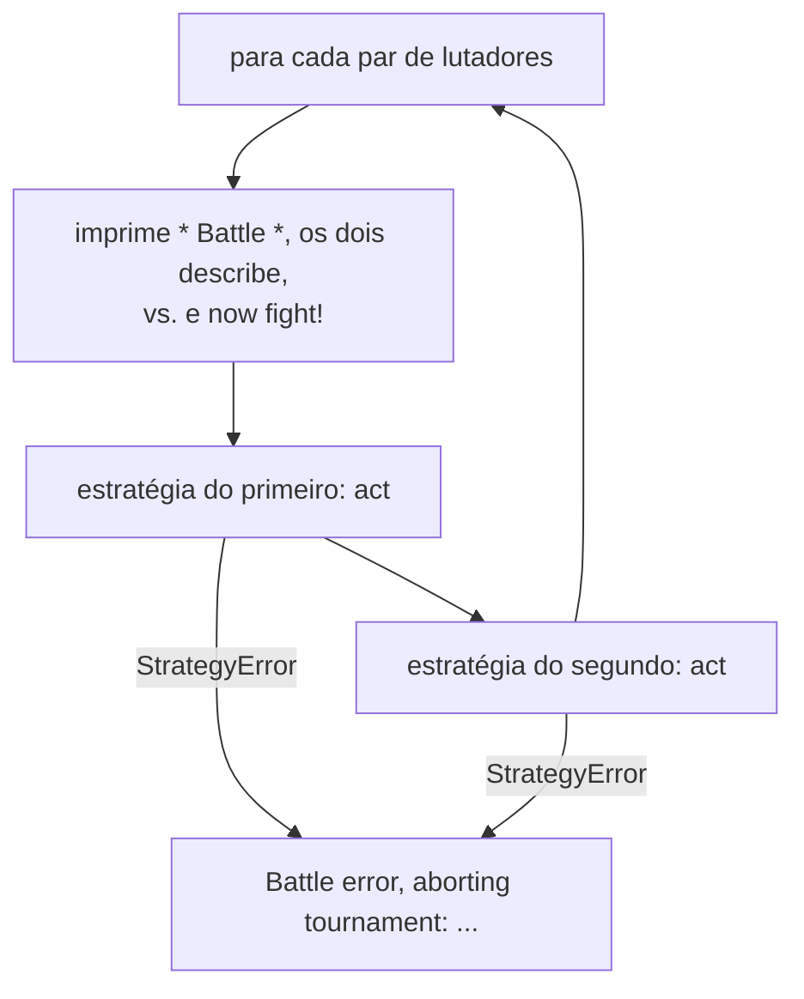

# O torneio

O torneio recebe criaturas de famílias diferentes, cada uma com a sua estratégia, e põe cada uma
contra cada uma das outras. Ele não pergunta de que família é nenhuma criatura: só manda cada
estratégia agir.

Crie o arquivo `tournament.py`, na raiz do projeto, começando pelos imports e pela função
`battle`. A [próxima página](./07-a-demonstracao.md) acrescenta o resto, no fim do arquivo.

```python
from ex3 import CreatureFactory, FlameFactory, TransformCreatureFactory
from ex4 import (
    AggressiveStrategy,
    BattleStrategy,
    NormalStrategy,
    StrategyError,
)

Opponent = tuple[CreatureFactory, BattleStrategy]


def battle(opponents: list[Opponent]) -> None:
    print("*** Tournament ***")
    print(f"{len(opponents)} opponents involved")
    fighters = []
    for factory, strategy in opponents:
        fighters.append((factory.create_base(), strategy))
    try:
        for i in range(len(fighters)):
            for j in range(i + 1, len(fighters)):
                first, first_strategy = fighters[i]
                second, second_strategy = fighters[j]
                print("\n* Battle *")
                print(first.describe())
                print(" vs.")
                print(second.describe())
                print(" now fight!")
                first_strategy.act(first)
                second_strategy.act(second)
    except StrategyError as error:
        print(f"Battle error, aborting tournament: {error}")
```

## Os imports

O torneio usa as fábricas do `ex3` e as estratégias e a exceção do `ex4`, todas pela porta de
cada pacote. O import do `ex4` não cabe numa linha de 79 caracteres; entre parênteses, os nomes
podem ocupar várias linhas, um por linha.

## O oponente

O enunciado define cada oponente como uma tupla de uma `CreatureFactory` e uma `BattleStrategy`.
`Opponent = tuple[CreatureFactory, BattleStrategy]` dá um nome a esse tipo: é um **apelido de
tipo** (*type alias*), uma variável cujo valor é um type hint. Depois dele, `list[Opponent]` quer
dizer exatamente `list[tuple[CreatureFactory, BattleStrategy]]`, e as assinaturas ficam curtas.

## battle

É a **única** função de batalha que o enunciado pede. Passo a passo:

1. imprime o cabeçalho e quantos oponentes há (`len(opponents)`);
2. monta `fighters`, a lista dos lutadores: para cada oponente, a criatura base criada pela
   fábrica, ao lado da estratégia. Cada criatura é criada uma vez e luta em todas as batalhas do
   torneio. O mypy deduz o tipo da lista pelo primeiro `append`: tuplas `(Creature,
   BattleStrategy)`;
3. os dois `for` geram cada par uma vez só: `range(i + 1, len(fighters))` conta de `i + 1` até o
   último índice, então o lutador `i` só enfrenta quem vem depois dele. Com três lutadores, os
   pares são 0 contra 1, 0 contra 2 e 1 contra 2;
4. cada batalha imprime uma linha vazia (o `\n` no começo do texto) e `* Battle *`, descreve os
   dois lutadores e manda cada estratégia agir, primeiro a do lutador `i`, depois a do `j`.

`first_strategy.act(first)` é todo o código de luta do torneio. Se a estratégia é normal, a
criatura ataca; se é agressiva, a criatura se transforma, ataca e volta ao normal. O torneio não
tem nenhum `if` sobre famílias ou capacidades: a decisão mora na estratégia.

## Abortar o torneio

O `try` envolve os dois `for`. Quando um `act` lança `StrategyError`, o Python sai dos laços na
mesma hora e pula para o `except`, que imprime `Battle error, aborting tournament:` seguido da
mensagem da exceção. As batalhas que faltavam não acontecem: é o "aborta diante de um par
inválido" do enunciado.

As ações que já aconteceram ficam na saída. No segundo torneio do enunciado, o `Shiftling` age
antes do `Flameling`, e as três frases dele aparecem antes da mensagem de erro.


