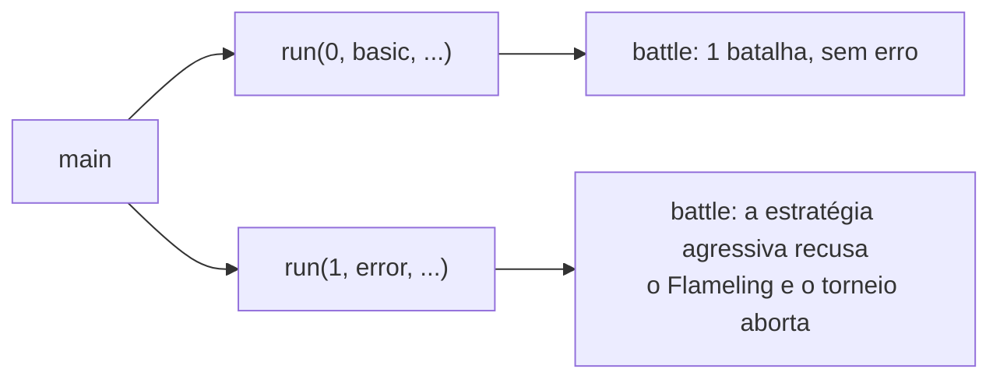

# A demonstração

O resto de `tournament.py` monta os dois torneios do enunciado. Antes de cada um, o programa
imprime o número, o rótulo e a lista de oponentes; depois chama `battle`.

## A lista de oponentes

```python
def roster(opponents: list[Opponent]) -> str:
    entries = []
    for factory, strategy in opponents:
        entries.append(f"({factory.create_base().name}+{strategy.name})")
    return "[ " + ", ".join(entries) + " ]"
```

`roster` devolve o texto `[ (Flameling+Normal), (Shiftling+Aggressive) ]`:

- para cada oponente, o nome da criatura base e o nome da estratégia, entre parênteses e ligados
  por `+`. A fábrica não sabe o nome da criatura antes de criá-la; `roster` cria uma só para ler
  o `name` e a descarta. A criatura que luta é outra, criada por `battle`;
- `", ".join(entries)` junta os textos com vírgula e espaço, e os colchetes com espaço por dentro
  vêm do enunciado.

## Um torneio

```python
def run(number: int, label: str, opponents: list[Opponent]) -> None:
    print(f"Tournament {number} ({label})")
    print(f" {roster(opponents)}")
    battle(opponents)
```

`run` imprime as duas linhas de abertura (a segunda começa com um espaço) e chama `battle`. Os
nomes `roster` e `run` são escolha do tutorial: o enunciado só fixa a função `battle`, e estas
duas preparam o que ela recebe.

## O main

```python
def main() -> None:
    flame = FlameFactory()
    transform = TransformCreatureFactory()
    normal = NormalStrategy()
    aggressive = AggressiveStrategy()
    run(0, "basic", [(flame, normal), (transform, aggressive)])
    print()
    run(1, "error", [(transform, aggressive), (flame, aggressive)])


if __name__ == "__main__":
    main()
```

- o `main` cria as duas fábricas e as duas estratégias uma vez e as combina nos dois torneios.
  Uma estratégia não guarda estado, e o mesmo objeto serve para mais de um oponente;
- o primeiro torneio põe o `Flameling` com a estratégia normal contra o `Shiftling` com a
  agressiva; o segundo dá a estratégia agressiva aos dois, e o `Flameling` não serve para ela;
- o `print()` imprime a linha vazia entre os dois torneios.

As listas de oponentes são escritas direto na chamada de `run`. Assim o mypy confere cada tupla
contra o tipo `Opponent` do parâmetro. Numa variável sem anotação, a lista do segundo torneio
seria deduzida como uma lista de `(CreatureFactory, AggressiveStrategy)`, e o mypy a recusaria
onde se pede `list[Opponent]`
([A lista de int não é uma lista de int | float](../02-conceitos/03-any-uniao-e-isinstance.md#lista-invariante)).


