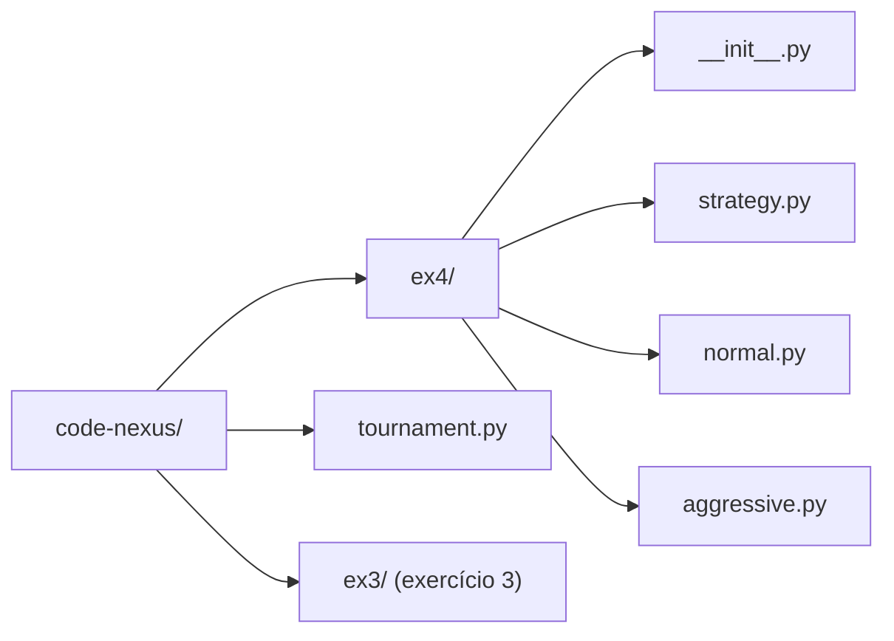

# Os arquivos completos

O exercício 4 tem cinco arquivos: quatro no pacote `ex4/` e o script `tournament.py` na raiz. O
pacote `ex3/` do exercício anterior continua igual e é usado por eles.



## O pacote

```python title="ex4/__init__.py"
from .aggressive import AggressiveStrategy
from .normal import NormalStrategy
from .strategy import BattleStrategy, StrategyError

__all__ = [
    "AggressiveStrategy",
    "BattleStrategy",
    "NormalStrategy",
    "StrategyError",
]
```

```python title="ex4/strategy.py"
from abc import ABC, abstractmethod

from ex3.creature import Creature


class StrategyError(Exception):
    pass


class BattleStrategy(ABC):
    name: str

    @abstractmethod
    def is_valid(self, creature: Creature) -> bool:
        pass

    @abstractmethod
    def act(self, creature: Creature) -> None:
        pass
```

```python title="ex4/normal.py"
from ex3.creature import Creature

from .strategy import BattleStrategy, StrategyError


class NormalStrategy(BattleStrategy):
    name = "Normal"

    def is_valid(self, creature: Creature) -> bool:
        return True

    def act(self, creature: Creature) -> None:
        if not self.is_valid(creature):
            raise StrategyError(f"Invalid Creature '{creature.name}' "
                                "for this normal strategy")
        print(creature.attack())
```

```python title="ex4/aggressive.py"
from ex3.capability import TransformCapability
from ex3.creature import Creature

from .strategy import BattleStrategy, StrategyError


class AggressiveStrategy(BattleStrategy):
    name = "Aggressive"

    def is_valid(self, creature: Creature) -> bool:
        return isinstance(creature, TransformCapability)

    def act(self, creature: Creature) -> None:
        if not isinstance(creature, TransformCapability):
            raise StrategyError(f"Invalid Creature '{creature.name}' "
                                "for this aggressive strategy")
        print(creature.transform())
        print(creature.attack())
        print(creature.revert())
```

## O script de teste

```python title="tournament.py"
from ex3 import CreatureFactory, FlameFactory, TransformCreatureFactory
from ex4 import (
    AggressiveStrategy,
    BattleStrategy,
    NormalStrategy,
    StrategyError,
)

Opponent = tuple[CreatureFactory, BattleStrategy]


def battle(opponents: list[Opponent]) -> None:
    print("*** Tournament ***")
    print(f"{len(opponents)} opponents involved")
    fighters = []
    for factory, strategy in opponents:
        fighters.append((factory.create_base(), strategy))
    try:
        for i in range(len(fighters)):
            for j in range(i + 1, len(fighters)):
                first, first_strategy = fighters[i]
                second, second_strategy = fighters[j]
                print("\n* Battle *")
                print(first.describe())
                print(" vs.")
                print(second.describe())
                print(" now fight!")
                first_strategy.act(first)
                second_strategy.act(second)
    except StrategyError as error:
        print(f"Battle error, aborting tournament: {error}")


def roster(opponents: list[Opponent]) -> str:
    entries = []
    for factory, strategy in opponents:
        entries.append(f"({factory.create_base().name}+{strategy.name})")
    return "[ " + ", ".join(entries) + " ]"


def run(number: int, label: str, opponents: list[Opponent]) -> None:
    print(f"Tournament {number} ({label})")
    print(f" {roster(opponents)}")
    battle(opponents)


def main() -> None:
    flame = FlameFactory()
    transform = TransformCreatureFactory()
    normal = NormalStrategy()
    aggressive = AggressiveStrategy()
    run(0, "basic", [(flame, normal), (transform, aggressive)])
    print()
    run(1, "error", [(transform, aggressive), (flame, aggressive)])


if __name__ == "__main__":
    main()
```

Cada arquivo termina com uma única quebra de linha depois da última linha, que o botão de copiar
não leva ([O arquivo completo do exercício 0](../03-ex0/08-o-arquivo-completo.md)).

O que os arquivos usam, todos autorizados: `abc` (`ABC` e `abstractmethod`), a classe embutida
`Exception`, as funções embutidas `isinstance`, `len`, `range` e `print`, o método de texto
`join`, o método de lista `append`, e os `import`s entre os arquivos do projeto.
