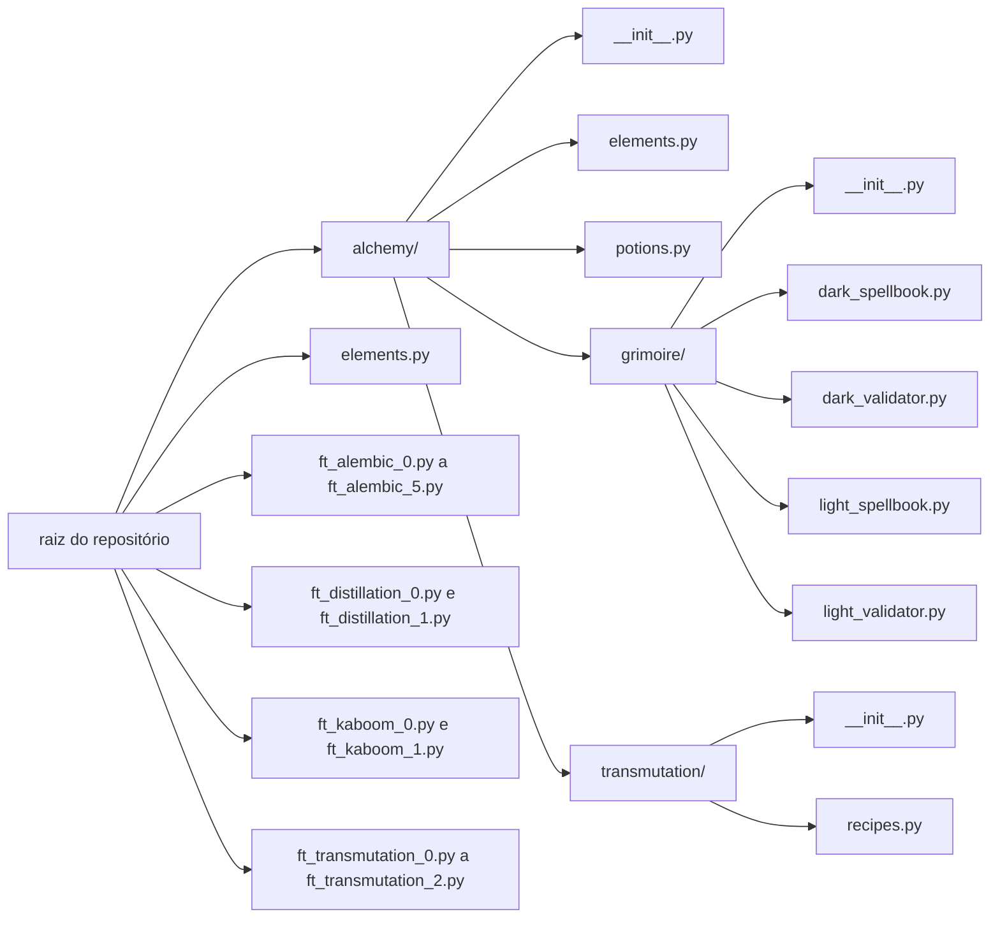

# O enunciado em linguagem simples

## Regras que valem para o projeto inteiro

- **Python 3.10 ou mais novo.** Os scripts são rodados com `python3`
  ([O Python](../01-ambiente/01-o-python.md)).
- **Estilo conferido pelo flake8.** O flake8 é um programa que lê o código e aponta o que foge do
  estilo padrão do Python: linha com mais de 79 caracteres, falta de linha em branco entre funções,
  `import` que não é usado. O código entregue não pode ter nenhum aviso dele.
- **Type hints em todo o código, conferidos pelo mypy.** Um *type hint* é a anotação do tipo de
  cada parâmetro e do retorno, como em `def create_fire() -> str:`. O mypy é o programa que
  confere se esses tipos batem com o uso
  ([Type hints, flake8 e mypy](../01-ambiente/04-type-hints-flake8-e-mypy.md)). Há uma única
  reclamação do mypy que o enunciado pede de propósito, na Parte I
  ([O erro proposital](../03-parte-1/06-o-erro-proposital.md)).
- **Tipos e funções embutidos liberados, menos `eval()` e `exec()`.** Todos os tipos padrão
  (`int`, `str`, `list`, `dict`...) com os seus métodos, e todas as funções que o Python oferece
  sem `import` (`print`, `len`, `str`...). As duas exceções rodam texto como se fosse código:
  `eval("1 + 2")` devolve `3`, e `exec` roda um texto com instruções inteiras. As duas estão
  proibidas.
- **Só imports do próprio projeto.** Um `import` só pode trazer um arquivo criado no projeto:
  nada dos módulos que vêm com o Python (`os`, `sys`, `math`...) nem de bibliotecas instaladas.
  Um **módulo** é um arquivo `.py` usado por outro arquivo através do `import`
  ([O módulo e o import](../02-conceitos/01-o-modulo-e-o-import.md)).
- **Proibido modificar `sys.path`.** `sys.path` é a lista de pastas onde o Python procura os
  módulos importados, e um programa pode acrescentar pastas a ela para achar arquivos em outros
  lugares. O enunciado proíbe: todo import tem de funcionar só pela posição dos arquivos nas
  pastas ([Onde o Python procura](../02-conceitos/02-onde-o-python-procura.md)).
- **Funções simples, que devolvem texto.** As funções do projeto só montam e devolvem textos; a
  lógica é mínima, porque o assunto é o import. Uma função foge da regra por pedido do próprio
  enunciado: a que lista os ingredientes permitidos de um feitiço devolve uma lista de textos
  ([O grimório das trevas](../06-parte-4/02-o-grimorio-das-trevas.md)).

## A árvore final

As quatro partes constroem uma única árvore, que fica na raiz do repositório entregue:

São 24 arquivos `.py`: 14 na raiz (o `elements.py` e os 13 scripts de teste) e 10 dentro de
`alchemy/`. Há dois arquivos chamados `elements.py`, um na raiz e outro em `alchemy/`, e isso é
de propósito ([O pacote](../03-parte-1/03-o-pacote.md)).

## As quatro partes

| Parte | O que o enunciado pede |
|---|---|
| I | `elements.py` com `create_fire()` e `create_water()`; `alchemy/elements.py` com `create_earth()` e `create_air()`; um `alchemy/__init__.py` que deixa `create_air` visível em `alchemy` e esconde `create_earth`; seis scripts que importam esses arquivos de seis jeitos ([Parte I](../03-parte-1/01-o-problema.md)) |
| II | `alchemy/potions.py` com duas poções, cada uma feita com dois elementos; o apelido `heal` para a poção de cura no `__init__.py`; dois scripts ([Parte II](../04-parte-2/01-o-problema.md)) |
| III | `alchemy/transmutation/recipes.py` com a receita `lead_to_gold()`, usando pelo menos um import absoluto e um relativo; três scripts que chegam à receita por caminhos diferentes ([Parte III](../05-parte-3/01-o-problema.md)) |
| IV | quatro arquivos em `alchemy/grimoire/`: um livro de feitiços e um validador da luz, e uma cópia das trevas. A luz evita o import circular; as trevas explodem com ele. Dois scripts ([Parte IV](../06-parte-4/01-o-problema.md)) |

Toda função devolve um texto fixo ou montado a partir de outras funções; o enunciado mostra a
saída exata de cada script, e a página [O resultado final](./04-o-resultado-final.md) reúne
todas.

## Entrega

A árvore inteira, na raiz de um repositório Git ([Entregar](../07-fechamento/02-entregar.md)).
Na avaliação, pode ser pedido que você explique os mecanismos de import, mostre os diferentes
estilos de import ou modifique o laboratório
([As perguntas do enunciado](../07-fechamento/03-as-perguntas-do-enunciado.md)).

## O que o enunciado cita sem explicar

- **Pacote** (*package*): uma pasta de módulos que se importa pelo nome da pasta, como
  `alchemy` ([O pacote](../03-parte-1/03-o-pacote.md)).
- **`__init__.py`**: o arquivo que transforma a pasta em pacote e roda quando o pacote é importado.
  O enunciado o chama de "portal".
- **Interface do módulo** (*module interface*): os nomes que um módulo ou pacote oferece a quem o
  importa ([A interface do pacote](../03-parte-1/05-a-interface-do-pacote.md)).
- **Alias de pacote** (*package alias*): um segundo nome, criado no `__init__.py`, para uma
  função de dentro do pacote ([O apelido heal](../04-parte-2/03-o-apelido-heal.md)).
- **Import absoluto e relativo**: os dois jeitos de escrever o caminho de um import
  ([Absoluto e relativo](../05-parte-3/02-absoluto-e-relativo.md)).
- **Dependência circular** (*circular dependency*): dois módulos que precisam um do outro; quando
  os dois se importam no topo do arquivo, o import falha
  ([A explosão](../06-parte-4/03-a-explosao.md)).
- **Módulo parcialmente inicializado** (*partially initialized module*): expressão da mensagem de
  erro do `ft_kaboom_1.py`; um módulo que começou a rodar e ainda não terminou.
- **Alembic, distillation, transmutation, grimoire, spellbook**: só o cenário. *Grimoire* é o
  grimório, e *spellbook*, o livro de feitiços.
- **Instruções sobre IA**: o enunciado tem um capítulo pedindo que todo código vindo de uma
  ferramenta de IA seja entendido por completo e revisado com colegas.
