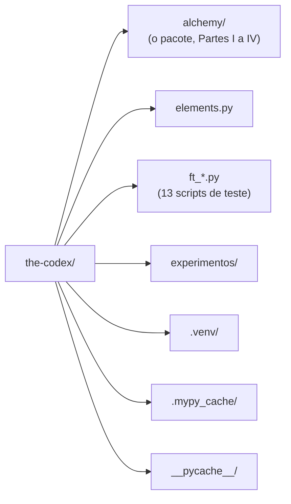

# A pasta do projeto

O enunciado fixa uma árvore de arquivos que fica na **raiz** do repositório entregue: os scripts
`ft_*.py` e o `elements.py` soltos na pasta principal, e a pasta `alchemy/` ao lado deles. Crie
uma pasta para o projeto e entre nela:

```bash
mkdir the-codex
cd the-codex
```

`mkdir` cria uma pasta. O nome `the-codex` é só uma sugestão; o que o enunciado fixa é o que fica
dentro dela. **Todos os comandos do tutorial são rodados a partir desta pasta**, a `the-codex`.

Crie também uma pasta `experimentos`, para os programas pequenos que mostram cada ideia antes de
ela entrar no projeto. Eles não fazem parte da entrega:

```bash
mkdir experimentos
```

Ao fim do projeto, a pasta fica assim:



- `.venv/` é criada na [próxima página](./03-o-ambiente-virtual.md);
- `.mypy_cache/` é criada pelo mypy na primeira vez que ele roda, para guardar resultados e
  conferir mais rápido da próxima vez;
- `__pycache__/` é criada pelo próprio Python na primeira vez que um arquivo do projeto é
  importado, e aparece também dentro de cada pasta de `alchemy/`
  ([O módulo e o import](../02-conceitos/01-o-modulo-e-o-import.md)).

Só `alchemy/`, `elements.py` e os scripts `ft_*.py` são entregues
([Entregar](../07-fechamento/02-entregar.md)).
